# Liter of Light · 菲律宾环保灯与 Parol 样式图鉴

这是一个基于早期 **Liter of Light** Sinatra 网站整理的菲律宾照明设计资料库，重点关注菲律宾本地 `Parol` 灯饰、社区灯笼工艺、低能耗光源，以及竹材、纸材、再生材料和可维修结构带来的环保设计启发。

本 README 收录 **120 张菲律宾照明图片**。图库只使用 Wikimedia Commons 中明确归入菲律宾地点、节庆或本地灯饰类别的文件；每张图片均保存在仓库中，并逐项提供菲律宾语境、样式介绍、环保设计提示、作者、来源与许可。

> 原始网站压缩包未附带 LICENSE，因此本仓库不对原网站代码声明新的统一许可证。图库图片分别遵循每一项标注的许可，权利仍归原作者或相应权利人。环保说明属于设计分析，不代表图片中的实物已经获得环保认证。

## 菲律宾图库范围

| 类型 | 图片数量 | 菲律宾语境 |
|---|---:|---|
| 菲律宾 Parol 星形灯 | 20 | 菲律宾传统 Parol 灯 |
| 圣费尔南多巨型灯笼节 | 20 | 菲律宾邦板牙省圣费尔南多市 |
| 布拉干 Jigsaw 拼接灯 | 15 | 菲律宾布拉干省圣拉斐尔一带 |
| 马洛洛斯社区 Parol | 15 | 菲律宾布拉干省马洛洛斯市与巴拉索因教堂周边 |
| 巴利瓦格 Parol | 15 | 菲律宾布拉干省巴利瓦格 |
| 邦阿西楠 Parol | 10 | 菲律宾邦阿西楠省 |
| 菲律宾纸灯笼 | 10 | 菲律宾纸灯笼与节庆空间 |
| 菲律宾建筑外墙灯 | 8 | 菲律宾历史建筑与公共建筑外墙 |
| 拉斯皮尼亚斯 Parol 工艺 | 7 | 菲律宾拉斯皮尼亚斯市 Parol 制作中心 |

## 本地运行

```bash
bundle install
bundle exec thin start -R config.ru -p 4567
```

浏览器访问 `http://127.0.0.1:4567/`。

## 菲律宾灯具样式图库

## 菲律宾 Parol 星形灯

### 001 · 0028jfPagala Baliuag Pasalubong Center Bulacanfvf 33.jpg

<p align="center"><a href="https://commons.wikimedia.org/wiki/File:0028jfPagala_Baliuag_Pasalubong_Center_Bulacanfvf_33.jpg">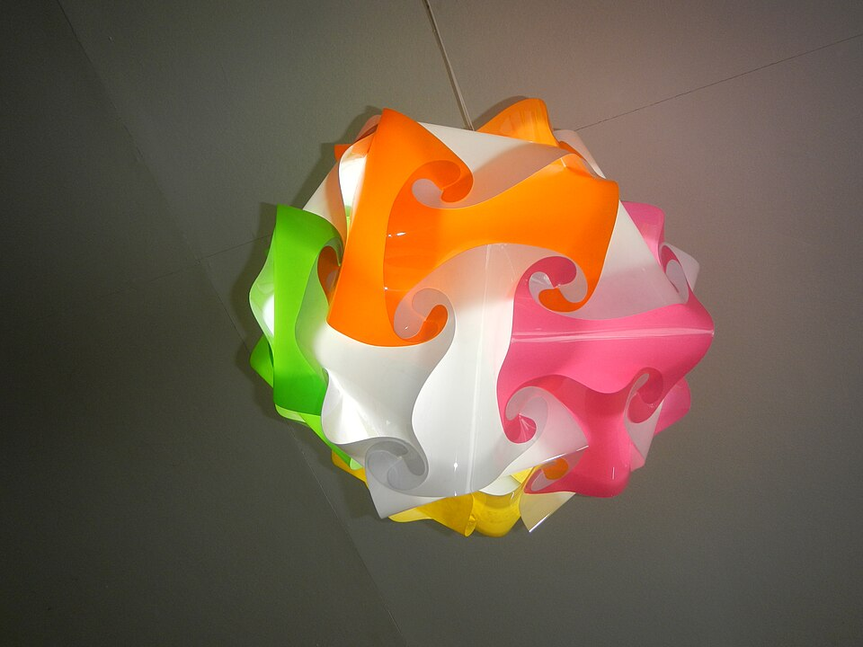</a></p>

- **菲律宾语境**：菲律宾传统 Parol 灯
- **样式介绍**：Parol 是菲律宾代表性的星形灯饰，常见骨架、透光面与放射状装饰组合，适合观察本地灯饰的比例、色彩与图案语言。
- **环保设计提示**：环保改进可优先使用竹条、再生纸和可替换 LED 光源。
- **图片作者**：Judgefloro
- **来源**：[Wikimedia Commons 原始文件页](https://commons.wikimedia.org/wiki/File:0028jfPagala_Baliuag_Pasalubong_Center_Bulacanfvf_33.jpg)
- **许可**：[CC0](http://creativecommons.org/publicdomain/zero/1.0/deed.en)

### 002 · 01341jfSan Vicente Bridge Chapel Roads San Miguel, Bulacan Riverfvf 17.jpg

<p align="center"><a href="https://commons.wikimedia.org/wiki/File:01341jfSan_Vicente_Bridge_Chapel_Roads_San_Miguel,_Bulacan_Riverfvf_17.jpg">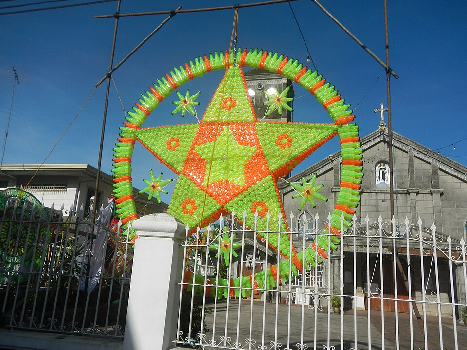</a></p>

- **菲律宾语境**：菲律宾传统 Parol 灯
- **样式介绍**：Parol 是菲律宾代表性的星形灯饰，常见骨架、透光面与放射状装饰组合，适合观察本地灯饰的比例、色彩与图案语言。
- **环保设计提示**：可重复使用骨架，只更换受损饰面，以延长节庆灯具寿命。
- **图片作者**：Judgefloro
- **来源**：[Wikimedia Commons 原始文件页](https://commons.wikimedia.org/wiki/File:01341jfSan_Vicente_Bridge_Chapel_Roads_San_Miguel,_Bulacan_Riverfvf_17.jpg)
- **许可**：[CC0](http://creativecommons.org/publicdomain/zero/1.0/deed.en)

### 003 · 01341jfSan Vicente Bridge Chapel Roads San Miguel, Bulacan Riverfvf 18.jpg

<p align="center"><a href="https://commons.wikimedia.org/wiki/File:01341jfSan_Vicente_Bridge_Chapel_Roads_San_Miguel,_Bulacan_Riverfvf_18.jpg">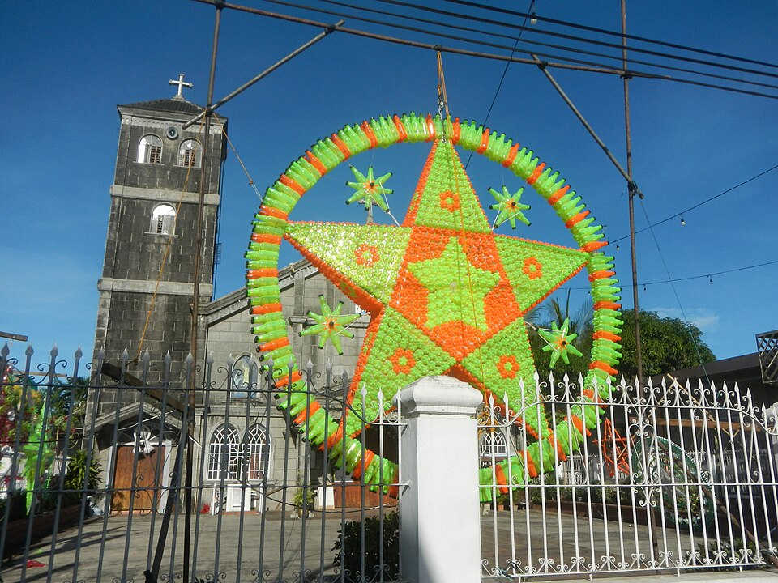</a></p>

- **菲律宾语境**：菲律宾传统 Parol 灯
- **样式介绍**：Parol 是菲律宾代表性的星形灯饰，常见骨架、透光面与放射状装饰组合，适合观察本地灯饰的比例、色彩与图案语言。
- **环保设计提示**：轻量化框架有助于减少材料用量并方便收纳。
- **图片作者**：Judgefloro
- **来源**：[Wikimedia Commons 原始文件页](https://commons.wikimedia.org/wiki/File:01341jfSan_Vicente_Bridge_Chapel_Roads_San_Miguel,_Bulacan_Riverfvf_18.jpg)
- **许可**：[CC0](http://creativecommons.org/publicdomain/zero/1.0/deed.en)

### 004 · 01370jfSan Vicente Bridge Chapel Roads San Miguel, Bulacan Riverfvf 04.jpg

<p align="center"><a href="https://commons.wikimedia.org/wiki/File:01370jfSan_Vicente_Bridge_Chapel_Roads_San_Miguel,_Bulacan_Riverfvf_04.jpg">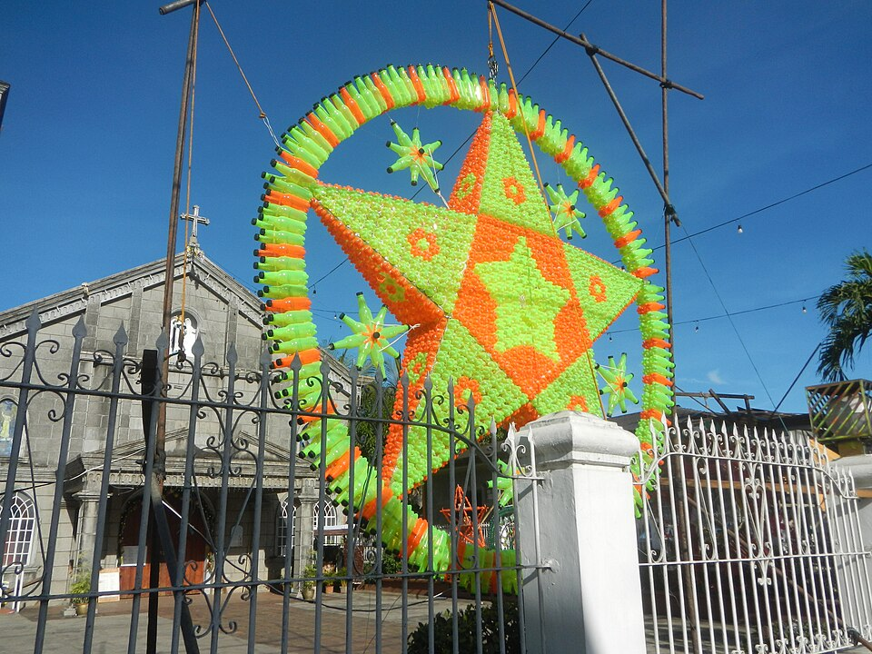</a></p>

- **菲律宾语境**：菲律宾传统 Parol 灯
- **样式介绍**：Parol 是菲律宾代表性的星形灯饰，常见骨架、透光面与放射状装饰组合，适合观察本地灯饰的比例、色彩与图案语言。
- **环保设计提示**：低功率 LED 可在保留传统造型的同时降低用电。
- **图片作者**：Judgefloro
- **来源**：[Wikimedia Commons 原始文件页](https://commons.wikimedia.org/wiki/File:01370jfSan_Vicente_Bridge_Chapel_Roads_San_Miguel,_Bulacan_Riverfvf_04.jpg)
- **许可**：[CC0](http://creativecommons.org/publicdomain/zero/1.0/deed.en)

### 005 · 01370jfSan Vicente Bridge Chapel Roads San Miguel, Bulacan Riverfvf 05.jpg

<p align="center"><a href="https://commons.wikimedia.org/wiki/File:01370jfSan_Vicente_Bridge_Chapel_Roads_San_Miguel,_Bulacan_Riverfvf_05.jpg">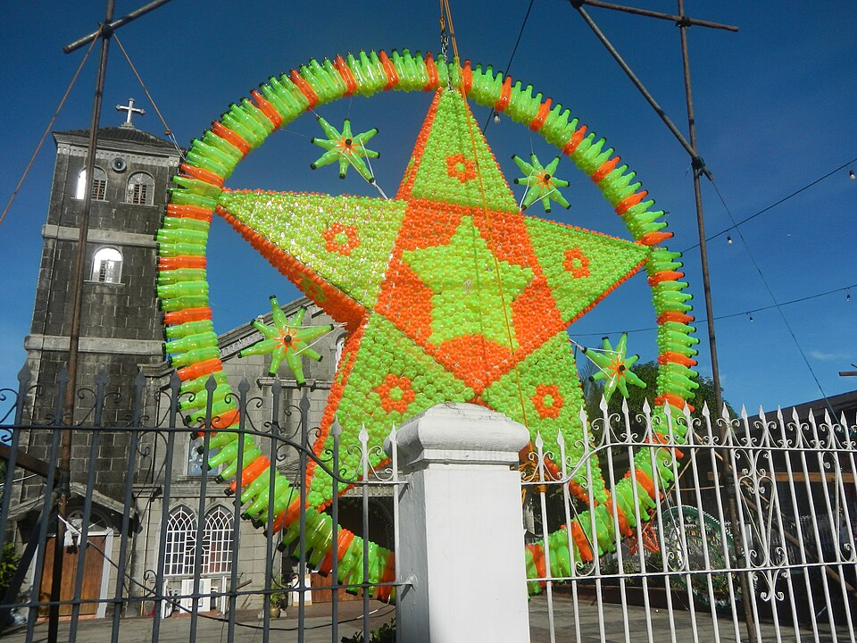</a></p>

- **菲律宾语境**：菲律宾传统 Parol 灯
- **样式介绍**：Parol 是菲律宾代表性的星形灯饰，常见骨架、透光面与放射状装饰组合，适合观察本地灯饰的比例、色彩与图案语言。
- **环保设计提示**：环保改进可优先使用竹条、再生纸和可替换 LED 光源。
- **图片作者**：Judgefloro
- **来源**：[Wikimedia Commons 原始文件页](https://commons.wikimedia.org/wiki/File:01370jfSan_Vicente_Bridge_Chapel_Roads_San_Miguel,_Bulacan_Riverfvf_05.jpg)
- **许可**：[CC0](http://creativecommons.org/publicdomain/zero/1.0/deed.en)

### 006 · 01370jfSan Vicente Bridge Chapel Roads San Miguel, Bulacan Riverfvf 06.jpg

<p align="center"><a href="https://commons.wikimedia.org/wiki/File:01370jfSan_Vicente_Bridge_Chapel_Roads_San_Miguel,_Bulacan_Riverfvf_06.jpg">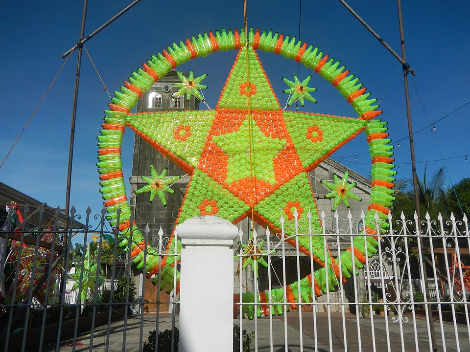</a></p>

- **菲律宾语境**：菲律宾传统 Parol 灯
- **样式介绍**：Parol 是菲律宾代表性的星形灯饰，常见骨架、透光面与放射状装饰组合，适合观察本地灯饰的比例、色彩与图案语言。
- **环保设计提示**：可重复使用骨架，只更换受损饰面，以延长节庆灯具寿命。
- **图片作者**：Judgefloro
- **来源**：[Wikimedia Commons 原始文件页](https://commons.wikimedia.org/wiki/File:01370jfSan_Vicente_Bridge_Chapel_Roads_San_Miguel,_Bulacan_Riverfvf_06.jpg)
- **许可**：[CC0](http://creativecommons.org/publicdomain/zero/1.0/deed.en)

### 007 · 01370jfSan Vicente Bridge Chapel Roads San Miguel, Bulacan Riverfvf 09.jpg

<p align="center"><a href="https://commons.wikimedia.org/wiki/File:01370jfSan_Vicente_Bridge_Chapel_Roads_San_Miguel,_Bulacan_Riverfvf_09.jpg">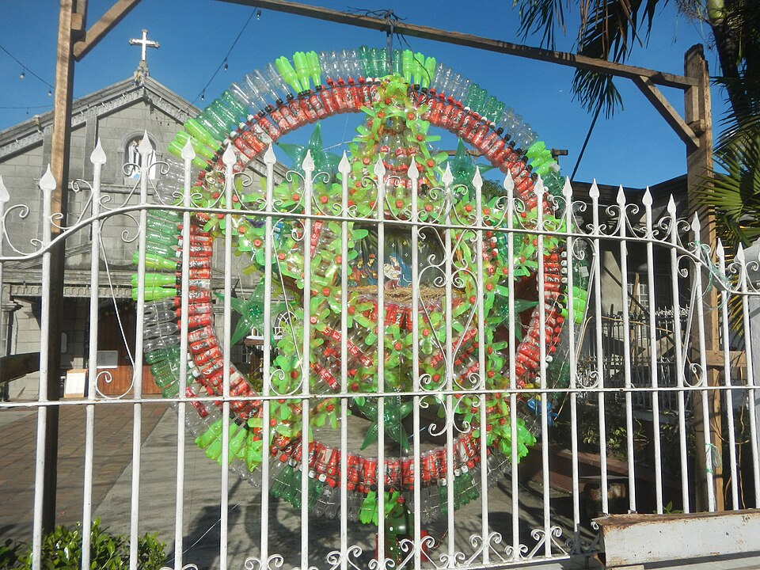</a></p>

- **菲律宾语境**：菲律宾传统 Parol 灯
- **样式介绍**：Parol 是菲律宾代表性的星形灯饰，常见骨架、透光面与放射状装饰组合，适合观察本地灯饰的比例、色彩与图案语言。
- **环保设计提示**：轻量化框架有助于减少材料用量并方便收纳。
- **图片作者**：Judgefloro
- **来源**：[Wikimedia Commons 原始文件页](https://commons.wikimedia.org/wiki/File:01370jfSan_Vicente_Bridge_Chapel_Roads_San_Miguel,_Bulacan_Riverfvf_09.jpg)
- **许可**：[CC0](http://creativecommons.org/publicdomain/zero/1.0/deed.en)

### 008 · 01370jfSan Vicente Bridge Chapel Roads San Miguel, Bulacan Riverfvf 12.jpg

<p align="center"><a href="https://commons.wikimedia.org/wiki/File:01370jfSan_Vicente_Bridge_Chapel_Roads_San_Miguel,_Bulacan_Riverfvf_12.jpg">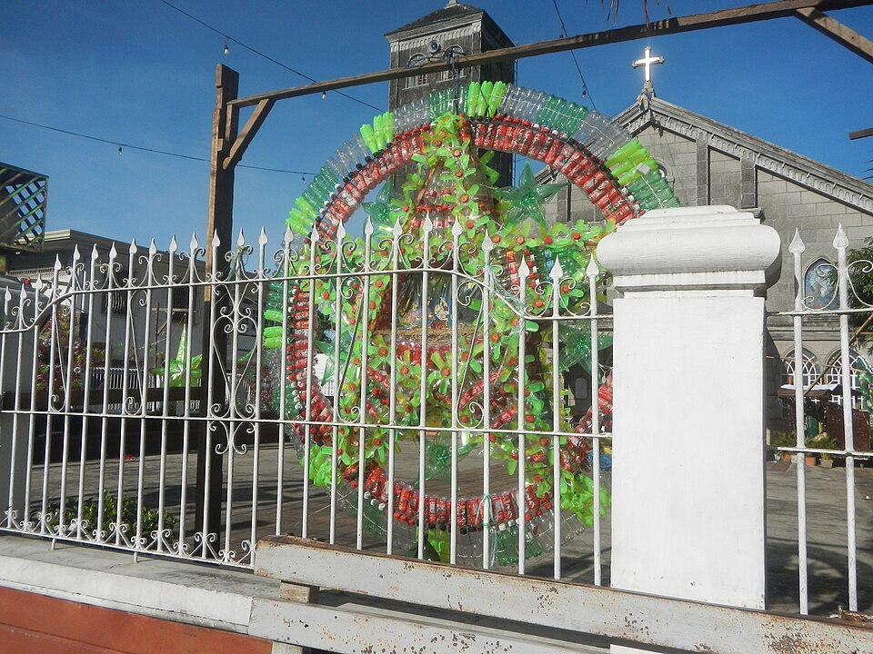</a></p>

- **菲律宾语境**：菲律宾传统 Parol 灯
- **样式介绍**：Parol 是菲律宾代表性的星形灯饰，常见骨架、透光面与放射状装饰组合，适合观察本地灯饰的比例、色彩与图案语言。
- **环保设计提示**：低功率 LED 可在保留传统造型的同时降低用电。
- **图片作者**：Judgefloro
- **来源**：[Wikimedia Commons 原始文件页](https://commons.wikimedia.org/wiki/File:01370jfSan_Vicente_Bridge_Chapel_Roads_San_Miguel,_Bulacan_Riverfvf_12.jpg)
- **许可**：[CC0](http://creativecommons.org/publicdomain/zero/1.0/deed.en)

### 009 · 01370jfSan Vicente Bridge Chapel Roads San Miguel, Bulacan Riverfvf 13.jpg

<p align="center"><a href="https://commons.wikimedia.org/wiki/File:01370jfSan_Vicente_Bridge_Chapel_Roads_San_Miguel,_Bulacan_Riverfvf_13.jpg">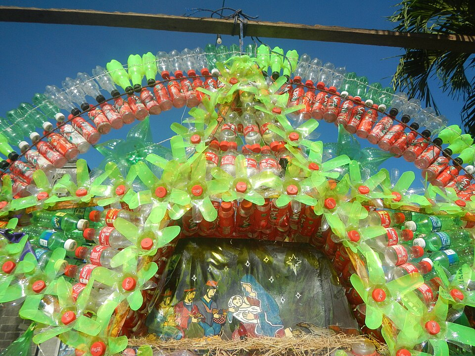</a></p>

- **菲律宾语境**：菲律宾传统 Parol 灯
- **样式介绍**：Parol 是菲律宾代表性的星形灯饰，常见骨架、透光面与放射状装饰组合，适合观察本地灯饰的比例、色彩与图案语言。
- **环保设计提示**：环保改进可优先使用竹条、再生纸和可替换 LED 光源。
- **图片作者**：Judgefloro
- **来源**：[Wikimedia Commons 原始文件页](https://commons.wikimedia.org/wiki/File:01370jfSan_Vicente_Bridge_Chapel_Roads_San_Miguel,_Bulacan_Riverfvf_13.jpg)
- **许可**：[CC0](http://creativecommons.org/publicdomain/zero/1.0/deed.en)

### 010 · 01370jfSan Vicente Bridge Chapel Roads San Miguel, Bulacan Riverfvf 14.jpg

<p align="center"><a href="https://commons.wikimedia.org/wiki/File:01370jfSan_Vicente_Bridge_Chapel_Roads_San_Miguel,_Bulacan_Riverfvf_14.jpg">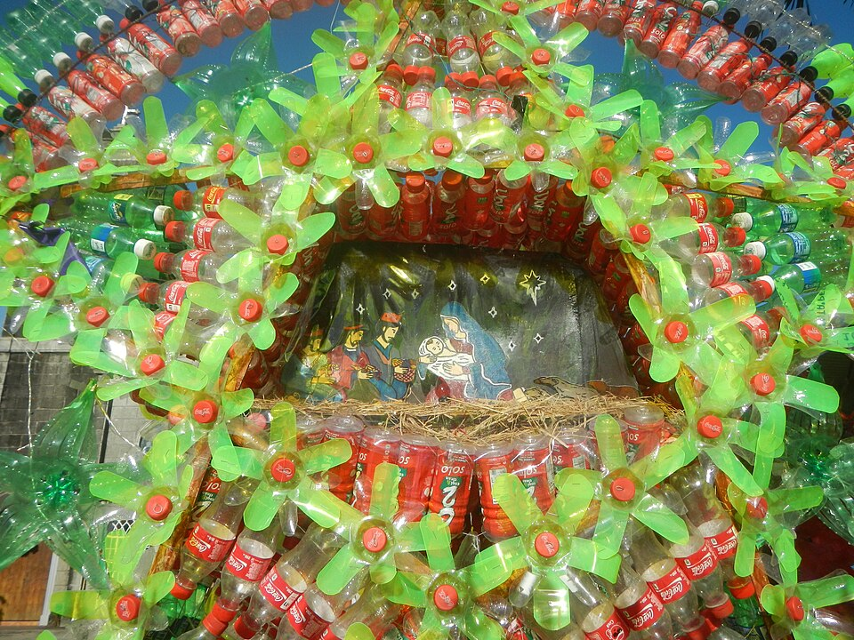</a></p>

- **菲律宾语境**：菲律宾传统 Parol 灯
- **样式介绍**：Parol 是菲律宾代表性的星形灯饰，常见骨架、透光面与放射状装饰组合，适合观察本地灯饰的比例、色彩与图案语言。
- **环保设计提示**：可重复使用骨架，只更换受损饰面，以延长节庆灯具寿命。
- **图片作者**：Judgefloro
- **来源**：[Wikimedia Commons 原始文件页](https://commons.wikimedia.org/wiki/File:01370jfSan_Vicente_Bridge_Chapel_Roads_San_Miguel,_Bulacan_Riverfvf_14.jpg)
- **许可**：[CC0](http://creativecommons.org/publicdomain/zero/1.0/deed.en)

### 011 · 01370jfSan Vicente Bridge Chapel Roads San Miguel, Bulacan Riverfvf 15.jpg

<p align="center"><a href="https://commons.wikimedia.org/wiki/File:01370jfSan_Vicente_Bridge_Chapel_Roads_San_Miguel,_Bulacan_Riverfvf_15.jpg">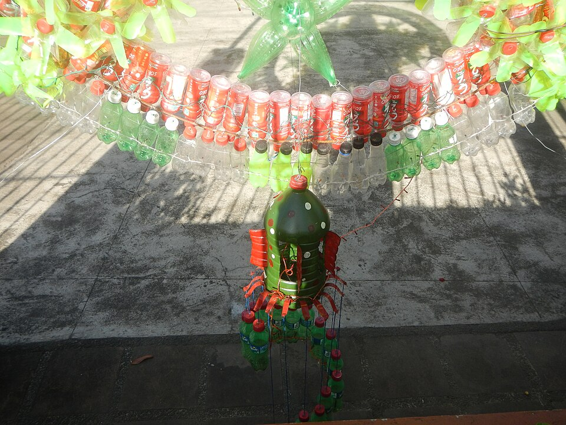</a></p>

- **菲律宾语境**：菲律宾传统 Parol 灯
- **样式介绍**：Parol 是菲律宾代表性的星形灯饰，常见骨架、透光面与放射状装饰组合，适合观察本地灯饰的比例、色彩与图案语言。
- **环保设计提示**：轻量化框架有助于减少材料用量并方便收纳。
- **图片作者**：Judgefloro
- **来源**：[Wikimedia Commons 原始文件页](https://commons.wikimedia.org/wiki/File:01370jfSan_Vicente_Bridge_Chapel_Roads_San_Miguel,_Bulacan_Riverfvf_15.jpg)
- **许可**：[CC0](http://creativecommons.org/publicdomain/zero/1.0/deed.en)

### 012 · 01370jfSan Vicente Bridge Chapel Roads San Miguel, Bulacan Riverfvf 16.jpg

<p align="center"><a href="https://commons.wikimedia.org/wiki/File:01370jfSan_Vicente_Bridge_Chapel_Roads_San_Miguel,_Bulacan_Riverfvf_16.jpg">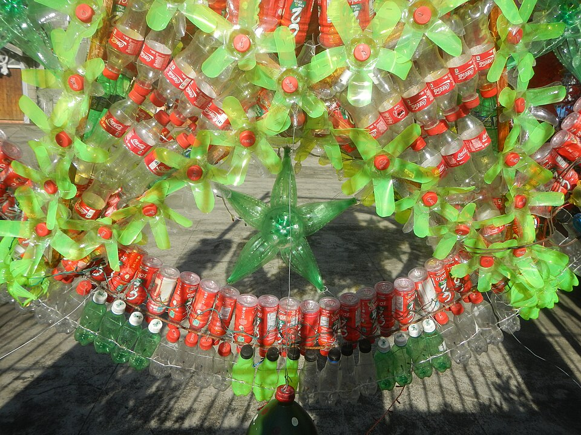</a></p>

- **菲律宾语境**：菲律宾传统 Parol 灯
- **样式介绍**：Parol 是菲律宾代表性的星形灯饰，常见骨架、透光面与放射状装饰组合，适合观察本地灯饰的比例、色彩与图案语言。
- **环保设计提示**：低功率 LED 可在保留传统造型的同时降低用电。
- **图片作者**：Judgefloro
- **来源**：[Wikimedia Commons 原始文件页](https://commons.wikimedia.org/wiki/File:01370jfSan_Vicente_Bridge_Chapel_Roads_San_Miguel,_Bulacan_Riverfvf_16.jpg)
- **许可**：[CC0](http://creativecommons.org/publicdomain/zero/1.0/deed.en)

### 013 · 01370jfSan Vicente Bridge Chapel Roads San Miguel, Bulacan Riverfvf 17.jpg

<p align="center"><a href="https://commons.wikimedia.org/wiki/File:01370jfSan_Vicente_Bridge_Chapel_Roads_San_Miguel,_Bulacan_Riverfvf_17.jpg">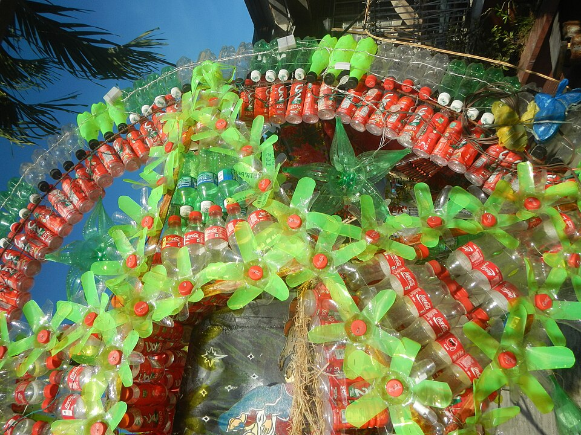</a></p>

- **菲律宾语境**：菲律宾传统 Parol 灯
- **样式介绍**：Parol 是菲律宾代表性的星形灯饰，常见骨架、透光面与放射状装饰组合，适合观察本地灯饰的比例、色彩与图案语言。
- **环保设计提示**：环保改进可优先使用竹条、再生纸和可替换 LED 光源。
- **图片作者**：Judgefloro
- **来源**：[Wikimedia Commons 原始文件页](https://commons.wikimedia.org/wiki/File:01370jfSan_Vicente_Bridge_Chapel_Roads_San_Miguel,_Bulacan_Riverfvf_17.jpg)
- **许可**：[CC0](http://creativecommons.org/publicdomain/zero/1.0/deed.en)

### 014 · 01370jfSan Vicente Bridge Chapel Roads San Miguel, Bulacan Riverfvf 18.jpg

<p align="center"><a href="https://commons.wikimedia.org/wiki/File:01370jfSan_Vicente_Bridge_Chapel_Roads_San_Miguel,_Bulacan_Riverfvf_18.jpg">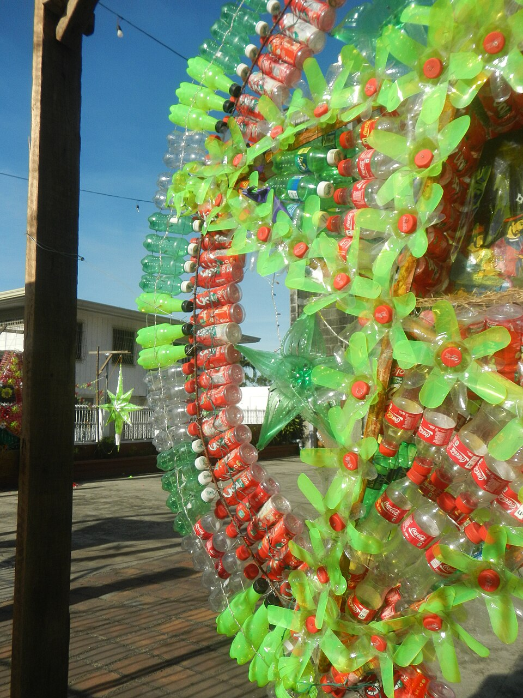</a></p>

- **菲律宾语境**：菲律宾传统 Parol 灯
- **样式介绍**：Parol 是菲律宾代表性的星形灯饰，常见骨架、透光面与放射状装饰组合，适合观察本地灯饰的比例、色彩与图案语言。
- **环保设计提示**：可重复使用骨架，只更换受损饰面，以延长节庆灯具寿命。
- **图片作者**：Judgefloro
- **来源**：[Wikimedia Commons 原始文件页](https://commons.wikimedia.org/wiki/File:01370jfSan_Vicente_Bridge_Chapel_Roads_San_Miguel,_Bulacan_Riverfvf_18.jpg)
- **许可**：[CC0](http://creativecommons.org/publicdomain/zero/1.0/deed.en)

### 015 · 01370jfSan Vicente Bridge Chapel Roads San Miguel, Bulacan Riverfvf 19.jpg

<p align="center"><a href="https://commons.wikimedia.org/wiki/File:01370jfSan_Vicente_Bridge_Chapel_Roads_San_Miguel,_Bulacan_Riverfvf_19.jpg">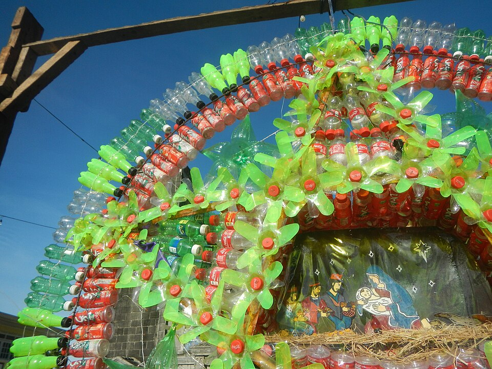</a></p>

- **菲律宾语境**：菲律宾传统 Parol 灯
- **样式介绍**：Parol 是菲律宾代表性的星形灯饰，常见骨架、透光面与放射状装饰组合，适合观察本地灯饰的比例、色彩与图案语言。
- **环保设计提示**：轻量化框架有助于减少材料用量并方便收纳。
- **图片作者**：Judgefloro
- **来源**：[Wikimedia Commons 原始文件页](https://commons.wikimedia.org/wiki/File:01370jfSan_Vicente_Bridge_Chapel_Roads_San_Miguel,_Bulacan_Riverfvf_19.jpg)
- **许可**：[CC0](http://creativecommons.org/publicdomain/zero/1.0/deed.en)

### 016 · 01389jfSan Vicente Santa Rita Camias, San Miguel Bulacan Provincial Roadfvf 01.jpg

<p align="center"><a href="https://commons.wikimedia.org/wiki/File:01389jfSan_Vicente_Santa_Rita_Camias,_San_Miguel_Bulacan_Provincial_Roadfvf_01.jpg">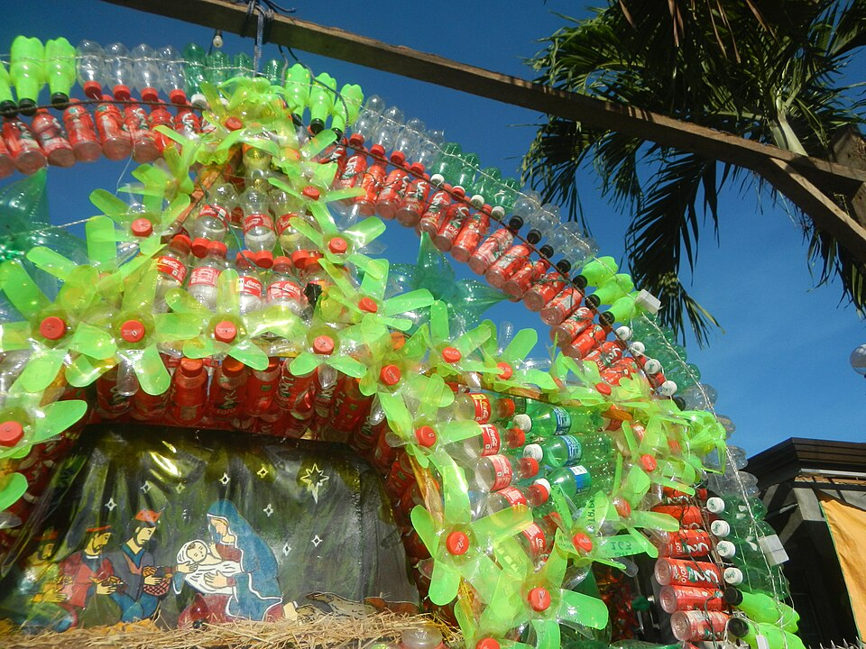</a></p>

- **菲律宾语境**：菲律宾传统 Parol 灯
- **样式介绍**：Parol 是菲律宾代表性的星形灯饰，常见骨架、透光面与放射状装饰组合，适合观察本地灯饰的比例、色彩与图案语言。
- **环保设计提示**：低功率 LED 可在保留传统造型的同时降低用电。
- **图片作者**：Judgefloro
- **来源**：[Wikimedia Commons 原始文件页](https://commons.wikimedia.org/wiki/File:01389jfSan_Vicente_Santa_Rita_Camias,_San_Miguel_Bulacan_Provincial_Roadfvf_01.jpg)
- **许可**：[CC0](http://creativecommons.org/publicdomain/zero/1.0/deed.en)

### 017 · 02631jfCentro Trees Apalit Pampangafvf 07.JPG

<p align="center"><a href="https://commons.wikimedia.org/wiki/File:02631jfCentro_Trees_Apalit_Pampangafvf_07.JPG">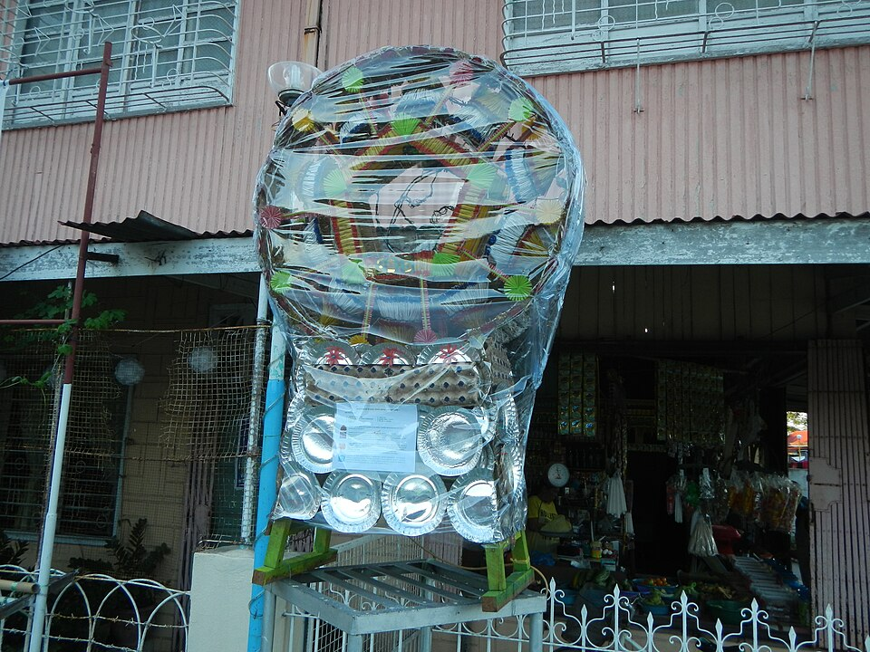</a></p>

- **菲律宾语境**：菲律宾传统 Parol 灯
- **样式介绍**：Parol 是菲律宾代表性的星形灯饰，常见骨架、透光面与放射状装饰组合，适合观察本地灯饰的比例、色彩与图案语言。
- **环保设计提示**：环保改进可优先使用竹条、再生纸和可替换 LED 光源。
- **图片作者**：Judgefloro
- **来源**：[Wikimedia Commons 原始文件页](https://commons.wikimedia.org/wiki/File:02631jfCentro_Trees_Apalit_Pampangafvf_07.JPG)
- **许可**：Public domain

### 018 · 02631jfCentro Trees Apalit Pampangafvf 08.JPG

<p align="center"><a href="https://commons.wikimedia.org/wiki/File:02631jfCentro_Trees_Apalit_Pampangafvf_08.JPG">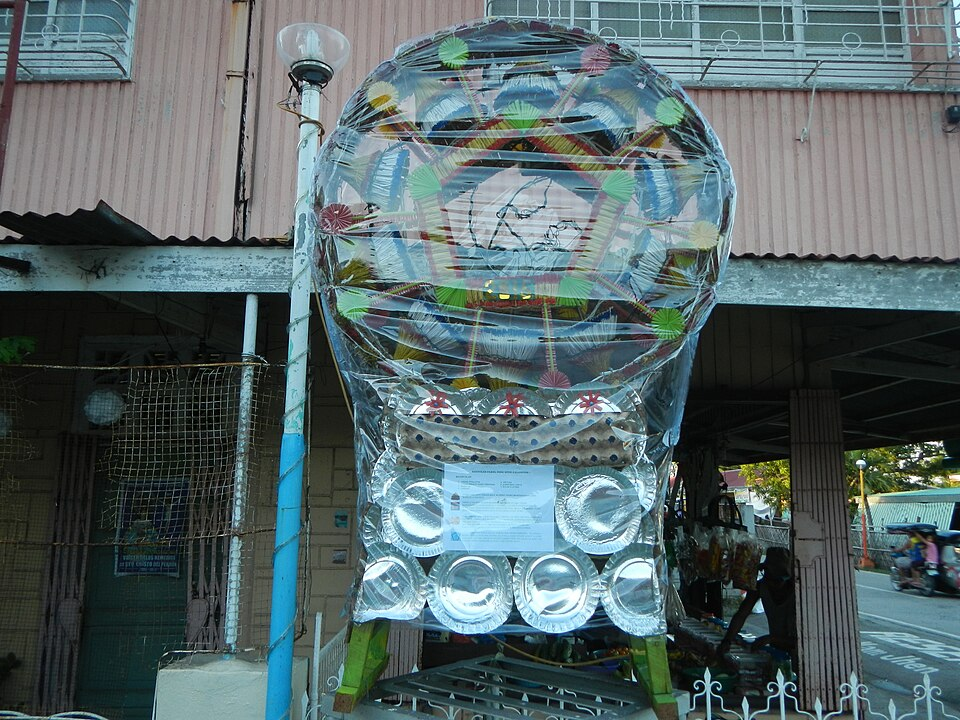</a></p>

- **菲律宾语境**：菲律宾传统 Parol 灯
- **样式介绍**：Parol 是菲律宾代表性的星形灯饰，常见骨架、透光面与放射状装饰组合，适合观察本地灯饰的比例、色彩与图案语言。
- **环保设计提示**：可重复使用骨架，只更换受损饰面，以延长节庆灯具寿命。
- **图片作者**：Judgefloro
- **来源**：[Wikimedia Commons 原始文件页](https://commons.wikimedia.org/wiki/File:02631jfCentro_Trees_Apalit_Pampangafvf_08.JPG)
- **许可**：Public domain

### 019 · 02631jfCentro Trees Apalit Pampangafvf 10.JPG

<p align="center"><a href="https://commons.wikimedia.org/wiki/File:02631jfCentro_Trees_Apalit_Pampangafvf_10.JPG">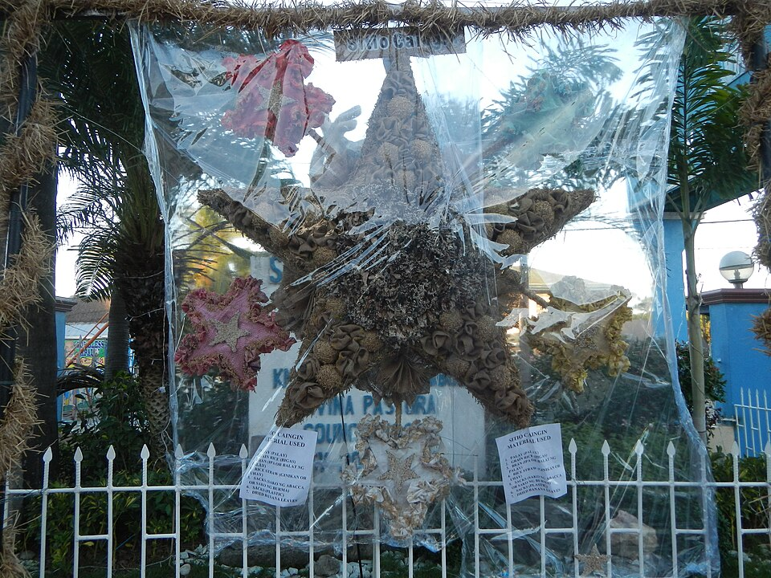</a></p>

- **菲律宾语境**：菲律宾传统 Parol 灯
- **样式介绍**：Parol 是菲律宾代表性的星形灯饰，常见骨架、透光面与放射状装饰组合，适合观察本地灯饰的比例、色彩与图案语言。
- **环保设计提示**：轻量化框架有助于减少材料用量并方便收纳。
- **图片作者**：Judgefloro
- **来源**：[Wikimedia Commons 原始文件页](https://commons.wikimedia.org/wiki/File:02631jfCentro_Trees_Apalit_Pampangafvf_10.JPG)
- **许可**：Public domain

### 020 · 02631jfCentro Trees Apalit Pampangafvf 13.JPG

<p align="center"><a href="https://commons.wikimedia.org/wiki/File:02631jfCentro_Trees_Apalit_Pampangafvf_13.JPG">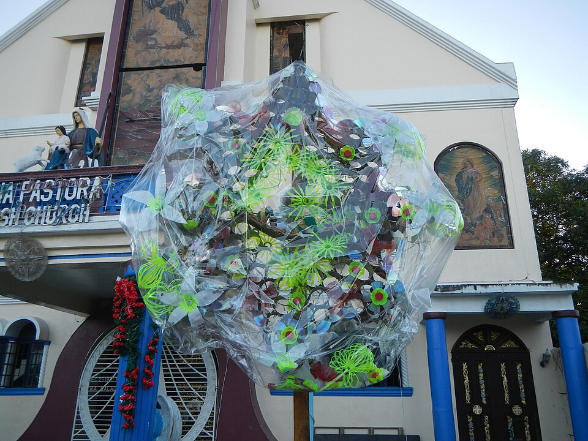</a></p>

- **菲律宾语境**：菲律宾传统 Parol 灯
- **样式介绍**：Parol 是菲律宾代表性的星形灯饰，常见骨架、透光面与放射状装饰组合，适合观察本地灯饰的比例、色彩与图案语言。
- **环保设计提示**：低功率 LED 可在保留传统造型的同时降低用电。
- **图片作者**：Judgefloro
- **来源**：[Wikimedia Commons 原始文件页](https://commons.wikimedia.org/wiki/File:02631jfCentro_Trees_Apalit_Pampangafvf_13.JPG)
- **许可**：Public domain

## 圣费尔南多巨型灯笼节

### 021 · GLFjf1342 01.JPG

<p align="center"><a href="https://commons.wikimedia.org/wiki/File:GLFjf1342_01.JPG">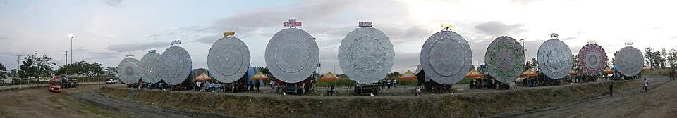</a></p>

- **菲律宾语境**：菲律宾邦板牙省圣费尔南多市
- **样式介绍**：圣费尔南多巨型灯笼节以大型放射图案、动态灯序和社区协作为特色，展示菲律宾 Parol 从家庭尺度扩展到公共装置的方式。
- **环保设计提示**：大型装置适合采用可拆装、可重复使用的模块化框架。
- **图片作者**：Ramon FVelasquez
- **来源**：[Wikimedia Commons 原始文件页](https://commons.wikimedia.org/wiki/File:GLFjf1342_01.JPG)
- **许可**：[CC BY-SA 3.0](https://creativecommons.org/licenses/by-sa/3.0)

### 022 · GLFjf1342 02.JPG

<p align="center"><a href="https://commons.wikimedia.org/wiki/File:GLFjf1342_02.JPG">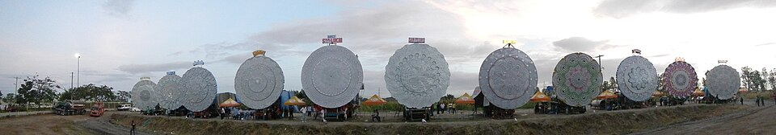</a></p>

- **菲律宾语境**：菲律宾邦板牙省圣费尔南多市
- **样式介绍**：圣费尔南多巨型灯笼节以大型放射图案、动态灯序和社区协作为特色，展示菲律宾 Parol 从家庭尺度扩展到公共装置的方式。
- **环保设计提示**：以 LED 替代高耗能灯泡，可减少热量与运行能耗。
- **图片作者**：Ramon FVelasquez
- **来源**：[Wikimedia Commons 原始文件页](https://commons.wikimedia.org/wiki/File:GLFjf1342_02.JPG)
- **许可**：[CC BY-SA 3.0](https://creativecommons.org/licenses/by-sa/3.0)

### 023 · GLFjf1342 03.JPG

<p align="center"><a href="https://commons.wikimedia.org/wiki/File:GLFjf1342_03.JPG">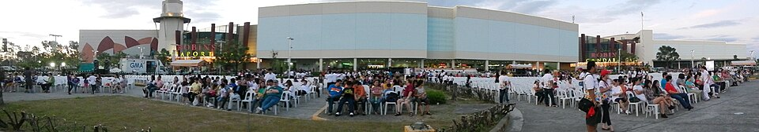</a></p>

- **菲律宾语境**：菲律宾邦板牙省圣费尔南多市
- **样式介绍**：圣费尔南多巨型灯笼节以大型放射图案、动态灯序和社区协作为特色，展示菲律宾 Parol 从家庭尺度扩展到公共装置的方式。
- **环保设计提示**：分区控制灯组能够在保持动态效果时降低峰值负载。
- **图片作者**：Ramon FVelasquez
- **来源**：[Wikimedia Commons 原始文件页](https://commons.wikimedia.org/wiki/File:GLFjf1342_03.JPG)
- **许可**：[CC BY-SA 3.0](https://creativecommons.org/licenses/by-sa/3.0)

### 024 · GLFjf1342 04.JPG

<p align="center"><a href="https://commons.wikimedia.org/wiki/File:GLFjf1342_04.JPG">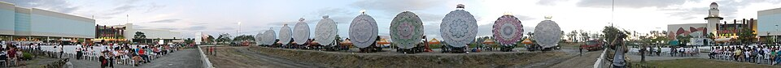</a></p>

- **菲律宾语境**：菲律宾邦板牙省圣费尔南多市
- **样式介绍**：圣费尔南多巨型灯笼节以大型放射图案、动态灯序和社区协作为特色，展示菲律宾 Parol 从家庭尺度扩展到公共装置的方式。
- **环保设计提示**：社区共建与年度复用可提高材料的使用周期。
- **图片作者**：Ramon FVelasquez
- **来源**：[Wikimedia Commons 原始文件页](https://commons.wikimedia.org/wiki/File:GLFjf1342_04.JPG)
- **许可**：[CC BY-SA 3.0](https://creativecommons.org/licenses/by-sa/3.0)

### 025 · GLFjf1342 05.JPG

<p align="center"><a href="https://commons.wikimedia.org/wiki/File:GLFjf1342_05.JPG">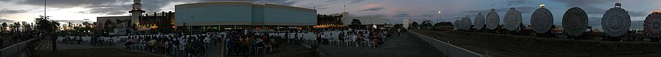</a></p>

- **菲律宾语境**：菲律宾邦板牙省圣费尔南多市
- **样式介绍**：圣费尔南多巨型灯笼节以大型放射图案、动态灯序和社区协作为特色，展示菲律宾 Parol 从家庭尺度扩展到公共装置的方式。
- **环保设计提示**：大型装置适合采用可拆装、可重复使用的模块化框架。
- **图片作者**：Ramon FVelasquez
- **来源**：[Wikimedia Commons 原始文件页](https://commons.wikimedia.org/wiki/File:GLFjf1342_05.JPG)
- **许可**：[CC BY-SA 3.0](https://creativecommons.org/licenses/by-sa/3.0)

### 026 · GLFjf1348 01.JPG

<p align="center"><a href="https://commons.wikimedia.org/wiki/File:GLFjf1348_01.JPG">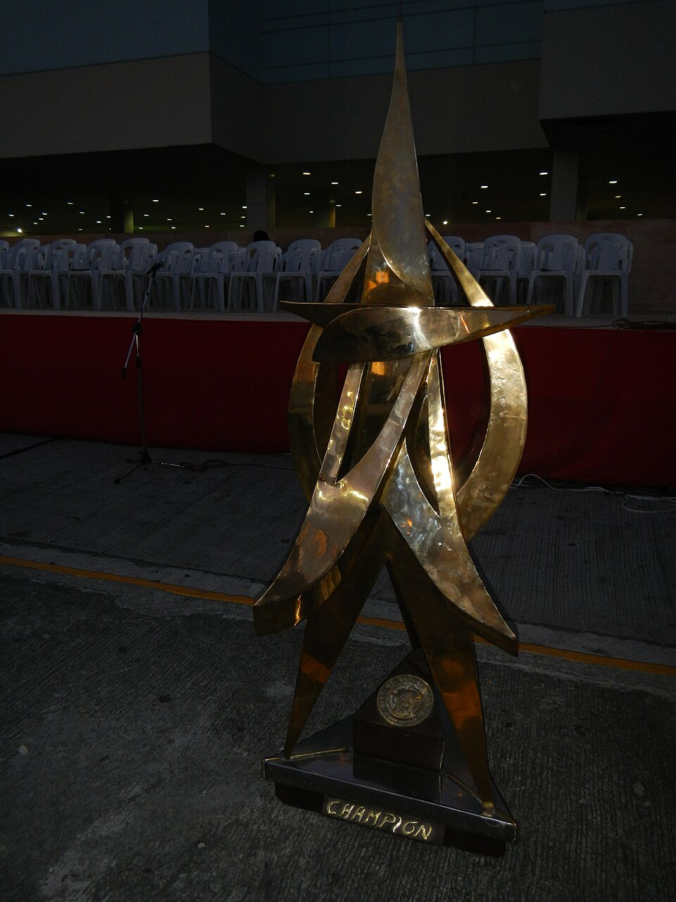</a></p>

- **菲律宾语境**：菲律宾邦板牙省圣费尔南多市
- **样式介绍**：圣费尔南多巨型灯笼节以大型放射图案、动态灯序和社区协作为特色，展示菲律宾 Parol 从家庭尺度扩展到公共装置的方式。
- **环保设计提示**：以 LED 替代高耗能灯泡，可减少热量与运行能耗。
- **图片作者**：Ramon FVelasquez
- **来源**：[Wikimedia Commons 原始文件页](https://commons.wikimedia.org/wiki/File:GLFjf1348_01.JPG)
- **许可**：[CC BY-SA 3.0](https://creativecommons.org/licenses/by-sa/3.0)

### 027 · GLFjf1348 02.JPG

<p align="center"><a href="https://commons.wikimedia.org/wiki/File:GLFjf1348_02.JPG"></a></p>

- **菲律宾语境**：菲律宾邦板牙省圣费尔南多市
- **样式介绍**：圣费尔南多巨型灯笼节以大型放射图案、动态灯序和社区协作为特色，展示菲律宾 Parol 从家庭尺度扩展到公共装置的方式。
- **环保设计提示**：分区控制灯组能够在保持动态效果时降低峰值负载。
- **图片作者**：Ramon FVelasquez
- **来源**：[Wikimedia Commons 原始文件页](https://commons.wikimedia.org/wiki/File:GLFjf1348_02.JPG)
- **许可**：[CC BY-SA 3.0](https://creativecommons.org/licenses/by-sa/3.0)

### 028 · GLFjf1348 03.JPG

<p align="center"><a href="https://commons.wikimedia.org/wiki/File:GLFjf1348_03.JPG">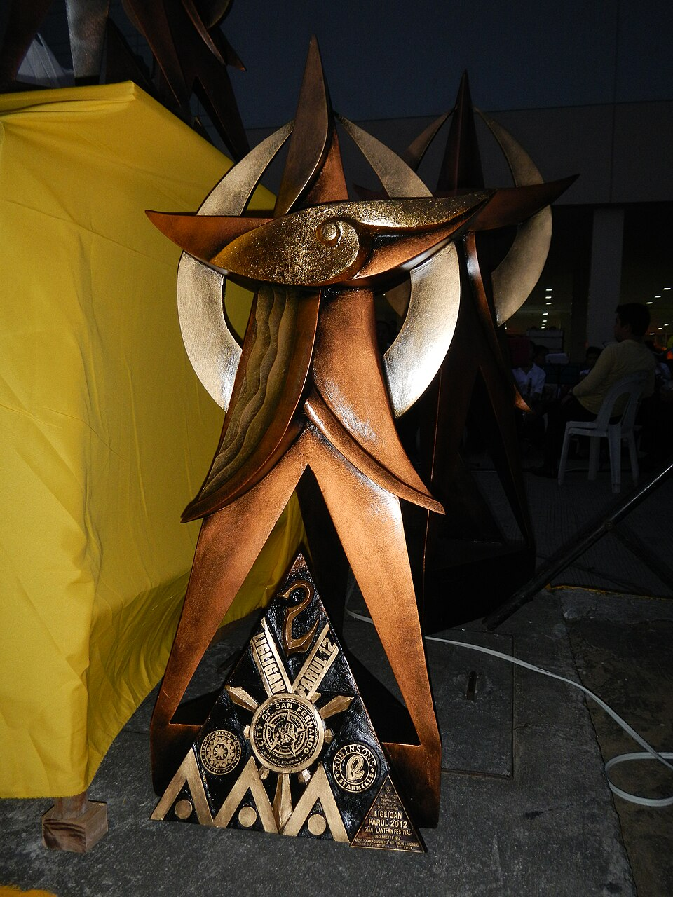</a></p>

- **菲律宾语境**：菲律宾邦板牙省圣费尔南多市
- **样式介绍**：圣费尔南多巨型灯笼节以大型放射图案、动态灯序和社区协作为特色，展示菲律宾 Parol 从家庭尺度扩展到公共装置的方式。
- **环保设计提示**：社区共建与年度复用可提高材料的使用周期。
- **图片作者**：Ramon FVelasquez
- **来源**：[Wikimedia Commons 原始文件页](https://commons.wikimedia.org/wiki/File:GLFjf1348_03.JPG)
- **许可**：[CC BY-SA 3.0](https://creativecommons.org/licenses/by-sa/3.0)

### 029 · GLFjf1348 04.JPG

<p align="center"><a href="https://commons.wikimedia.org/wiki/File:GLFjf1348_04.JPG">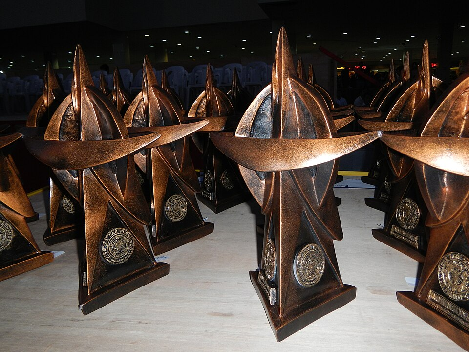</a></p>

- **菲律宾语境**：菲律宾邦板牙省圣费尔南多市
- **样式介绍**：圣费尔南多巨型灯笼节以大型放射图案、动态灯序和社区协作为特色，展示菲律宾 Parol 从家庭尺度扩展到公共装置的方式。
- **环保设计提示**：大型装置适合采用可拆装、可重复使用的模块化框架。
- **图片作者**：Ramon FVelasquez
- **来源**：[Wikimedia Commons 原始文件页](https://commons.wikimedia.org/wiki/File:GLFjf1348_04.JPG)
- **许可**：[CC BY-SA 3.0](https://creativecommons.org/licenses/by-sa/3.0)

### 030 · GLFjf1348 05.JPG

<p align="center"><a href="https://commons.wikimedia.org/wiki/File:GLFjf1348_05.JPG">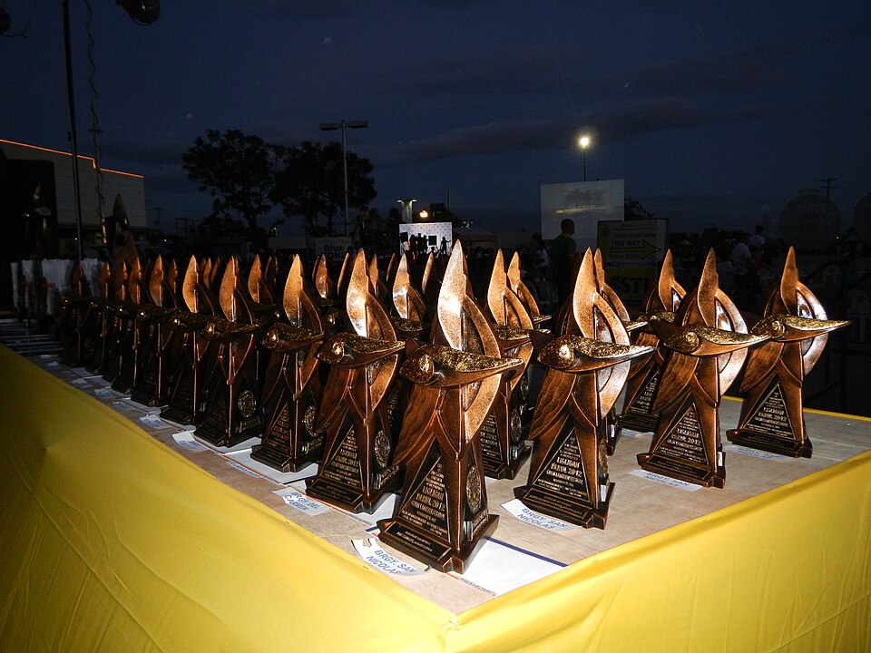</a></p>

- **菲律宾语境**：菲律宾邦板牙省圣费尔南多市
- **样式介绍**：圣费尔南多巨型灯笼节以大型放射图案、动态灯序和社区协作为特色，展示菲律宾 Parol 从家庭尺度扩展到公共装置的方式。
- **环保设计提示**：以 LED 替代高耗能灯泡，可减少热量与运行能耗。
- **图片作者**：Ramon FVelasquez
- **来源**：[Wikimedia Commons 原始文件页](https://commons.wikimedia.org/wiki/File:GLFjf1348_05.JPG)
- **许可**：[CC BY-SA 3.0](https://creativecommons.org/licenses/by-sa/3.0)

### 031 · GLFjf1348 06.JPG

<p align="center"><a href="https://commons.wikimedia.org/wiki/File:GLFjf1348_06.JPG">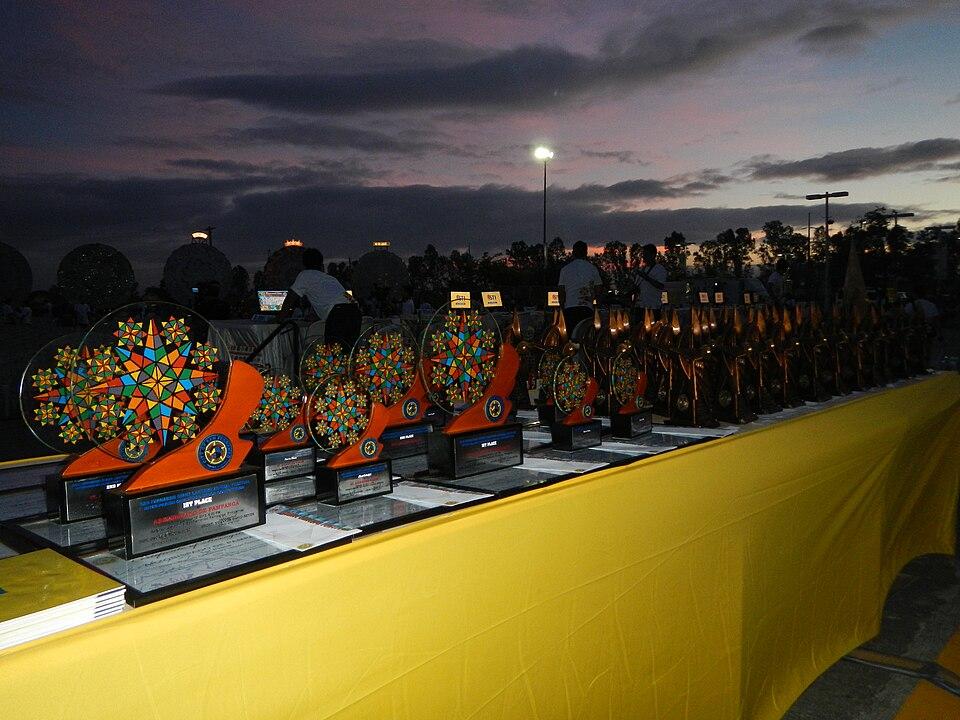</a></p>

- **菲律宾语境**：菲律宾邦板牙省圣费尔南多市
- **样式介绍**：圣费尔南多巨型灯笼节以大型放射图案、动态灯序和社区协作为特色，展示菲律宾 Parol 从家庭尺度扩展到公共装置的方式。
- **环保设计提示**：分区控制灯组能够在保持动态效果时降低峰值负载。
- **图片作者**：Ramon FVelasquez
- **来源**：[Wikimedia Commons 原始文件页](https://commons.wikimedia.org/wiki/File:GLFjf1348_06.JPG)
- **许可**：[CC BY-SA 3.0](https://creativecommons.org/licenses/by-sa/3.0)

### 032 · GLFjf1353 01.JPG

<p align="center"><a href="https://commons.wikimedia.org/wiki/File:GLFjf1353_01.JPG"></a></p>

- **菲律宾语境**：菲律宾邦板牙省圣费尔南多市
- **样式介绍**：圣费尔南多巨型灯笼节以大型放射图案、动态灯序和社区协作为特色，展示菲律宾 Parol 从家庭尺度扩展到公共装置的方式。
- **环保设计提示**：社区共建与年度复用可提高材料的使用周期。
- **图片作者**：Ramon FVelasquez
- **来源**：[Wikimedia Commons 原始文件页](https://commons.wikimedia.org/wiki/File:GLFjf1353_01.JPG)
- **许可**：[CC BY-SA 3.0](https://creativecommons.org/licenses/by-sa/3.0)

### 033 · GLFjf1353 02.JPG

<p align="center"><a href="https://commons.wikimedia.org/wiki/File:GLFjf1353_02.JPG"></a></p>

- **菲律宾语境**：菲律宾邦板牙省圣费尔南多市
- **样式介绍**：圣费尔南多巨型灯笼节以大型放射图案、动态灯序和社区协作为特色，展示菲律宾 Parol 从家庭尺度扩展到公共装置的方式。
- **环保设计提示**：大型装置适合采用可拆装、可重复使用的模块化框架。
- **图片作者**：Ramon FVelasquez
- **来源**：[Wikimedia Commons 原始文件页](https://commons.wikimedia.org/wiki/File:GLFjf1353_02.JPG)
- **许可**：[CC BY-SA 3.0](https://creativecommons.org/licenses/by-sa/3.0)

### 034 · GLFjf1353 03.JPG

<p align="center"><a href="https://commons.wikimedia.org/wiki/File:GLFjf1353_03.JPG">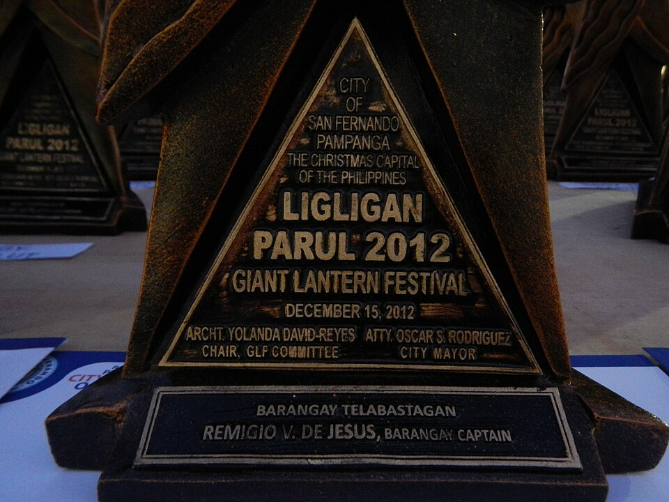</a></p>

- **菲律宾语境**：菲律宾邦板牙省圣费尔南多市
- **样式介绍**：圣费尔南多巨型灯笼节以大型放射图案、动态灯序和社区协作为特色，展示菲律宾 Parol 从家庭尺度扩展到公共装置的方式。
- **环保设计提示**：以 LED 替代高耗能灯泡，可减少热量与运行能耗。
- **图片作者**：Ramon FVelasquez
- **来源**：[Wikimedia Commons 原始文件页](https://commons.wikimedia.org/wiki/File:GLFjf1353_03.JPG)
- **许可**：[CC BY-SA 3.0](https://creativecommons.org/licenses/by-sa/3.0)

### 035 · GLFjf1353 04.JPG

<p align="center"><a href="https://commons.wikimedia.org/wiki/File:GLFjf1353_04.JPG"></a></p>

- **菲律宾语境**：菲律宾邦板牙省圣费尔南多市
- **样式介绍**：圣费尔南多巨型灯笼节以大型放射图案、动态灯序和社区协作为特色，展示菲律宾 Parol 从家庭尺度扩展到公共装置的方式。
- **环保设计提示**：分区控制灯组能够在保持动态效果时降低峰值负载。
- **图片作者**：Ramon FVelasquez
- **来源**：[Wikimedia Commons 原始文件页](https://commons.wikimedia.org/wiki/File:GLFjf1353_04.JPG)
- **许可**：[CC BY-SA 3.0](https://creativecommons.org/licenses/by-sa/3.0)

### 036 · GLFjf1353 05.JPG

<p align="center"><a href="https://commons.wikimedia.org/wiki/File:GLFjf1353_05.JPG">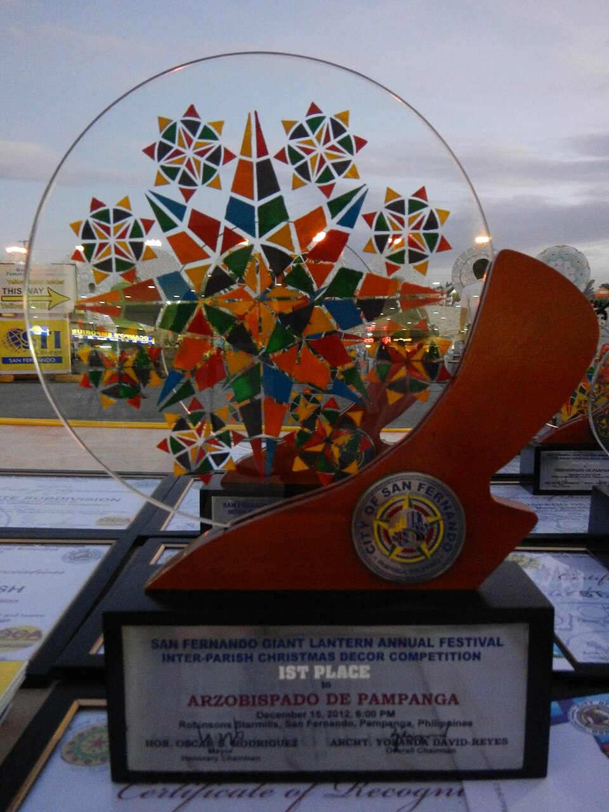</a></p>

- **菲律宾语境**：菲律宾邦板牙省圣费尔南多市
- **样式介绍**：圣费尔南多巨型灯笼节以大型放射图案、动态灯序和社区协作为特色，展示菲律宾 Parol 从家庭尺度扩展到公共装置的方式。
- **环保设计提示**：社区共建与年度复用可提高材料的使用周期。
- **图片作者**：Ramon FVelasquez
- **来源**：[Wikimedia Commons 原始文件页](https://commons.wikimedia.org/wiki/File:GLFjf1353_05.JPG)
- **许可**：[CC BY-SA 3.0](https://creativecommons.org/licenses/by-sa/3.0)

### 037 · GLFjf1353 06.JPG

<p align="center"><a href="https://commons.wikimedia.org/wiki/File:GLFjf1353_06.JPG"></a></p>

- **菲律宾语境**：菲律宾邦板牙省圣费尔南多市
- **样式介绍**：圣费尔南多巨型灯笼节以大型放射图案、动态灯序和社区协作为特色，展示菲律宾 Parol 从家庭尺度扩展到公共装置的方式。
- **环保设计提示**：大型装置适合采用可拆装、可重复使用的模块化框架。
- **图片作者**：Ramon FVelasquez
- **来源**：[Wikimedia Commons 原始文件页](https://commons.wikimedia.org/wiki/File:GLFjf1353_06.JPG)
- **许可**：[CC BY-SA 3.0](https://creativecommons.org/licenses/by-sa/3.0)

### 038 · GLFjf1365 01.JPG

<p align="center"><a href="https://commons.wikimedia.org/wiki/File:GLFjf1365_01.JPG">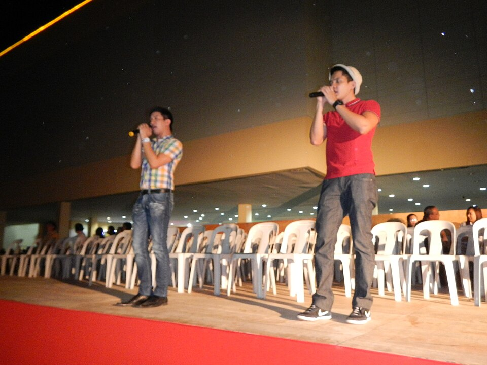</a></p>

- **菲律宾语境**：菲律宾邦板牙省圣费尔南多市
- **样式介绍**：圣费尔南多巨型灯笼节以大型放射图案、动态灯序和社区协作为特色，展示菲律宾 Parol 从家庭尺度扩展到公共装置的方式。
- **环保设计提示**：以 LED 替代高耗能灯泡，可减少热量与运行能耗。
- **图片作者**：Ramon FVelasquez
- **来源**：[Wikimedia Commons 原始文件页](https://commons.wikimedia.org/wiki/File:GLFjf1365_01.JPG)
- **许可**：[CC BY-SA 3.0](https://creativecommons.org/licenses/by-sa/3.0)

### 039 · GLFjf1365 02.JPG

<p align="center"><a href="https://commons.wikimedia.org/wiki/File:GLFjf1365_02.JPG">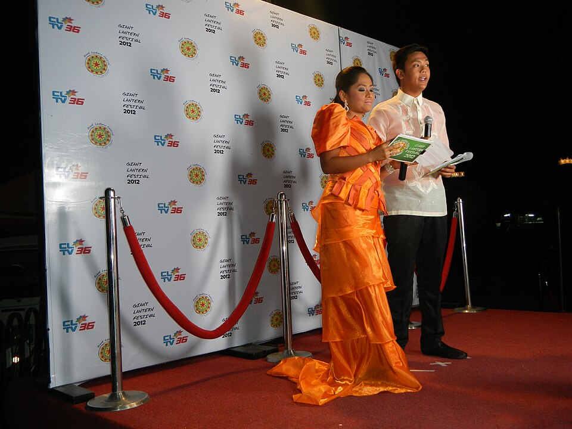</a></p>

- **菲律宾语境**：菲律宾邦板牙省圣费尔南多市
- **样式介绍**：圣费尔南多巨型灯笼节以大型放射图案、动态灯序和社区协作为特色，展示菲律宾 Parol 从家庭尺度扩展到公共装置的方式。
- **环保设计提示**：分区控制灯组能够在保持动态效果时降低峰值负载。
- **图片作者**：Ramon FVelasquez
- **来源**：[Wikimedia Commons 原始文件页](https://commons.wikimedia.org/wiki/File:GLFjf1365_02.JPG)
- **许可**：[CC BY-SA 3.0](https://creativecommons.org/licenses/by-sa/3.0)

### 040 · GLFjf1365 03.JPG

<p align="center"><a href="https://commons.wikimedia.org/wiki/File:GLFjf1365_03.JPG"></a></p>

- **菲律宾语境**：菲律宾邦板牙省圣费尔南多市
- **样式介绍**：圣费尔南多巨型灯笼节以大型放射图案、动态灯序和社区协作为特色，展示菲律宾 Parol 从家庭尺度扩展到公共装置的方式。
- **环保设计提示**：社区共建与年度复用可提高材料的使用周期。
- **图片作者**：Ramon FVelasquez
- **来源**：[Wikimedia Commons 原始文件页](https://commons.wikimedia.org/wiki/File:GLFjf1365_03.JPG)
- **许可**：[CC BY-SA 3.0](https://creativecommons.org/licenses/by-sa/3.0)

## 布拉干 Jigsaw 拼接灯

### 041 · 05754jfGolden Bloom Orchids Jigsaw Lamps Maginao San Rafael Bulacanfvf 01.jpg

<p align="center"><a href="https://commons.wikimedia.org/wiki/File:05754jfGolden_Bloom_Orchids_Jigsaw_Lamps_Maginao_San_Rafael_Bulacanfvf_01.jpg">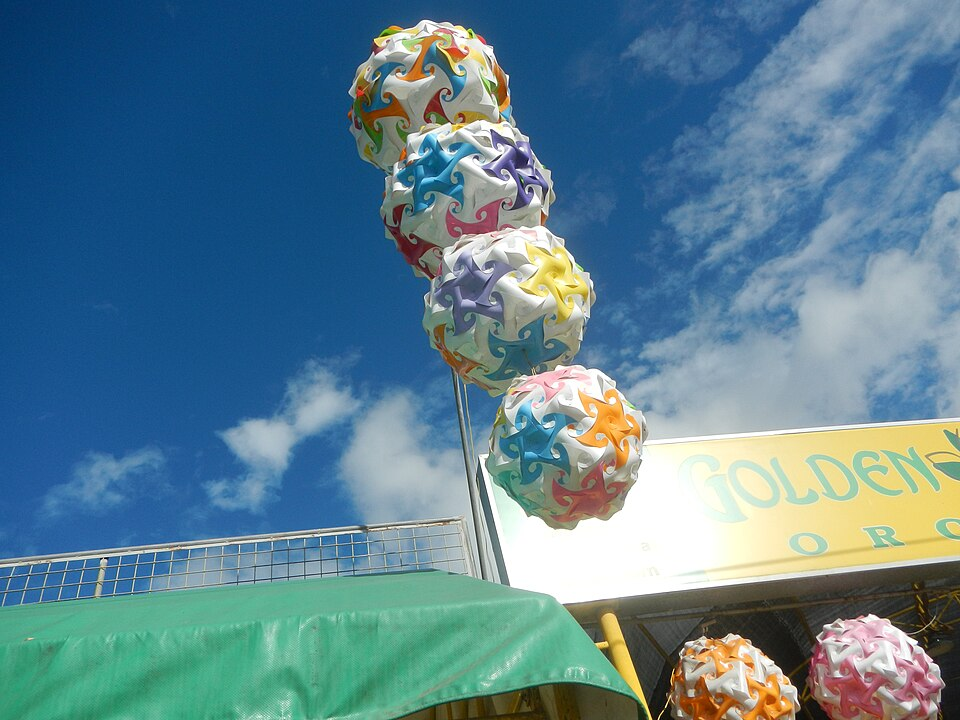</a></p>

- **菲律宾语境**：菲律宾布拉干省圣拉斐尔一带
- **样式介绍**：Jigsaw 拼接灯以重复单元和几何咬合构成灯体，能够形成花形、球形及层叠轮廓，是菲律宾模块化装饰灯的代表样式。
- **环保设计提示**：标准化拼片便于更换单个损坏部件，降低整灯报废概率。
- **图片作者**：Judgefloro
- **来源**：[Wikimedia Commons 原始文件页](https://commons.wikimedia.org/wiki/File:05754jfGolden_Bloom_Orchids_Jigsaw_Lamps_Maginao_San_Rafael_Bulacanfvf_01.jpg)
- **许可**：[CC0](http://creativecommons.org/publicdomain/zero/1.0/deed.en)

### 042 · 05754jfGolden Bloom Orchids Jigsaw Lamps Maginao San Rafael Bulacanfvf 02.jpg

<p align="center"><a href="https://commons.wikimedia.org/wiki/File:05754jfGolden_Bloom_Orchids_Jigsaw_Lamps_Maginao_San_Rafael_Bulacanfvf_02.jpg">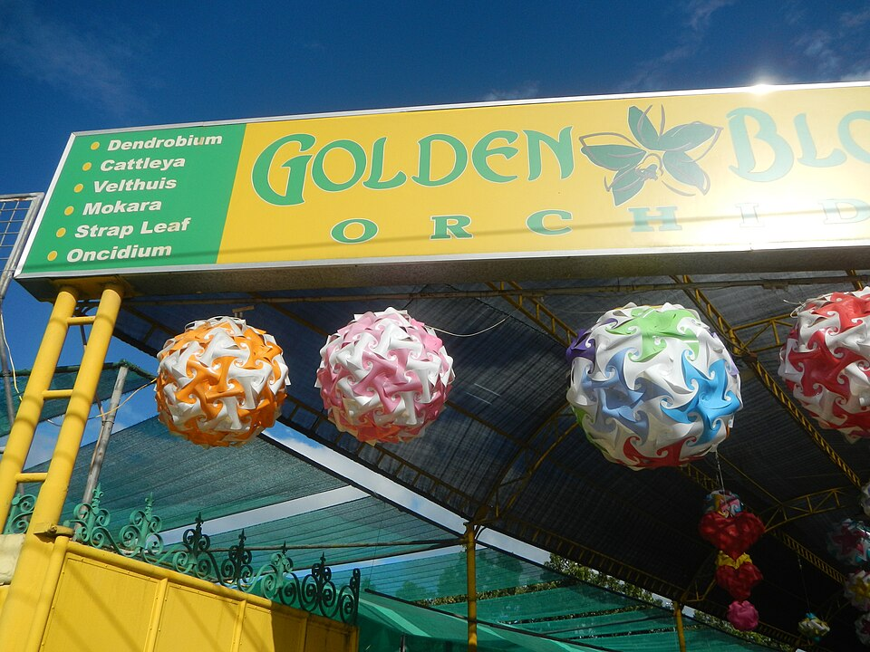</a></p>

- **菲律宾语境**：菲律宾布拉干省圣拉斐尔一带
- **样式介绍**：Jigsaw 拼接灯以重复单元和几何咬合构成灯体，能够形成花形、球形及层叠轮廓，是菲律宾模块化装饰灯的代表样式。
- **环保设计提示**：平板化零件有利于集中排版和节省运输空间。
- **图片作者**：Judgefloro
- **来源**：[Wikimedia Commons 原始文件页](https://commons.wikimedia.org/wiki/File:05754jfGolden_Bloom_Orchids_Jigsaw_Lamps_Maginao_San_Rafael_Bulacanfvf_02.jpg)
- **许可**：[CC0](http://creativecommons.org/publicdomain/zero/1.0/deed.en)

### 043 · 05754jfGolden Bloom Orchids Jigsaw Lamps Maginao San Rafael Bulacanfvf 03.jpg

<p align="center"><a href="https://commons.wikimedia.org/wiki/File:05754jfGolden_Bloom_Orchids_Jigsaw_Lamps_Maginao_San_Rafael_Bulacanfvf_03.jpg">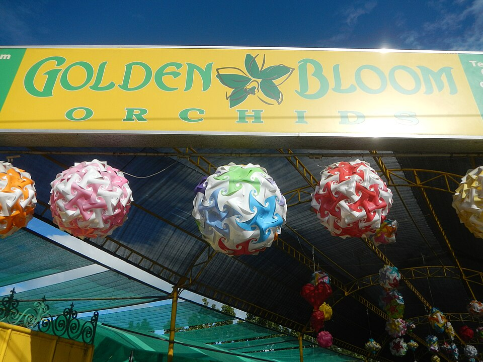</a></p>

- **菲律宾语境**：菲律宾布拉干省圣拉斐尔一带
- **样式介绍**：Jigsaw 拼接灯以重复单元和几何咬合构成灯体，能够形成花形、球形及层叠轮廓，是菲律宾模块化装饰灯的代表样式。
- **环保设计提示**：使用再生板材或耐用薄片可进一步降低材料影响。
- **图片作者**：Judgefloro
- **来源**：[Wikimedia Commons 原始文件页](https://commons.wikimedia.org/wiki/File:05754jfGolden_Bloom_Orchids_Jigsaw_Lamps_Maginao_San_Rafael_Bulacanfvf_03.jpg)
- **许可**：[CC0](http://creativecommons.org/publicdomain/zero/1.0/deed.en)

### 044 · 05754jfGolden Bloom Orchids Jigsaw Lamps Maginao San Rafael Bulacanfvf 04.jpg

<p align="center"><a href="https://commons.wikimedia.org/wiki/File:05754jfGolden_Bloom_Orchids_Jigsaw_Lamps_Maginao_San_Rafael_Bulacanfvf_04.jpg">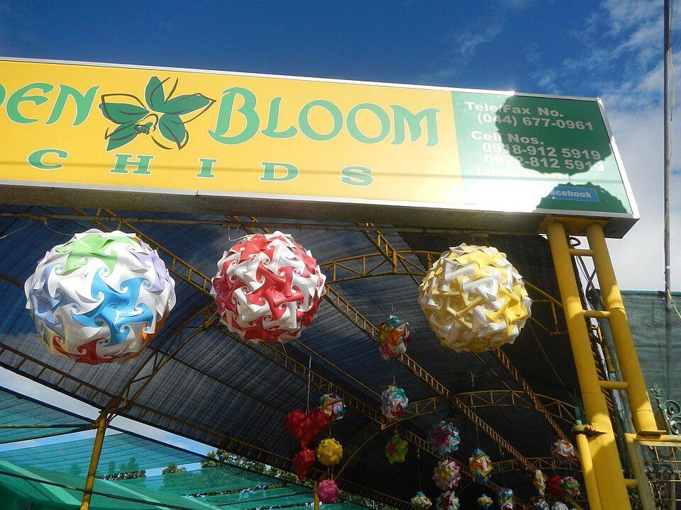</a></p>

- **菲律宾语境**：菲律宾布拉干省圣拉斐尔一带
- **样式介绍**：Jigsaw 拼接灯以重复单元和几何咬合构成灯体，能够形成花形、球形及层叠轮廓，是菲律宾模块化装饰灯的代表样式。
- **环保设计提示**：模块重复带来多种造型，适合小批量本地制作。
- **图片作者**：Judgefloro
- **来源**：[Wikimedia Commons 原始文件页](https://commons.wikimedia.org/wiki/File:05754jfGolden_Bloom_Orchids_Jigsaw_Lamps_Maginao_San_Rafael_Bulacanfvf_04.jpg)
- **许可**：[CC0](http://creativecommons.org/publicdomain/zero/1.0/deed.en)

### 045 · 05754jfGolden Bloom Orchids Jigsaw Lamps Maginao San Rafael Bulacanfvf 05.jpg

<p align="center"><a href="https://commons.wikimedia.org/wiki/File:05754jfGolden_Bloom_Orchids_Jigsaw_Lamps_Maginao_San_Rafael_Bulacanfvf_05.jpg">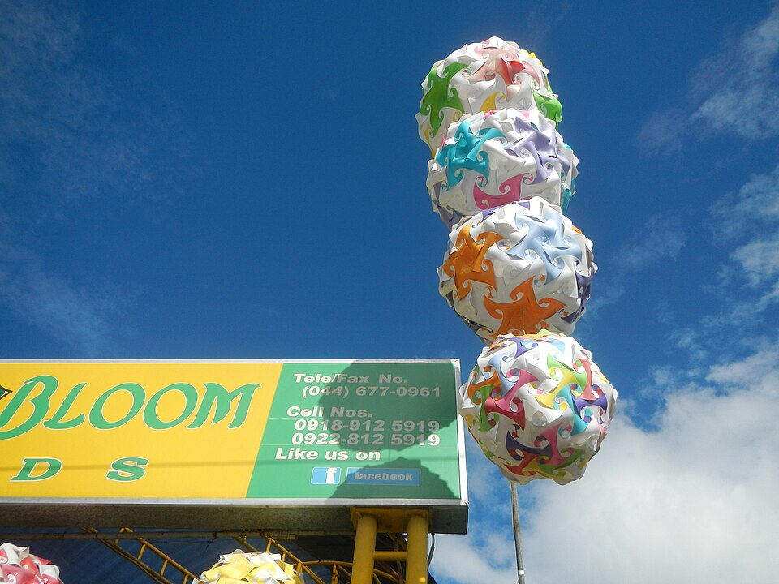</a></p>

- **菲律宾语境**：菲律宾布拉干省圣拉斐尔一带
- **样式介绍**：Jigsaw 拼接灯以重复单元和几何咬合构成灯体，能够形成花形、球形及层叠轮廓，是菲律宾模块化装饰灯的代表样式。
- **环保设计提示**：标准化拼片便于更换单个损坏部件，降低整灯报废概率。
- **图片作者**：Judgefloro
- **来源**：[Wikimedia Commons 原始文件页](https://commons.wikimedia.org/wiki/File:05754jfGolden_Bloom_Orchids_Jigsaw_Lamps_Maginao_San_Rafael_Bulacanfvf_05.jpg)
- **许可**：[CC0](http://creativecommons.org/publicdomain/zero/1.0/deed.en)

### 046 · 05754jfGolden Bloom Orchids Jigsaw Lamps Maginao San Rafael Bulacanfvf 06.jpg

<p align="center"><a href="https://commons.wikimedia.org/wiki/File:05754jfGolden_Bloom_Orchids_Jigsaw_Lamps_Maginao_San_Rafael_Bulacanfvf_06.jpg">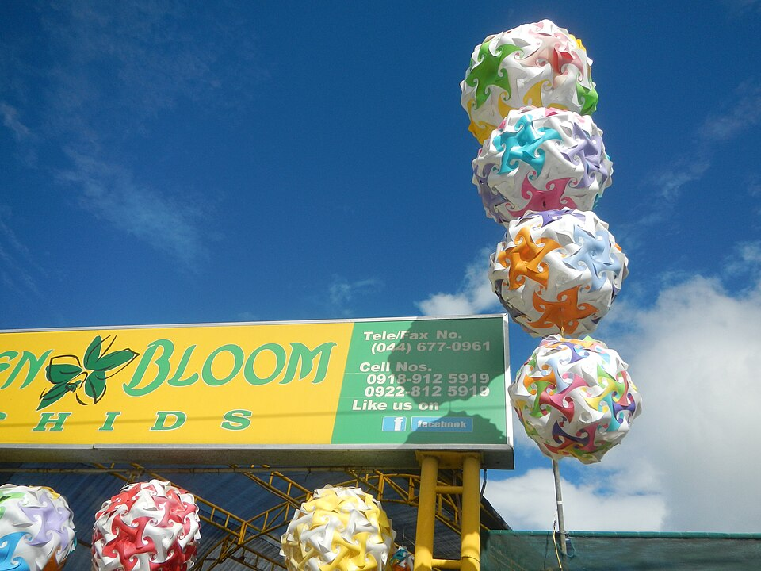</a></p>

- **菲律宾语境**：菲律宾布拉干省圣拉斐尔一带
- **样式介绍**：Jigsaw 拼接灯以重复单元和几何咬合构成灯体，能够形成花形、球形及层叠轮廓，是菲律宾模块化装饰灯的代表样式。
- **环保设计提示**：平板化零件有利于集中排版和节省运输空间。
- **图片作者**：Judgefloro
- **来源**：[Wikimedia Commons 原始文件页](https://commons.wikimedia.org/wiki/File:05754jfGolden_Bloom_Orchids_Jigsaw_Lamps_Maginao_San_Rafael_Bulacanfvf_06.jpg)
- **许可**：[CC0](http://creativecommons.org/publicdomain/zero/1.0/deed.en)

### 047 · 05754jfGolden Bloom Orchids Jigsaw Lamps Maginao San Rafael Bulacanfvf 07.jpg

<p align="center"><a href="https://commons.wikimedia.org/wiki/File:05754jfGolden_Bloom_Orchids_Jigsaw_Lamps_Maginao_San_Rafael_Bulacanfvf_07.jpg">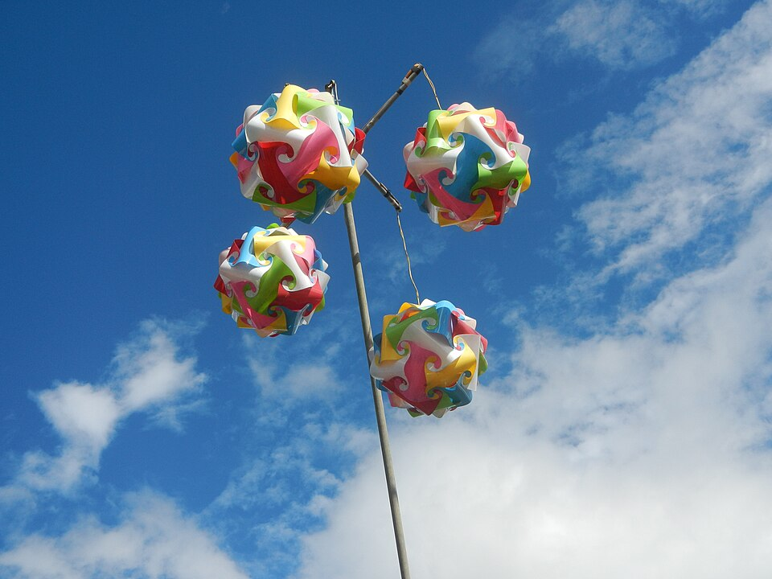</a></p>

- **菲律宾语境**：菲律宾布拉干省圣拉斐尔一带
- **样式介绍**：Jigsaw 拼接灯以重复单元和几何咬合构成灯体，能够形成花形、球形及层叠轮廓，是菲律宾模块化装饰灯的代表样式。
- **环保设计提示**：使用再生板材或耐用薄片可进一步降低材料影响。
- **图片作者**：Judgefloro
- **来源**：[Wikimedia Commons 原始文件页](https://commons.wikimedia.org/wiki/File:05754jfGolden_Bloom_Orchids_Jigsaw_Lamps_Maginao_San_Rafael_Bulacanfvf_07.jpg)
- **许可**：[CC0](http://creativecommons.org/publicdomain/zero/1.0/deed.en)

### 048 · 05754jfGolden Bloom Orchids Jigsaw Lamps Maginao San Rafael Bulacanfvf 08.jpg

<p align="center"><a href="https://commons.wikimedia.org/wiki/File:05754jfGolden_Bloom_Orchids_Jigsaw_Lamps_Maginao_San_Rafael_Bulacanfvf_08.jpg">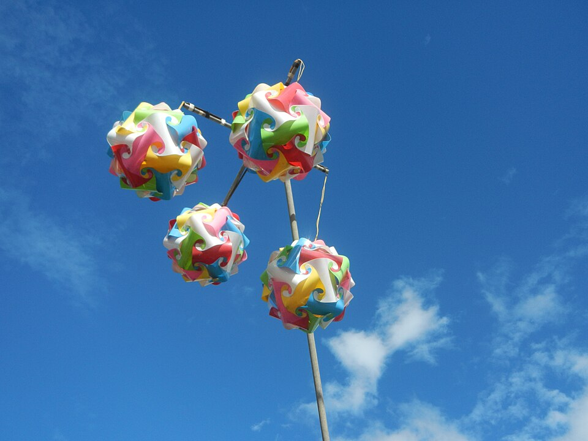</a></p>

- **菲律宾语境**：菲律宾布拉干省圣拉斐尔一带
- **样式介绍**：Jigsaw 拼接灯以重复单元和几何咬合构成灯体，能够形成花形、球形及层叠轮廓，是菲律宾模块化装饰灯的代表样式。
- **环保设计提示**：模块重复带来多种造型，适合小批量本地制作。
- **图片作者**：Judgefloro
- **来源**：[Wikimedia Commons 原始文件页](https://commons.wikimedia.org/wiki/File:05754jfGolden_Bloom_Orchids_Jigsaw_Lamps_Maginao_San_Rafael_Bulacanfvf_08.jpg)
- **许可**：[CC0](http://creativecommons.org/publicdomain/zero/1.0/deed.en)

### 049 · 05754jfGolden Bloom Orchids Jigsaw Lamps Maginao San Rafael Bulacanfvf 09.jpg

<p align="center"><a href="https://commons.wikimedia.org/wiki/File:05754jfGolden_Bloom_Orchids_Jigsaw_Lamps_Maginao_San_Rafael_Bulacanfvf_09.jpg">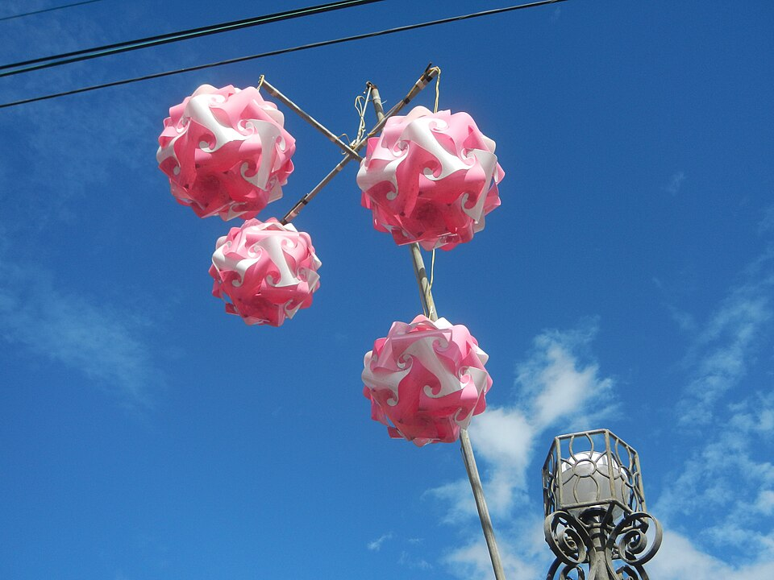</a></p>

- **菲律宾语境**：菲律宾布拉干省圣拉斐尔一带
- **样式介绍**：Jigsaw 拼接灯以重复单元和几何咬合构成灯体，能够形成花形、球形及层叠轮廓，是菲律宾模块化装饰灯的代表样式。
- **环保设计提示**：标准化拼片便于更换单个损坏部件，降低整灯报废概率。
- **图片作者**：Judgefloro
- **来源**：[Wikimedia Commons 原始文件页](https://commons.wikimedia.org/wiki/File:05754jfGolden_Bloom_Orchids_Jigsaw_Lamps_Maginao_San_Rafael_Bulacanfvf_09.jpg)
- **许可**：[CC0](http://creativecommons.org/publicdomain/zero/1.0/deed.en)

### 050 · 05754jfGolden Bloom Orchids Jigsaw Lamps Maginao San Rafael Bulacanfvf 10.jpg

<p align="center"><a href="https://commons.wikimedia.org/wiki/File:05754jfGolden_Bloom_Orchids_Jigsaw_Lamps_Maginao_San_Rafael_Bulacanfvf_10.jpg">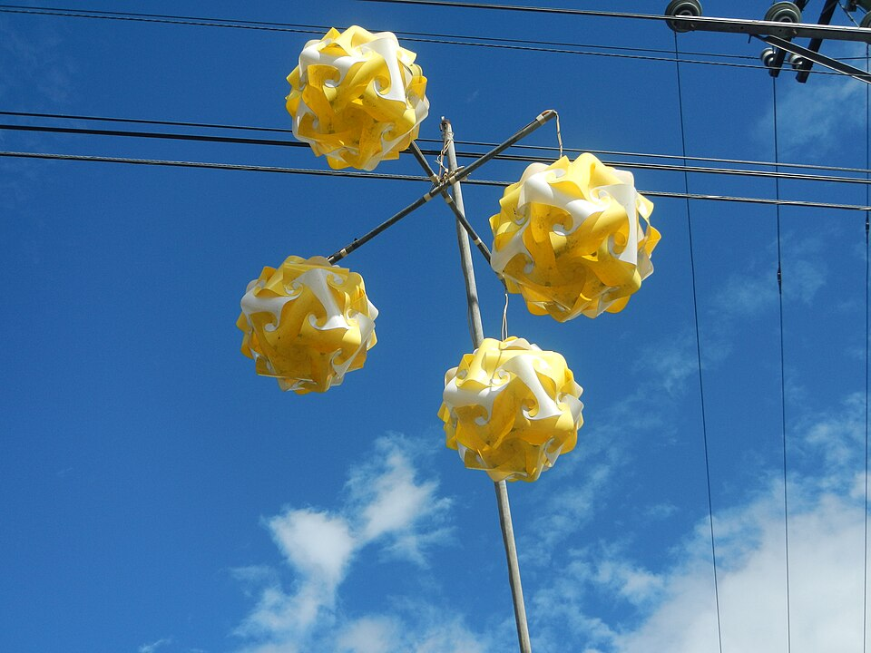</a></p>

- **菲律宾语境**：菲律宾布拉干省圣拉斐尔一带
- **样式介绍**：Jigsaw 拼接灯以重复单元和几何咬合构成灯体，能够形成花形、球形及层叠轮廓，是菲律宾模块化装饰灯的代表样式。
- **环保设计提示**：平板化零件有利于集中排版和节省运输空间。
- **图片作者**：Judgefloro
- **来源**：[Wikimedia Commons 原始文件页](https://commons.wikimedia.org/wiki/File:05754jfGolden_Bloom_Orchids_Jigsaw_Lamps_Maginao_San_Rafael_Bulacanfvf_10.jpg)
- **许可**：[CC0](http://creativecommons.org/publicdomain/zero/1.0/deed.en)

### 051 · 05754jfGolden Bloom Orchids Jigsaw Lamps Maginao San Rafael Bulacanfvf 11.jpg

<p align="center"><a href="https://commons.wikimedia.org/wiki/File:05754jfGolden_Bloom_Orchids_Jigsaw_Lamps_Maginao_San_Rafael_Bulacanfvf_11.jpg">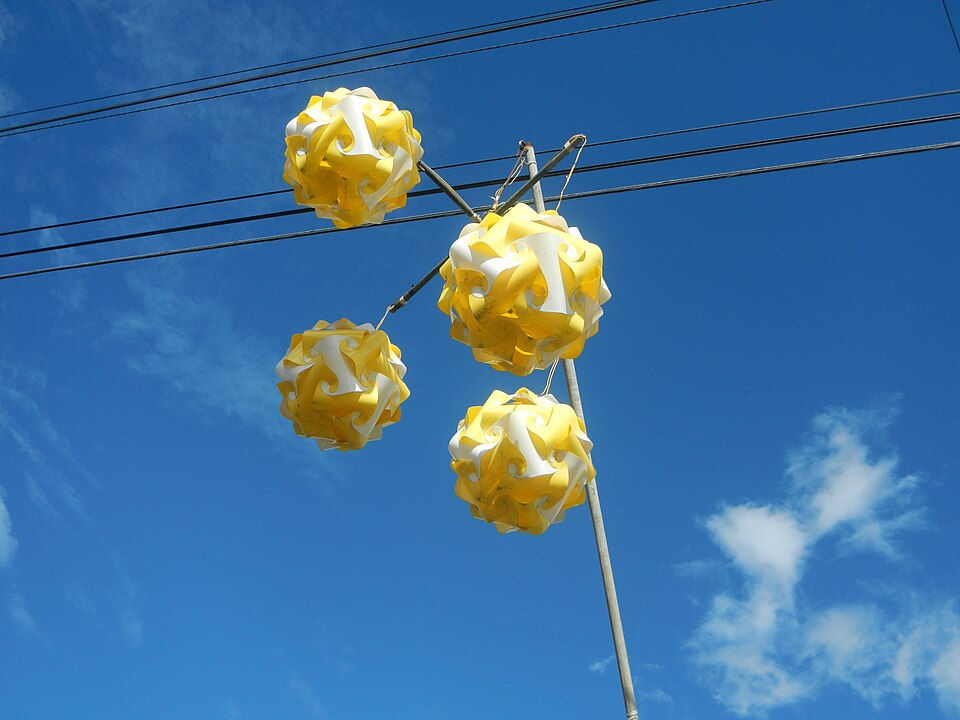</a></p>

- **菲律宾语境**：菲律宾布拉干省圣拉斐尔一带
- **样式介绍**：Jigsaw 拼接灯以重复单元和几何咬合构成灯体，能够形成花形、球形及层叠轮廓，是菲律宾模块化装饰灯的代表样式。
- **环保设计提示**：使用再生板材或耐用薄片可进一步降低材料影响。
- **图片作者**：Judgefloro
- **来源**：[Wikimedia Commons 原始文件页](https://commons.wikimedia.org/wiki/File:05754jfGolden_Bloom_Orchids_Jigsaw_Lamps_Maginao_San_Rafael_Bulacanfvf_11.jpg)
- **许可**：[CC0](http://creativecommons.org/publicdomain/zero/1.0/deed.en)

### 052 · 05754jfGolden Bloom Orchids Jigsaw Lamps Maginao San Rafael Bulacanfvf 12.jpg

<p align="center"><a href="https://commons.wikimedia.org/wiki/File:05754jfGolden_Bloom_Orchids_Jigsaw_Lamps_Maginao_San_Rafael_Bulacanfvf_12.jpg">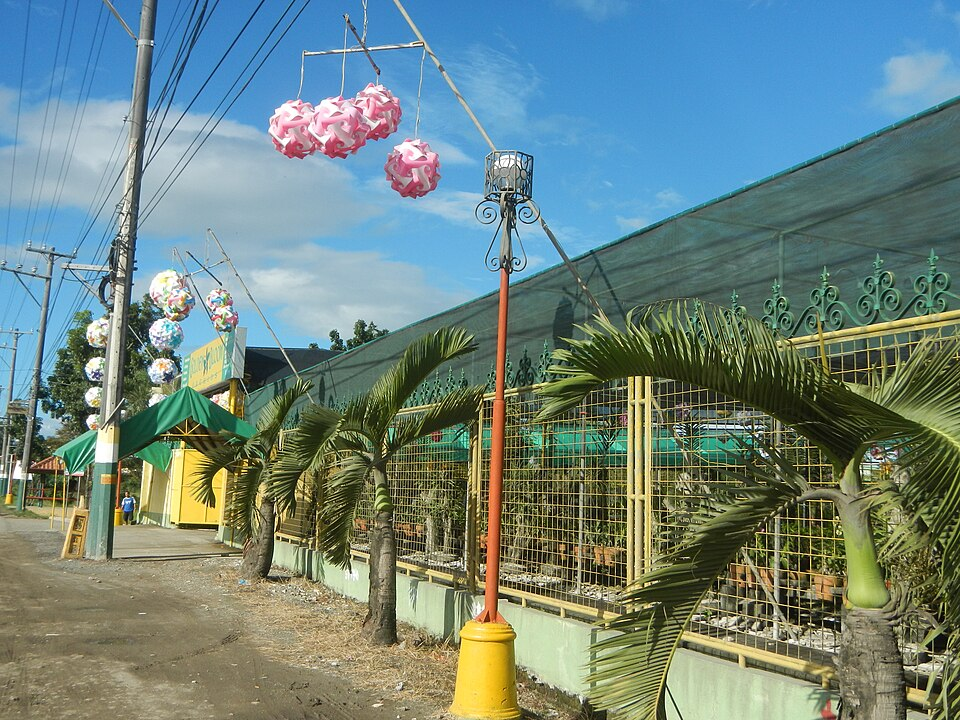</a></p>

- **菲律宾语境**：菲律宾布拉干省圣拉斐尔一带
- **样式介绍**：Jigsaw 拼接灯以重复单元和几何咬合构成灯体，能够形成花形、球形及层叠轮廓，是菲律宾模块化装饰灯的代表样式。
- **环保设计提示**：模块重复带来多种造型，适合小批量本地制作。
- **图片作者**：Judgefloro
- **来源**：[Wikimedia Commons 原始文件页](https://commons.wikimedia.org/wiki/File:05754jfGolden_Bloom_Orchids_Jigsaw_Lamps_Maginao_San_Rafael_Bulacanfvf_12.jpg)
- **许可**：[CC0](http://creativecommons.org/publicdomain/zero/1.0/deed.en)

### 053 · 05754jfGolden Bloom Orchids Jigsaw Lamps Maginao San Rafael Bulacanfvf 13.jpg

<p align="center"><a href="https://commons.wikimedia.org/wiki/File:05754jfGolden_Bloom_Orchids_Jigsaw_Lamps_Maginao_San_Rafael_Bulacanfvf_13.jpg">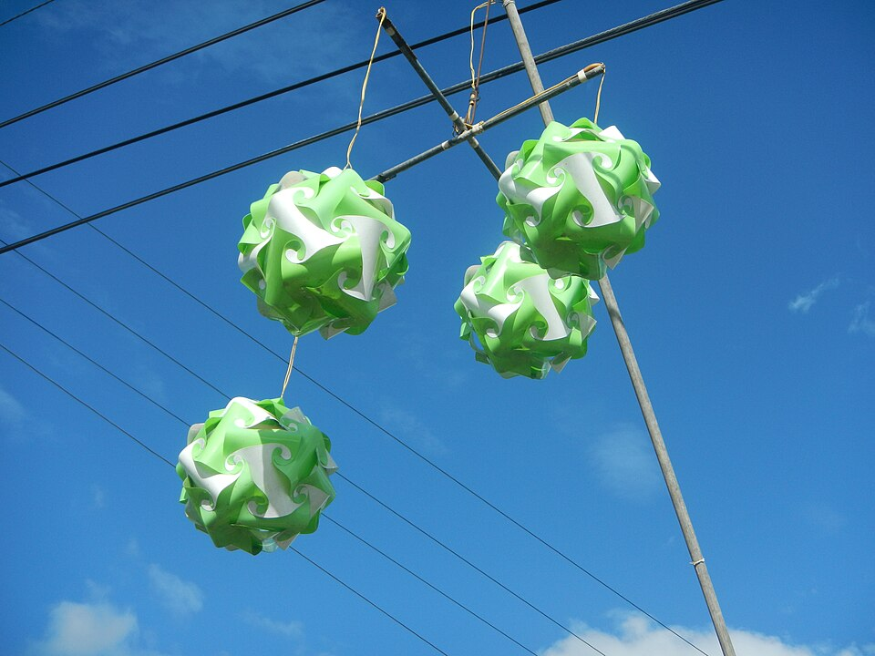</a></p>

- **菲律宾语境**：菲律宾布拉干省圣拉斐尔一带
- **样式介绍**：Jigsaw 拼接灯以重复单元和几何咬合构成灯体，能够形成花形、球形及层叠轮廓，是菲律宾模块化装饰灯的代表样式。
- **环保设计提示**：标准化拼片便于更换单个损坏部件，降低整灯报废概率。
- **图片作者**：Judgefloro
- **来源**：[Wikimedia Commons 原始文件页](https://commons.wikimedia.org/wiki/File:05754jfGolden_Bloom_Orchids_Jigsaw_Lamps_Maginao_San_Rafael_Bulacanfvf_13.jpg)
- **许可**：[CC0](http://creativecommons.org/publicdomain/zero/1.0/deed.en)

### 054 · 05754jfGolden Bloom Orchids Jigsaw Lamps Maginao San Rafael Bulacanfvf 14.jpg

<p align="center"><a href="https://commons.wikimedia.org/wiki/File:05754jfGolden_Bloom_Orchids_Jigsaw_Lamps_Maginao_San_Rafael_Bulacanfvf_14.jpg">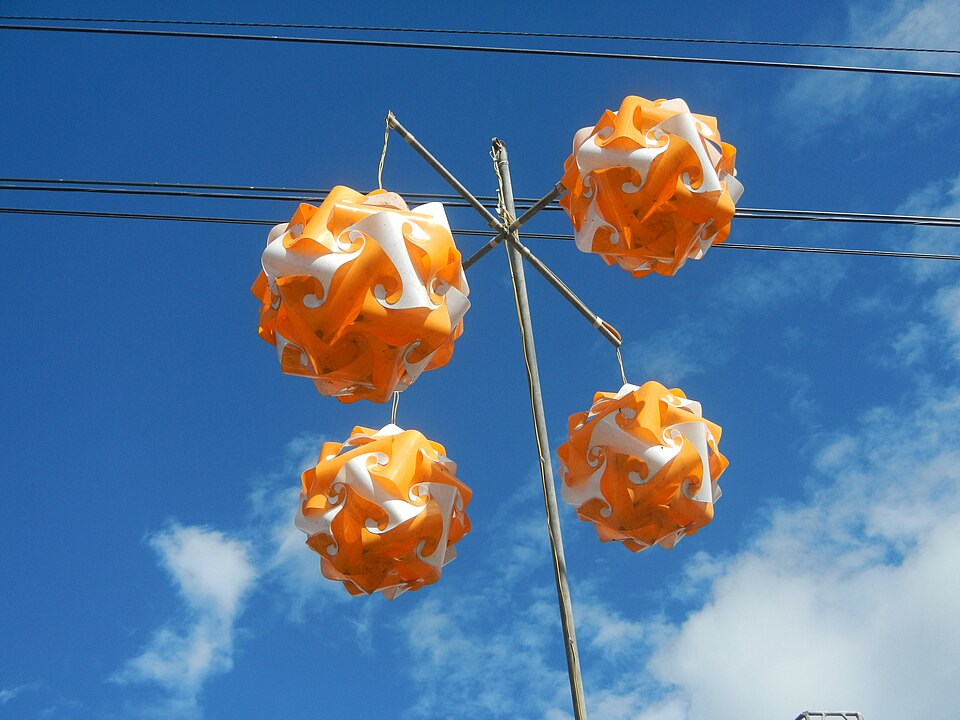</a></p>

- **菲律宾语境**：菲律宾布拉干省圣拉斐尔一带
- **样式介绍**：Jigsaw 拼接灯以重复单元和几何咬合构成灯体，能够形成花形、球形及层叠轮廓，是菲律宾模块化装饰灯的代表样式。
- **环保设计提示**：平板化零件有利于集中排版和节省运输空间。
- **图片作者**：Judgefloro
- **来源**：[Wikimedia Commons 原始文件页](https://commons.wikimedia.org/wiki/File:05754jfGolden_Bloom_Orchids_Jigsaw_Lamps_Maginao_San_Rafael_Bulacanfvf_14.jpg)
- **许可**：[CC0](http://creativecommons.org/publicdomain/zero/1.0/deed.en)

### 055 · 05754jfGolden Bloom Orchids Jigsaw Lamps Maginao San Rafael Bulacanfvf 15.jpg

<p align="center"><a href="https://commons.wikimedia.org/wiki/File:05754jfGolden_Bloom_Orchids_Jigsaw_Lamps_Maginao_San_Rafael_Bulacanfvf_15.jpg">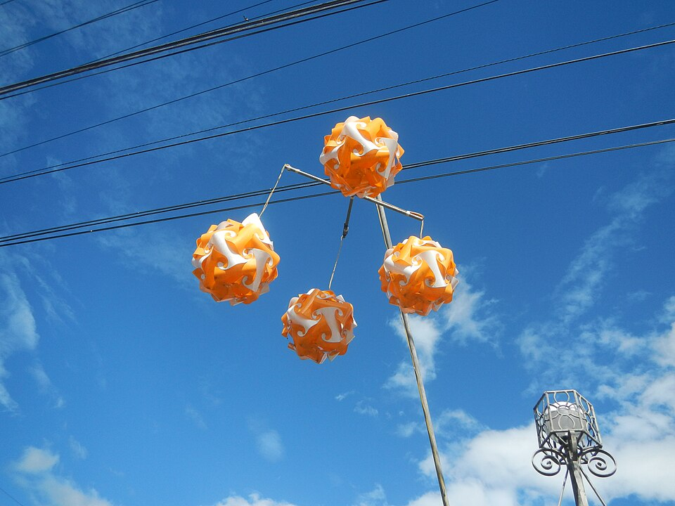</a></p>

- **菲律宾语境**：菲律宾布拉干省圣拉斐尔一带
- **样式介绍**：Jigsaw 拼接灯以重复单元和几何咬合构成灯体，能够形成花形、球形及层叠轮廓，是菲律宾模块化装饰灯的代表样式。
- **环保设计提示**：使用再生板材或耐用薄片可进一步降低材料影响。
- **图片作者**：Judgefloro
- **来源**：[Wikimedia Commons 原始文件页](https://commons.wikimedia.org/wiki/File:05754jfGolden_Bloom_Orchids_Jigsaw_Lamps_Maginao_San_Rafael_Bulacanfvf_15.jpg)
- **许可**：[CC0](http://creativecommons.org/publicdomain/zero/1.0/deed.en)

## 马洛洛斯社区 Parol

### 056 · 09363jfParol Festival 2016 Barangays of Malolos City Barasoain Churchfvf 01.jpg

<p align="center"><a href="https://commons.wikimedia.org/wiki/File:09363jfParol_Festival_2016_Barangays_of_Malolos_City_Barasoain_Churchfvf_01.jpg">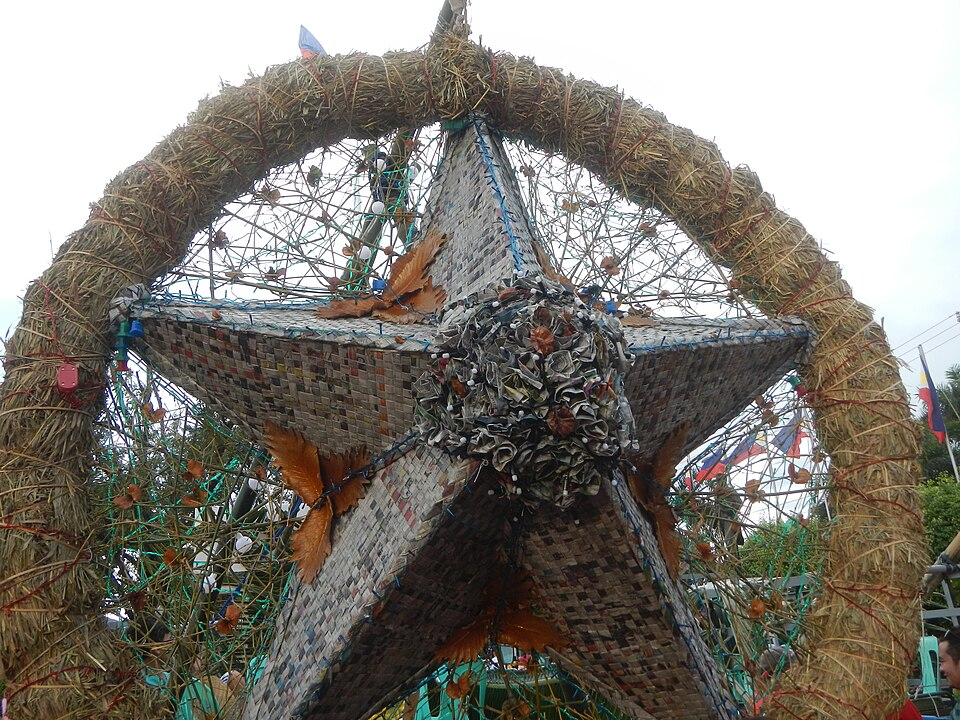</a></p>

- **菲律宾语境**：菲律宾布拉干省马洛洛斯市与巴拉索因教堂周边
- **样式介绍**：马洛洛斯社区 Parol 将地方图案、节庆色彩和公共空间展示结合，体现社区灯饰在街区尺度上的多样表达。
- **环保设计提示**：社区编号与模块化安装便于节后回收和次年复用。
- **图片作者**：Judgefloro
- **来源**：[Wikimedia Commons 原始文件页](https://commons.wikimedia.org/wiki/File:09363jfParol_Festival_2016_Barangays_of_Malolos_City_Barasoain_Churchfvf_01.jpg)
- **许可**：[CC0](http://creativecommons.org/publicdomain/zero/1.0/deed.en)

### 057 · 09363jfParol Festival 2016 Barangays of Malolos City Barasoain Churchfvf 02.jpg

<p align="center"><a href="https://commons.wikimedia.org/wiki/File:09363jfParol_Festival_2016_Barangays_of_Malolos_City_Barasoain_Churchfvf_02.jpg"></a></p>

- **菲律宾语境**：菲律宾布拉干省马洛洛斯市与巴拉索因教堂周边
- **样式介绍**：马洛洛斯社区 Parol 将地方图案、节庆色彩和公共空间展示结合，体现社区灯饰在街区尺度上的多样表达。
- **环保设计提示**：可优先采用本地竹材、纸材或可回收塑料饰面。
- **图片作者**：Judgefloro
- **来源**：[Wikimedia Commons 原始文件页](https://commons.wikimedia.org/wiki/File:09363jfParol_Festival_2016_Barangays_of_Malolos_City_Barasoain_Churchfvf_02.jpg)
- **许可**：[CC0](http://creativecommons.org/publicdomain/zero/1.0/deed.en)

### 058 · 09363jfParol Festival 2016 Barangays of Malolos City Barasoain Churchfvf 03.jpg

<p align="center"><a href="https://commons.wikimedia.org/wiki/File:09363jfParol_Festival_2016_Barangays_of_Malolos_City_Barasoain_Churchfvf_03.jpg"></a></p>

- **菲律宾语境**：菲律宾布拉干省马洛洛斯市与巴拉索因教堂周边
- **样式介绍**：马洛洛斯社区 Parol 将地方图案、节庆色彩和公共空间展示结合，体现社区灯饰在街区尺度上的多样表达。
- **环保设计提示**：使用定时器和低功率 LED 可减少无人时段的能耗。
- **图片作者**：Judgefloro
- **来源**：[Wikimedia Commons 原始文件页](https://commons.wikimedia.org/wiki/File:09363jfParol_Festival_2016_Barangays_of_Malolos_City_Barasoain_Churchfvf_03.jpg)
- **许可**：[CC0](http://creativecommons.org/publicdomain/zero/1.0/deed.en)

### 059 · 09363jfParol Festival 2016 Barangays of Malolos City Barasoain Churchfvf 04.jpg

<p align="center"><a href="https://commons.wikimedia.org/wiki/File:09363jfParol_Festival_2016_Barangays_of_Malolos_City_Barasoain_Churchfvf_04.jpg"></a></p>

- **菲律宾语境**：菲律宾布拉干省马洛洛斯市与巴拉索因教堂周边
- **样式介绍**：马洛洛斯社区 Parol 将地方图案、节庆色彩和公共空间展示结合，体现社区灯饰在街区尺度上的多样表达。
- **环保设计提示**：耐修复连接方式适合社区共同维护。
- **图片作者**：Judgefloro
- **来源**：[Wikimedia Commons 原始文件页](https://commons.wikimedia.org/wiki/File:09363jfParol_Festival_2016_Barangays_of_Malolos_City_Barasoain_Churchfvf_04.jpg)
- **许可**：[CC0](http://creativecommons.org/publicdomain/zero/1.0/deed.en)

### 060 · 09363jfParol Festival 2016 Barangays of Malolos City Barasoain Churchfvf 05.jpg

<p align="center"><a href="https://commons.wikimedia.org/wiki/File:09363jfParol_Festival_2016_Barangays_of_Malolos_City_Barasoain_Churchfvf_05.jpg"></a></p>

- **菲律宾语境**：菲律宾布拉干省马洛洛斯市与巴拉索因教堂周边
- **样式介绍**：马洛洛斯社区 Parol 将地方图案、节庆色彩和公共空间展示结合，体现社区灯饰在街区尺度上的多样表达。
- **环保设计提示**：社区编号与模块化安装便于节后回收和次年复用。
- **图片作者**：Judgefloro
- **来源**：[Wikimedia Commons 原始文件页](https://commons.wikimedia.org/wiki/File:09363jfParol_Festival_2016_Barangays_of_Malolos_City_Barasoain_Churchfvf_05.jpg)
- **许可**：[CC0](http://creativecommons.org/publicdomain/zero/1.0/deed.en)

### 061 · 09363jfParol Festival 2016 Barangays of Malolos City Barasoain Churchfvf 06.jpg

<p align="center"><a href="https://commons.wikimedia.org/wiki/File:09363jfParol_Festival_2016_Barangays_of_Malolos_City_Barasoain_Churchfvf_06.jpg"></a></p>

- **菲律宾语境**：菲律宾布拉干省马洛洛斯市与巴拉索因教堂周边
- **样式介绍**：马洛洛斯社区 Parol 将地方图案、节庆色彩和公共空间展示结合，体现社区灯饰在街区尺度上的多样表达。
- **环保设计提示**：可优先采用本地竹材、纸材或可回收塑料饰面。
- **图片作者**：Judgefloro
- **来源**：[Wikimedia Commons 原始文件页](https://commons.wikimedia.org/wiki/File:09363jfParol_Festival_2016_Barangays_of_Malolos_City_Barasoain_Churchfvf_06.jpg)
- **许可**：[CC0](http://creativecommons.org/publicdomain/zero/1.0/deed.en)

### 062 · 09363jfParol Festival 2016 Barangays of Malolos City Barasoain Churchfvf 07.jpg

<p align="center"><a href="https://commons.wikimedia.org/wiki/File:09363jfParol_Festival_2016_Barangays_of_Malolos_City_Barasoain_Churchfvf_07.jpg"></a></p>

- **菲律宾语境**：菲律宾布拉干省马洛洛斯市与巴拉索因教堂周边
- **样式介绍**：马洛洛斯社区 Parol 将地方图案、节庆色彩和公共空间展示结合，体现社区灯饰在街区尺度上的多样表达。
- **环保设计提示**：使用定时器和低功率 LED 可减少无人时段的能耗。
- **图片作者**：Judgefloro
- **来源**：[Wikimedia Commons 原始文件页](https://commons.wikimedia.org/wiki/File:09363jfParol_Festival_2016_Barangays_of_Malolos_City_Barasoain_Churchfvf_07.jpg)
- **许可**：[CC0](http://creativecommons.org/publicdomain/zero/1.0/deed.en)

### 063 · 09363jfParol Festival 2016 Barangays of Malolos City Barasoain Churchfvf 08.jpg

<p align="center"><a href="https://commons.wikimedia.org/wiki/File:09363jfParol_Festival_2016_Barangays_of_Malolos_City_Barasoain_Churchfvf_08.jpg"></a></p>

- **菲律宾语境**：菲律宾布拉干省马洛洛斯市与巴拉索因教堂周边
- **样式介绍**：马洛洛斯社区 Parol 将地方图案、节庆色彩和公共空间展示结合，体现社区灯饰在街区尺度上的多样表达。
- **环保设计提示**：耐修复连接方式适合社区共同维护。
- **图片作者**：Judgefloro
- **来源**：[Wikimedia Commons 原始文件页](https://commons.wikimedia.org/wiki/File:09363jfParol_Festival_2016_Barangays_of_Malolos_City_Barasoain_Churchfvf_08.jpg)
- **许可**：[CC0](http://creativecommons.org/publicdomain/zero/1.0/deed.en)

### 064 · 09363jfParol Festival 2016 Barangays of Malolos City Barasoain Churchfvf 09.jpg

<p align="center"><a href="https://commons.wikimedia.org/wiki/File:09363jfParol_Festival_2016_Barangays_of_Malolos_City_Barasoain_Churchfvf_09.jpg"></a></p>

- **菲律宾语境**：菲律宾布拉干省马洛洛斯市与巴拉索因教堂周边
- **样式介绍**：马洛洛斯社区 Parol 将地方图案、节庆色彩和公共空间展示结合，体现社区灯饰在街区尺度上的多样表达。
- **环保设计提示**：社区编号与模块化安装便于节后回收和次年复用。
- **图片作者**：Judgefloro
- **来源**：[Wikimedia Commons 原始文件页](https://commons.wikimedia.org/wiki/File:09363jfParol_Festival_2016_Barangays_of_Malolos_City_Barasoain_Churchfvf_09.jpg)
- **许可**：[CC0](http://creativecommons.org/publicdomain/zero/1.0/deed.en)

### 065 · 09363jfParol Festival 2016 Barangays of Malolos City Barasoain Churchfvf 10.jpg

<p align="center"><a href="https://commons.wikimedia.org/wiki/File:09363jfParol_Festival_2016_Barangays_of_Malolos_City_Barasoain_Churchfvf_10.jpg"></a></p>

- **菲律宾语境**：菲律宾布拉干省马洛洛斯市与巴拉索因教堂周边
- **样式介绍**：马洛洛斯社区 Parol 将地方图案、节庆色彩和公共空间展示结合，体现社区灯饰在街区尺度上的多样表达。
- **环保设计提示**：可优先采用本地竹材、纸材或可回收塑料饰面。
- **图片作者**：Judgefloro
- **来源**：[Wikimedia Commons 原始文件页](https://commons.wikimedia.org/wiki/File:09363jfParol_Festival_2016_Barangays_of_Malolos_City_Barasoain_Churchfvf_10.jpg)
- **许可**：[CC0](http://creativecommons.org/publicdomain/zero/1.0/deed.en)

### 066 · 09363jfParol Festival 2016 Barangays of Malolos City Barasoain Churchfvf 11.jpg

<p align="center"><a href="https://commons.wikimedia.org/wiki/File:09363jfParol_Festival_2016_Barangays_of_Malolos_City_Barasoain_Churchfvf_11.jpg"></a></p>

- **菲律宾语境**：菲律宾布拉干省马洛洛斯市与巴拉索因教堂周边
- **样式介绍**：马洛洛斯社区 Parol 将地方图案、节庆色彩和公共空间展示结合，体现社区灯饰在街区尺度上的多样表达。
- **环保设计提示**：使用定时器和低功率 LED 可减少无人时段的能耗。
- **图片作者**：Judgefloro
- **来源**：[Wikimedia Commons 原始文件页](https://commons.wikimedia.org/wiki/File:09363jfParol_Festival_2016_Barangays_of_Malolos_City_Barasoain_Churchfvf_11.jpg)
- **许可**：[CC0](http://creativecommons.org/publicdomain/zero/1.0/deed.en)

### 067 · 09363jfParol Festival 2016 Barangays of Malolos City Barasoain Churchfvf 12.jpg

<p align="center"><a href="https://commons.wikimedia.org/wiki/File:09363jfParol_Festival_2016_Barangays_of_Malolos_City_Barasoain_Churchfvf_12.jpg"></a></p>

- **菲律宾语境**：菲律宾布拉干省马洛洛斯市与巴拉索因教堂周边
- **样式介绍**：马洛洛斯社区 Parol 将地方图案、节庆色彩和公共空间展示结合，体现社区灯饰在街区尺度上的多样表达。
- **环保设计提示**：耐修复连接方式适合社区共同维护。
- **图片作者**：Judgefloro
- **来源**：[Wikimedia Commons 原始文件页](https://commons.wikimedia.org/wiki/File:09363jfParol_Festival_2016_Barangays_of_Malolos_City_Barasoain_Churchfvf_12.jpg)
- **许可**：[CC0](http://creativecommons.org/publicdomain/zero/1.0/deed.en)

### 068 · 09363jfParol Festival 2016 Barangays of Malolos City Barasoain Churchfvf 13.jpg

<p align="center"><a href="https://commons.wikimedia.org/wiki/File:09363jfParol_Festival_2016_Barangays_of_Malolos_City_Barasoain_Churchfvf_13.jpg"></a></p>

- **菲律宾语境**：菲律宾布拉干省马洛洛斯市与巴拉索因教堂周边
- **样式介绍**：马洛洛斯社区 Parol 将地方图案、节庆色彩和公共空间展示结合，体现社区灯饰在街区尺度上的多样表达。
- **环保设计提示**：社区编号与模块化安装便于节后回收和次年复用。
- **图片作者**：Judgefloro
- **来源**：[Wikimedia Commons 原始文件页](https://commons.wikimedia.org/wiki/File:09363jfParol_Festival_2016_Barangays_of_Malolos_City_Barasoain_Churchfvf_13.jpg)
- **许可**：[CC0](http://creativecommons.org/publicdomain/zero/1.0/deed.en)

### 069 · 09363jfParol Festival 2016 Barangays of Malolos City Barasoain Churchfvf 14.jpg

<p align="center"><a href="https://commons.wikimedia.org/wiki/File:09363jfParol_Festival_2016_Barangays_of_Malolos_City_Barasoain_Churchfvf_14.jpg"></a></p>

- **菲律宾语境**：菲律宾布拉干省马洛洛斯市与巴拉索因教堂周边
- **样式介绍**：马洛洛斯社区 Parol 将地方图案、节庆色彩和公共空间展示结合，体现社区灯饰在街区尺度上的多样表达。
- **环保设计提示**：可优先采用本地竹材、纸材或可回收塑料饰面。
- **图片作者**：Judgefloro
- **来源**：[Wikimedia Commons 原始文件页](https://commons.wikimedia.org/wiki/File:09363jfParol_Festival_2016_Barangays_of_Malolos_City_Barasoain_Churchfvf_14.jpg)
- **许可**：[CC0](http://creativecommons.org/publicdomain/zero/1.0/deed.en)

### 070 · 09363jfParol Festival 2016 Barangays of Malolos City Barasoain Churchfvf 15.jpg

<p align="center"><a href="https://commons.wikimedia.org/wiki/File:09363jfParol_Festival_2016_Barangays_of_Malolos_City_Barasoain_Churchfvf_15.jpg"></a></p>

- **菲律宾语境**：菲律宾布拉干省马洛洛斯市与巴拉索因教堂周边
- **样式介绍**：马洛洛斯社区 Parol 将地方图案、节庆色彩和公共空间展示结合，体现社区灯饰在街区尺度上的多样表达。
- **环保设计提示**：使用定时器和低功率 LED 可减少无人时段的能耗。
- **图片作者**：Judgefloro
- **来源**：[Wikimedia Commons 原始文件页](https://commons.wikimedia.org/wiki/File:09363jfParol_Festival_2016_Barangays_of_Malolos_City_Barasoain_Churchfvf_15.jpg)
- **许可**：[CC0](http://creativecommons.org/publicdomain/zero/1.0/deed.en)

## 巴利瓦格 Parol

### 071 · 4831Baliuag, Bulacan Public Market 11.jpg

<p align="center"><a href="https://commons.wikimedia.org/wiki/File:4831Baliuag,_Bulacan_Public_Market_11.jpg"></a></p>

- **菲律宾语境**：菲律宾布拉干省巴利瓦格
- **样式介绍**：巴利瓦格 Parol 具有鲜明的星芒、花瓣和多层边框，适合研究菲律宾城镇灯饰如何在统一传统中形成不同构图。
- **环保设计提示**：多层边框可拆分储存，减少大型灯饰的季节性占用。
- **图片作者**：Judgefloro
- **来源**：[Wikimedia Commons 原始文件页](https://commons.wikimedia.org/wiki/File:4831Baliuag,_Bulacan_Public_Market_11.jpg)
- **许可**：[CC0](http://creativecommons.org/publicdomain/zero/1.0/deed.en)

### 072 · 4831Baliuag, Bulacan Public Market 12.jpg

<p align="center"><a href="https://commons.wikimedia.org/wiki/File:4831Baliuag,_Bulacan_Public_Market_12.jpg"></a></p>

- **菲律宾语境**：菲律宾布拉干省巴利瓦格
- **样式介绍**：巴利瓦格 Parol 具有鲜明的星芒、花瓣和多层边框，适合研究菲律宾城镇灯饰如何在统一传统中形成不同构图。
- **环保设计提示**：局部更换饰面比整件重制更节省材料。
- **图片作者**：Judgefloro
- **来源**：[Wikimedia Commons 原始文件页](https://commons.wikimedia.org/wiki/File:4831Baliuag,_Bulacan_Public_Market_12.jpg)
- **许可**：[CC0](http://creativecommons.org/publicdomain/zero/1.0/deed.en)

### 073 · 4831Baliuag, Bulacan Public Market 13.jpg

<p align="center"><a href="https://commons.wikimedia.org/wiki/File:4831Baliuag,_Bulacan_Public_Market_13.jpg"></a></p>

- **菲律宾语境**：菲律宾布拉干省巴利瓦格
- **样式介绍**：巴利瓦格 Parol 具有鲜明的星芒、花瓣和多层边框，适合研究菲律宾城镇灯饰如何在统一传统中形成不同构图。
- **环保设计提示**：反光材料可提高低功率光源的视觉亮度。
- **图片作者**：Judgefloro
- **来源**：[Wikimedia Commons 原始文件页](https://commons.wikimedia.org/wiki/File:4831Baliuag,_Bulacan_Public_Market_13.jpg)
- **许可**：[CC0](http://creativecommons.org/publicdomain/zero/1.0/deed.en)

### 074 · 4831Baliuag, Bulacan Public Market 14.jpg

<p align="center"><a href="https://commons.wikimedia.org/wiki/File:4831Baliuag,_Bulacan_Public_Market_14.jpg"></a></p>

- **菲律宾语境**：菲律宾布拉干省巴利瓦格
- **样式介绍**：巴利瓦格 Parol 具有鲜明的星芒、花瓣和多层边框，适合研究菲律宾城镇灯饰如何在统一传统中形成不同构图。
- **环保设计提示**：采用可回收单一材质有助于灯饰退役后的分类处理。
- **图片作者**：Judgefloro
- **来源**：[Wikimedia Commons 原始文件页](https://commons.wikimedia.org/wiki/File:4831Baliuag,_Bulacan_Public_Market_14.jpg)
- **许可**：[CC0](http://creativecommons.org/publicdomain/zero/1.0/deed.en)

### 075 · 4831Baliuag, Bulacan Public Market 15.jpg

<p align="center"><a href="https://commons.wikimedia.org/wiki/File:4831Baliuag,_Bulacan_Public_Market_15.jpg"></a></p>

- **菲律宾语境**：菲律宾布拉干省巴利瓦格
- **样式介绍**：巴利瓦格 Parol 具有鲜明的星芒、花瓣和多层边框，适合研究菲律宾城镇灯饰如何在统一传统中形成不同构图。
- **环保设计提示**：多层边框可拆分储存，减少大型灯饰的季节性占用。
- **图片作者**：Judgefloro
- **来源**：[Wikimedia Commons 原始文件页](https://commons.wikimedia.org/wiki/File:4831Baliuag,_Bulacan_Public_Market_15.jpg)
- **许可**：[CC0](http://creativecommons.org/publicdomain/zero/1.0/deed.en)

### 076 · 4831Baliuag, Bulacan Public Market 16.jpg

<p align="center"><a href="https://commons.wikimedia.org/wiki/File:4831Baliuag,_Bulacan_Public_Market_16.jpg"></a></p>

- **菲律宾语境**：菲律宾布拉干省巴利瓦格
- **样式介绍**：巴利瓦格 Parol 具有鲜明的星芒、花瓣和多层边框，适合研究菲律宾城镇灯饰如何在统一传统中形成不同构图。
- **环保设计提示**：局部更换饰面比整件重制更节省材料。
- **图片作者**：Judgefloro
- **来源**：[Wikimedia Commons 原始文件页](https://commons.wikimedia.org/wiki/File:4831Baliuag,_Bulacan_Public_Market_16.jpg)
- **许可**：[CC0](http://creativecommons.org/publicdomain/zero/1.0/deed.en)

### 077 · 4831Baliuag, Bulacan Public Market 17.jpg

<p align="center"><a href="https://commons.wikimedia.org/wiki/File:4831Baliuag,_Bulacan_Public_Market_17.jpg"></a></p>

- **菲律宾语境**：菲律宾布拉干省巴利瓦格
- **样式介绍**：巴利瓦格 Parol 具有鲜明的星芒、花瓣和多层边框，适合研究菲律宾城镇灯饰如何在统一传统中形成不同构图。
- **环保设计提示**：反光材料可提高低功率光源的视觉亮度。
- **图片作者**：Judgefloro
- **来源**：[Wikimedia Commons 原始文件页](https://commons.wikimedia.org/wiki/File:4831Baliuag,_Bulacan_Public_Market_17.jpg)
- **许可**：[CC0](http://creativecommons.org/publicdomain/zero/1.0/deed.en)

### 078 · 4831Baliuag, Bulacan Public Market 18.jpg

<p align="center"><a href="https://commons.wikimedia.org/wiki/File:4831Baliuag,_Bulacan_Public_Market_18.jpg"></a></p>

- **菲律宾语境**：菲律宾布拉干省巴利瓦格
- **样式介绍**：巴利瓦格 Parol 具有鲜明的星芒、花瓣和多层边框，适合研究菲律宾城镇灯饰如何在统一传统中形成不同构图。
- **环保设计提示**：采用可回收单一材质有助于灯饰退役后的分类处理。
- **图片作者**：Judgefloro
- **来源**：[Wikimedia Commons 原始文件页](https://commons.wikimedia.org/wiki/File:4831Baliuag,_Bulacan_Public_Market_18.jpg)
- **许可**：[CC0](http://creativecommons.org/publicdomain/zero/1.0/deed.en)

### 079 · 4831Baliuag, Bulacan Public Market 19.jpg

<p align="center"><a href="https://commons.wikimedia.org/wiki/File:4831Baliuag,_Bulacan_Public_Market_19.jpg"></a></p>

- **菲律宾语境**：菲律宾布拉干省巴利瓦格
- **样式介绍**：巴利瓦格 Parol 具有鲜明的星芒、花瓣和多层边框，适合研究菲律宾城镇灯饰如何在统一传统中形成不同构图。
- **环保设计提示**：多层边框可拆分储存，减少大型灯饰的季节性占用。
- **图片作者**：Judgefloro
- **来源**：[Wikimedia Commons 原始文件页](https://commons.wikimedia.org/wiki/File:4831Baliuag,_Bulacan_Public_Market_19.jpg)
- **许可**：[CC0](http://creativecommons.org/publicdomain/zero/1.0/deed.en)

### 080 · 4831Baliuag, Bulacan Public Market 20.jpg

<p align="center"><a href="https://commons.wikimedia.org/wiki/File:4831Baliuag,_Bulacan_Public_Market_20.jpg"></a></p>

- **菲律宾语境**：菲律宾布拉干省巴利瓦格
- **样式介绍**：巴利瓦格 Parol 具有鲜明的星芒、花瓣和多层边框，适合研究菲律宾城镇灯饰如何在统一传统中形成不同构图。
- **环保设计提示**：局部更换饰面比整件重制更节省材料。
- **图片作者**：Judgefloro
- **来源**：[Wikimedia Commons 原始文件页](https://commons.wikimedia.org/wiki/File:4831Baliuag,_Bulacan_Public_Market_20.jpg)
- **许可**：[CC0](http://creativecommons.org/publicdomain/zero/1.0/deed.en)

### 081 · 4831Baliuag, Bulacan Public Market 21.jpg

<p align="center"><a href="https://commons.wikimedia.org/wiki/File:4831Baliuag,_Bulacan_Public_Market_21.jpg"></a></p>

- **菲律宾语境**：菲律宾布拉干省巴利瓦格
- **样式介绍**：巴利瓦格 Parol 具有鲜明的星芒、花瓣和多层边框，适合研究菲律宾城镇灯饰如何在统一传统中形成不同构图。
- **环保设计提示**：反光材料可提高低功率光源的视觉亮度。
- **图片作者**：Judgefloro
- **来源**：[Wikimedia Commons 原始文件页](https://commons.wikimedia.org/wiki/File:4831Baliuag,_Bulacan_Public_Market_21.jpg)
- **许可**：[CC0](http://creativecommons.org/publicdomain/zero/1.0/deed.en)

### 082 · 4831Baliuag, Bulacan Public Market 22.jpg

<p align="center"><a href="https://commons.wikimedia.org/wiki/File:4831Baliuag,_Bulacan_Public_Market_22.jpg"></a></p>

- **菲律宾语境**：菲律宾布拉干省巴利瓦格
- **样式介绍**：巴利瓦格 Parol 具有鲜明的星芒、花瓣和多层边框，适合研究菲律宾城镇灯饰如何在统一传统中形成不同构图。
- **环保设计提示**：采用可回收单一材质有助于灯饰退役后的分类处理。
- **图片作者**：Judgefloro
- **来源**：[Wikimedia Commons 原始文件页](https://commons.wikimedia.org/wiki/File:4831Baliuag,_Bulacan_Public_Market_22.jpg)
- **许可**：[CC0](http://creativecommons.org/publicdomain/zero/1.0/deed.en)

### 083 · 4831Baliuag, Bulacan Public Market 23.jpg

<p align="center"><a href="https://commons.wikimedia.org/wiki/File:4831Baliuag,_Bulacan_Public_Market_23.jpg"></a></p>

- **菲律宾语境**：菲律宾布拉干省巴利瓦格
- **样式介绍**：巴利瓦格 Parol 具有鲜明的星芒、花瓣和多层边框，适合研究菲律宾城镇灯饰如何在统一传统中形成不同构图。
- **环保设计提示**：多层边框可拆分储存，减少大型灯饰的季节性占用。
- **图片作者**：Judgefloro
- **来源**：[Wikimedia Commons 原始文件页](https://commons.wikimedia.org/wiki/File:4831Baliuag,_Bulacan_Public_Market_23.jpg)
- **许可**：[CC0](http://creativecommons.org/publicdomain/zero/1.0/deed.en)

### 084 · 4831Baliuag, Bulacan Public Market 24.jpg

<p align="center"><a href="https://commons.wikimedia.org/wiki/File:4831Baliuag,_Bulacan_Public_Market_24.jpg"></a></p>

- **菲律宾语境**：菲律宾布拉干省巴利瓦格
- **样式介绍**：巴利瓦格 Parol 具有鲜明的星芒、花瓣和多层边框，适合研究菲律宾城镇灯饰如何在统一传统中形成不同构图。
- **环保设计提示**：局部更换饰面比整件重制更节省材料。
- **图片作者**：Judgefloro
- **来源**：[Wikimedia Commons 原始文件页](https://commons.wikimedia.org/wiki/File:4831Baliuag,_Bulacan_Public_Market_24.jpg)
- **许可**：[CC0](http://creativecommons.org/publicdomain/zero/1.0/deed.en)

### 085 · 4831Baliuag, Bulacan Public Market 25.jpg

<p align="center"><a href="https://commons.wikimedia.org/wiki/File:4831Baliuag,_Bulacan_Public_Market_25.jpg"></a></p>

- **菲律宾语境**：菲律宾布拉干省巴利瓦格
- **样式介绍**：巴利瓦格 Parol 具有鲜明的星芒、花瓣和多层边框，适合研究菲律宾城镇灯饰如何在统一传统中形成不同构图。
- **环保设计提示**：反光材料可提高低功率光源的视觉亮度。
- **图片作者**：Judgefloro
- **来源**：[Wikimedia Commons 原始文件页](https://commons.wikimedia.org/wiki/File:4831Baliuag,_Bulacan_Public_Market_25.jpg)
- **许可**：[CC0](http://creativecommons.org/publicdomain/zero/1.0/deed.en)

## 邦阿西楠 Parol

### 086 · 5604Poblacion Central Urbiztondo, Pangasinan 54.jpg

<p align="center"><a href="https://commons.wikimedia.org/wiki/File:5604Poblacion_Central_Urbiztondo,_Pangasinan_54.jpg"></a></p>

- **菲律宾语境**：菲律宾邦阿西楠省
- **样式介绍**：邦阿西楠地区 Parol 展示不同城镇对星形轮廓、放射纹样和节庆配色的本地化处理。
- **环保设计提示**：本地生产可缩短运输距离并支持社区手工艺。
- **图片作者**：Judgefloro
- **来源**：[Wikimedia Commons 原始文件页](https://commons.wikimedia.org/wiki/File:5604Poblacion_Central_Urbiztondo,_Pangasinan_54.jpg)
- **许可**：[CC0](http://creativecommons.org/publicdomain/zero/1.0/deed.en)

### 087 · 5948Poblacion Central, Urbiztondo Pangasinan 13.jpg

<p align="center"><a href="https://commons.wikimedia.org/wiki/File:5948Poblacion_Central,_Urbiztondo_Pangasinan_13.jpg"></a></p>

- **菲律宾语境**：菲律宾邦阿西楠省
- **样式介绍**：邦阿西楠地区 Parol 展示不同城镇对星形轮廓、放射纹样和节庆配色的本地化处理。
- **环保设计提示**：可使用可再生竹骨架与水性涂层降低材料负担。
- **图片作者**：Judgefloro
- **来源**：[Wikimedia Commons 原始文件页](https://commons.wikimedia.org/wiki/File:5948Poblacion_Central,_Urbiztondo_Pangasinan_13.jpg)
- **许可**：[CC0](http://creativecommons.org/publicdomain/zero/1.0/deed.en)

### 088 · 5948Poblacion Central, Urbiztondo Pangasinan 14.jpg

<p align="center"><a href="https://commons.wikimedia.org/wiki/File:5948Poblacion_Central,_Urbiztondo_Pangasinan_14.jpg"></a></p>

- **菲律宾语境**：菲律宾邦阿西楠省
- **样式介绍**：邦阿西楠地区 Parol 展示不同城镇对星形轮廓、放射纹样和节庆配色的本地化处理。
- **环保设计提示**：灯串采用可拆插头，便于维修和跨年度复用。
- **图片作者**：Judgefloro
- **来源**：[Wikimedia Commons 原始文件页](https://commons.wikimedia.org/wiki/File:5948Poblacion_Central,_Urbiztondo_Pangasinan_14.jpg)
- **许可**：[CC0](http://creativecommons.org/publicdomain/zero/1.0/deed.en)

### 089 · 5948Poblacion Central, Urbiztondo Pangasinan 34.jpg

<p align="center"><a href="https://commons.wikimedia.org/wiki/File:5948Poblacion_Central,_Urbiztondo_Pangasinan_34.jpg"></a></p>

- **菲律宾语境**：菲律宾邦阿西楠省
- **样式介绍**：邦阿西楠地区 Parol 展示不同城镇对星形轮廓、放射纹样和节庆配色的本地化处理。
- **环保设计提示**：控制装饰层数有助于平衡视觉效果与材料用量。
- **图片作者**：Judgefloro
- **来源**：[Wikimedia Commons 原始文件页](https://commons.wikimedia.org/wiki/File:5948Poblacion_Central,_Urbiztondo_Pangasinan_34.jpg)
- **许可**：[CC0](http://creativecommons.org/publicdomain/zero/1.0/deed.en)

### 090 · 5948Poblacion Central, Urbiztondo Pangasinan 35.jpg

<p align="center"><a href="https://commons.wikimedia.org/wiki/File:5948Poblacion_Central,_Urbiztondo_Pangasinan_35.jpg"></a></p>

- **菲律宾语境**：菲律宾邦阿西楠省
- **样式介绍**：邦阿西楠地区 Parol 展示不同城镇对星形轮廓、放射纹样和节庆配色的本地化处理。
- **环保设计提示**：本地生产可缩短运输距离并支持社区手工艺。
- **图片作者**：Judgefloro
- **来源**：[Wikimedia Commons 原始文件页](https://commons.wikimedia.org/wiki/File:5948Poblacion_Central,_Urbiztondo_Pangasinan_35.jpg)
- **许可**：[CC0](http://creativecommons.org/publicdomain/zero/1.0/deed.en)

### 091 · 5948Poblacion Central, Urbiztondo Pangasinan 39.jpg

<p align="center"><a href="https://commons.wikimedia.org/wiki/File:5948Poblacion_Central,_Urbiztondo_Pangasinan_39.jpg"></a></p>

- **菲律宾语境**：菲律宾邦阿西楠省
- **样式介绍**：邦阿西楠地区 Parol 展示不同城镇对星形轮廓、放射纹样和节庆配色的本地化处理。
- **环保设计提示**：可使用可再生竹骨架与水性涂层降低材料负担。
- **图片作者**：Judgefloro
- **来源**：[Wikimedia Commons 原始文件页](https://commons.wikimedia.org/wiki/File:5948Poblacion_Central,_Urbiztondo_Pangasinan_39.jpg)
- **许可**：[CC0](http://creativecommons.org/publicdomain/zero/1.0/deed.en)

### 092 · 5948Poblacion Central, Urbiztondo Pangasinan 62.jpg

<p align="center"><a href="https://commons.wikimedia.org/wiki/File:5948Poblacion_Central,_Urbiztondo_Pangasinan_62.jpg"></a></p>

- **菲律宾语境**：菲律宾邦阿西楠省
- **样式介绍**：邦阿西楠地区 Parol 展示不同城镇对星形轮廓、放射纹样和节庆配色的本地化处理。
- **环保设计提示**：灯串采用可拆插头，便于维修和跨年度复用。
- **图片作者**：Judgefloro
- **来源**：[Wikimedia Commons 原始文件页](https://commons.wikimedia.org/wiki/File:5948Poblacion_Central,_Urbiztondo_Pangasinan_62.jpg)
- **许可**：[CC0](http://creativecommons.org/publicdomain/zero/1.0/deed.en)

### 093 · 5948Poblacion Central, Urbiztondo Pangasinan 63.jpg

<p align="center"><a href="https://commons.wikimedia.org/wiki/File:5948Poblacion_Central,_Urbiztondo_Pangasinan_63.jpg"></a></p>

- **菲律宾语境**：菲律宾邦阿西楠省
- **样式介绍**：邦阿西楠地区 Parol 展示不同城镇对星形轮廓、放射纹样和节庆配色的本地化处理。
- **环保设计提示**：控制装饰层数有助于平衡视觉效果与材料用量。
- **图片作者**：Judgefloro
- **来源**：[Wikimedia Commons 原始文件页](https://commons.wikimedia.org/wiki/File:5948Poblacion_Central,_Urbiztondo_Pangasinan_63.jpg)
- **许可**：[CC0](http://creativecommons.org/publicdomain/zero/1.0/deed.en)

### 094 · 5948Poblacion Central, Urbiztondo Pangasinan 64.jpg

<p align="center"><a href="https://commons.wikimedia.org/wiki/File:5948Poblacion_Central,_Urbiztondo_Pangasinan_64.jpg"></a></p>

- **菲律宾语境**：菲律宾邦阿西楠省
- **样式介绍**：邦阿西楠地区 Parol 展示不同城镇对星形轮廓、放射纹样和节庆配色的本地化处理。
- **环保设计提示**：本地生产可缩短运输距离并支持社区手工艺。
- **图片作者**：Judgefloro
- **来源**：[Wikimedia Commons 原始文件页](https://commons.wikimedia.org/wiki/File:5948Poblacion_Central,_Urbiztondo_Pangasinan_64.jpg)
- **许可**：[CC0](http://creativecommons.org/publicdomain/zero/1.0/deed.en)

### 095 · 6013Poblacion Central, Urbiztondo Pangasinan 10.jpg

<p align="center"><a href="https://commons.wikimedia.org/wiki/File:6013Poblacion_Central,_Urbiztondo_Pangasinan_10.jpg"></a></p>

- **菲律宾语境**：菲律宾邦阿西楠省
- **样式介绍**：邦阿西楠地区 Parol 展示不同城镇对星形轮廓、放射纹样和节庆配色的本地化处理。
- **环保设计提示**：可使用可再生竹骨架与水性涂层降低材料负担。
- **图片作者**：Judgefloro
- **来源**：[Wikimedia Commons 原始文件页](https://commons.wikimedia.org/wiki/File:6013Poblacion_Central,_Urbiztondo_Pangasinan_10.jpg)
- **许可**：[CC0](http://creativecommons.org/publicdomain/zero/1.0/deed.en)

## 菲律宾纸灯笼

### 096 · Chinatown Museum 03.jpg

<p align="center"><a href="https://commons.wikimedia.org/wiki/File:Chinatown_Museum_03.jpg"></a></p>

- **菲律宾语境**：菲律宾纸灯笼与节庆空间
- **样式介绍**：纸灯笼以轻量骨架和透光纸面形成柔和光效，在菲律宾节庆、街道和室内装饰中具有丰富变化。
- **环保设计提示**：再生纸与无塑覆膜方案更利于回收和自然降解。
- **图片作者**：SwarmCheng
- **来源**：[Wikimedia Commons 原始文件页](https://commons.wikimedia.org/wiki/File:Chinatown_Museum_03.jpg)
- **许可**：[CC BY-SA 4.0](https://creativecommons.org/licenses/by-sa/4.0)

### 097 · Money tree 搖錢樹 of Prosperity costumes fans decors lanterns Banawe Chinatown 29 January 2025 Chinese Lunar New Year 農曆新年 Philippines7.jpg

<p align="center"><a href="https://commons.wikimedia.org/wiki/File:Money_tree_%E6%90%96%E9%8C%A2%E6%A8%B9_of_Prosperity_costumes_fans_decors_lanterns_Banawe_Chinatown_29_January_2025_Chinese_Lunar_New_Year_%E8%BE%B2%E6%9B%86%E6%96%B0%E5%B9%B4_Philippines7.jpg"></a></p>

- **菲律宾语境**：菲律宾纸灯笼与节庆空间
- **样式介绍**：纸灯笼以轻量骨架和透光纸面形成柔和光效，在菲律宾节庆、街道和室内装饰中具有丰富变化。
- **环保设计提示**：低温 LED 能降低纸质灯罩的热风险与能耗。
- **图片作者**：Wikimedia Commons contributor
- **来源**：[Wikimedia Commons 原始文件页](https://commons.wikimedia.org/wiki/File:Money_tree_%E6%90%96%E9%8C%A2%E6%A8%B9_of_Prosperity_costumes_fans_decors_lanterns_Banawe_Chinatown_29_January_2025_Chinese_Lunar_New_Year_%E8%BE%B2%E6%9B%86%E6%96%B0%E5%B9%B4_Philippines7.jpg)
- **许可**：[CC BY-SA 4.0](https://creativecommons.org/licenses/by-sa/4.0)

### 098 · Money tree 搖錢樹 of Prosperity costumes fans lanterns Banawe Chinatown 29 January 2025 Chinese Lunar New Year 農曆新年 Philippines4.jpg

<p align="center"><a href="https://commons.wikimedia.org/wiki/File:Money_tree_%E6%90%96%E9%8C%A2%E6%A8%B9_of_Prosperity_costumes_fans_lanterns_Banawe_Chinatown_29_January_2025_Chinese_Lunar_New_Year_%E8%BE%B2%E6%9B%86%E6%96%B0%E5%B9%B4_Philippines4.jpg"></a></p>

- **菲律宾语境**：菲律宾纸灯笼与节庆空间
- **样式介绍**：纸灯笼以轻量骨架和透光纸面形成柔和光效，在菲律宾节庆、街道和室内装饰中具有丰富变化。
- **环保设计提示**：折叠式结构便于运输、收纳和多次使用。
- **图片作者**：Wikimedia Commons contributor
- **来源**：[Wikimedia Commons 原始文件页](https://commons.wikimedia.org/wiki/File:Money_tree_%E6%90%96%E9%8C%A2%E6%A8%B9_of_Prosperity_costumes_fans_lanterns_Banawe_Chinatown_29_January_2025_Chinese_Lunar_New_Year_%E8%BE%B2%E6%9B%86%E6%96%B0%E5%B9%B4_Philippines4.jpg)
- **许可**：[CC BY-SA 4.0](https://creativecommons.org/licenses/by-sa/4.0)

### 099 · Money tree 搖錢樹 of Prosperity costumes lanterns Banawe Chinatown 29 January 2025 Chinese Lunar New Year 農曆新年 Philippines5.jpg

<p align="center"><a href="https://commons.wikimedia.org/wiki/File:Money_tree_%E6%90%96%E9%8C%A2%E6%A8%B9_of_Prosperity_costumes_lanterns_Banawe_Chinatown_29_January_2025_Chinese_Lunar_New_Year_%E8%BE%B2%E6%9B%86%E6%96%B0%E5%B9%B4_Philippines5.jpg"></a></p>

- **菲律宾语境**：菲律宾纸灯笼与节庆空间
- **样式介绍**：纸灯笼以轻量骨架和透光纸面形成柔和光效，在菲律宾节庆、街道和室内装饰中具有丰富变化。
- **环保设计提示**：局部补纸即可修复，有助于延长灯罩寿命。
- **图片作者**：Wikimedia Commons contributor
- **来源**：[Wikimedia Commons 原始文件页](https://commons.wikimedia.org/wiki/File:Money_tree_%E6%90%96%E9%8C%A2%E6%A8%B9_of_Prosperity_costumes_lanterns_Banawe_Chinatown_29_January_2025_Chinese_Lunar_New_Year_%E8%BE%B2%E6%9B%86%E6%96%B0%E5%B9%B4_Philippines5.jpg)
- **许可**：[CC BY-SA 4.0](https://creativecommons.org/licenses/by-sa/4.0)

### 100 · Money tree 搖錢樹 of Prosperity lanterns Banawe Chinatown 29 January 2025 Chinese Lunar New Year 農曆新年 Philippines1.jpg

<p align="center"><a href="https://commons.wikimedia.org/wiki/File:Money_tree_%E6%90%96%E9%8C%A2%E6%A8%B9_of_Prosperity_lanterns_Banawe_Chinatown_29_January_2025_Chinese_Lunar_New_Year_%E8%BE%B2%E6%9B%86%E6%96%B0%E5%B9%B4_Philippines1.jpg"></a></p>

- **菲律宾语境**：菲律宾纸灯笼与节庆空间
- **样式介绍**：纸灯笼以轻量骨架和透光纸面形成柔和光效，在菲律宾节庆、街道和室内装饰中具有丰富变化。
- **环保设计提示**：再生纸与无塑覆膜方案更利于回收和自然降解。
- **图片作者**：Wikimedia Commons contributor
- **来源**：[Wikimedia Commons 原始文件页](https://commons.wikimedia.org/wiki/File:Money_tree_%E6%90%96%E9%8C%A2%E6%A8%B9_of_Prosperity_lanterns_Banawe_Chinatown_29_January_2025_Chinese_Lunar_New_Year_%E8%BE%B2%E6%9B%86%E6%96%B0%E5%B9%B4_Philippines1.jpg)
- **许可**：[CC BY-SA 4.0](https://creativecommons.org/licenses/by-sa/4.0)

### 101 · Money tree 搖錢樹 of Prosperity lanterns Banawe Chinatown Fan 29 January 2025 Chinese Lunar New Year 農曆新年 Philippines3.jpg

<p align="center"><a href="https://commons.wikimedia.org/wiki/File:Money_tree_%E6%90%96%E9%8C%A2%E6%A8%B9_of_Prosperity_lanterns_Banawe_Chinatown_Fan_29_January_2025_Chinese_Lunar_New_Year_%E8%BE%B2%E6%9B%86%E6%96%B0%E5%B9%B4_Philippines3.jpg"></a></p>

- **菲律宾语境**：菲律宾纸灯笼与节庆空间
- **样式介绍**：纸灯笼以轻量骨架和透光纸面形成柔和光效，在菲律宾节庆、街道和室内装饰中具有丰富变化。
- **环保设计提示**：低温 LED 能降低纸质灯罩的热风险与能耗。
- **图片作者**：Wikimedia Commons contributor
- **来源**：[Wikimedia Commons 原始文件页](https://commons.wikimedia.org/wiki/File:Money_tree_%E6%90%96%E9%8C%A2%E6%A8%B9_of_Prosperity_lanterns_Banawe_Chinatown_Fan_29_January_2025_Chinese_Lunar_New_Year_%E8%BE%B2%E6%9B%86%E6%96%B0%E5%B9%B4_Philippines3.jpg)
- **许可**：[CC BY-SA 4.0](https://creativecommons.org/licenses/by-sa/4.0)

### 102 · Money tree 搖錢樹 of Prosperity lanterns Banawe Chinatown QC 29 January 2025 Chinese Lunar New Year 農曆新年 Philippines2.jpg

<p align="center"><a href="https://commons.wikimedia.org/wiki/File:Money_tree_%E6%90%96%E9%8C%A2%E6%A8%B9_of_Prosperity_lanterns_Banawe_Chinatown_QC_29_January_2025_Chinese_Lunar_New_Year_%E8%BE%B2%E6%9B%86%E6%96%B0%E5%B9%B4_Philippines2.jpg"></a></p>

- **菲律宾语境**：菲律宾纸灯笼与节庆空间
- **样式介绍**：纸灯笼以轻量骨架和透光纸面形成柔和光效，在菲律宾节庆、街道和室内装饰中具有丰富变化。
- **环保设计提示**：折叠式结构便于运输、收纳和多次使用。
- **图片作者**：Wikimedia Commons contributor
- **来源**：[Wikimedia Commons 原始文件页](https://commons.wikimedia.org/wiki/File:Money_tree_%E6%90%96%E9%8C%A2%E6%A8%B9_of_Prosperity_lanterns_Banawe_Chinatown_QC_29_January_2025_Chinese_Lunar_New_Year_%E8%BE%B2%E6%9B%86%E6%96%B0%E5%B9%B4_Philippines2.jpg)
- **许可**：[CC BY-SA 4.0](https://creativecommons.org/licenses/by-sa/4.0)

### 103 · Money tree 搖錢樹 of Prosperity red paper lanterns Banawe Chinatown 29 January 2025 Chinese Lunar New Year 農曆新年 Philippines6.jpg

<p align="center"><a href="https://commons.wikimedia.org/wiki/File:Money_tree_%E6%90%96%E9%8C%A2%E6%A8%B9_of_Prosperity_red_paper_lanterns_Banawe_Chinatown_29_January_2025_Chinese_Lunar_New_Year_%E8%BE%B2%E6%9B%86%E6%96%B0%E5%B9%B4_Philippines6.jpg"></a></p>

- **菲律宾语境**：菲律宾纸灯笼与节庆空间
- **样式介绍**：纸灯笼以轻量骨架和透光纸面形成柔和光效，在菲律宾节庆、街道和室内装饰中具有丰富变化。
- **环保设计提示**：局部补纸即可修复，有助于延长灯罩寿命。
- **图片作者**：Wikimedia Commons contributor
- **来源**：[Wikimedia Commons 原始文件页](https://commons.wikimedia.org/wiki/File:Money_tree_%E6%90%96%E9%8C%A2%E6%A8%B9_of_Prosperity_red_paper_lanterns_Banawe_Chinatown_29_January_2025_Chinese_Lunar_New_Year_%E8%BE%B2%E6%9B%86%E6%96%B0%E5%B9%B4_Philippines6.jpg)
- **许可**：[CC BY-SA 4.0](https://creativecommons.org/licenses/by-sa/4.0)

### 104 · Money 搖錢樹 Tree of Prosperity 26 January 2025 Chinese Lunar New Year 農曆新年 Philippines2.jpg

<p align="center"><a href="https://commons.wikimedia.org/wiki/File:Money_%E6%90%96%E9%8C%A2%E6%A8%B9_Tree_of_Prosperity_26_January_2025_Chinese_Lunar_New_Year_%E8%BE%B2%E6%9B%86%E6%96%B0%E5%B9%B4_Philippines2.jpg"></a></p>

- **菲律宾语境**：菲律宾纸灯笼与节庆空间
- **样式介绍**：纸灯笼以轻量骨架和透光纸面形成柔和光效，在菲律宾节庆、街道和室内装饰中具有丰富变化。
- **环保设计提示**：再生纸与无塑覆膜方案更利于回收和自然降解。
- **图片作者**：Wikimedia Commons contributor
- **来源**：[Wikimedia Commons 原始文件页](https://commons.wikimedia.org/wiki/File:Money_%E6%90%96%E9%8C%A2%E6%A8%B9_Tree_of_Prosperity_26_January_2025_Chinese_Lunar_New_Year_%E8%BE%B2%E6%9B%86%E6%96%B0%E5%B9%B4_Philippines2.jpg)
- **许可**：[CC BY-SA 4.0](https://creativecommons.org/licenses/by-sa/4.0)

### 105 · Paper lanterns in the Philippines 03.jpg

<p align="center"><a href="https://commons.wikimedia.org/wiki/File:Paper_lanterns_in_the_Philippines_03.jpg"></a></p>

- **菲律宾语境**：菲律宾纸灯笼与节庆空间
- **样式介绍**：纸灯笼以轻量骨架和透光纸面形成柔和光效，在菲律宾节庆、街道和室内装饰中具有丰富变化。
- **环保设计提示**：低温 LED 能降低纸质灯罩的热风险与能耗。
- **图片作者**：SwarmCheng
- **来源**：[Wikimedia Commons 原始文件页](https://commons.wikimedia.org/wiki/File:Paper_lanterns_in_the_Philippines_03.jpg)
- **许可**：[CC BY-SA 4.0](https://creativecommons.org/licenses/by-sa/4.0)

## 菲律宾建筑外墙灯

### 106 · Bahay na Tinigilan ni Andres Bonifacio Historical Marker, General Trias, Cavite.jpg

<p align="center"><a href="https://commons.wikimedia.org/wiki/File:Bahay_na_Tinigilan_ni_Andres_Bonifacio_Historical_Marker,_General_Trias,_Cavite.jpg"></a></p>

- **菲律宾语境**：菲律宾历史建筑与公共建筑外墙
- **样式介绍**：菲律宾建筑外墙灯结合遮雨、壁挂与传统灯笼轮廓，展示热带气候下入口和立面的照明方式。
- **环保设计提示**：在保留灯壳的情况下更换 LED 光源，可减少改造材料。
- **图片作者**：Ralff Nestor Nacor
- **来源**：[Wikimedia Commons 原始文件页](https://commons.wikimedia.org/wiki/File:Bahay_na_Tinigilan_ni_Andres_Bonifacio_Historical_Marker,_General_Trias,_Cavite.jpg)
- **许可**：[CC BY-SA 4.0](https://creativecommons.org/licenses/by-sa/4.0)

### 107 · Central United Methodist Church 2026-05-24 Manila 03.jpg

<p align="center"><a href="https://commons.wikimedia.org/wiki/File:Central_United_Methodist_Church_2026-05-24_Manila_03.jpg"></a></p>

- **菲律宾语境**：菲律宾历史建筑与公共建筑外墙
- **样式介绍**：菲律宾建筑外墙灯结合遮雨、壁挂与传统灯笼轮廓，展示热带气候下入口和立面的照明方式。
- **环保设计提示**：耐候灯体和可更换密封件有助于延长户外使用寿命。
- **图片作者**：P1898
- **来源**：[Wikimedia Commons 原始文件页](https://commons.wikimedia.org/wiki/File:Central_United_Methodist_Church_2026-05-24_Manila_03.jpg)
- **许可**：[CC BY 4.0](https://creativecommons.org/licenses/by/4.0)

### 108 · Entrance to Catalino Rodriguez House.JPG

<p align="center"><a href="https://commons.wikimedia.org/wiki/File:Entrance_to_Catalino_Rodriguez_House.JPG"></a></p>

- **菲律宾语境**：菲律宾历史建筑与公共建筑外墙
- **样式介绍**：菲律宾建筑外墙灯结合遮雨、壁挂与传统灯笼轮廓，展示热带气候下入口和立面的照明方式。
- **环保设计提示**：向下配光可减少眩光和不必要的夜空光溢出。
- **图片作者**：Ramiltibayan
- **来源**：[Wikimedia Commons 原始文件页](https://commons.wikimedia.org/wiki/File:Entrance_to_Catalino_Rodriguez_House.JPG)
- **许可**：[CC BY-SA 4.0](https://creativecommons.org/licenses/by-sa/4.0)

### 109 · Historical Marker of the old Tutuban Railway Station.JPG

<p align="center"><a href="https://commons.wikimedia.org/wiki/File:Historical_Marker_of_the_old_Tutuban_Railway_Station.JPG"></a></p>

- **菲律宾语境**：菲律宾历史建筑与公共建筑外墙
- **样式介绍**：菲律宾建筑外墙灯结合遮雨、壁挂与传统灯笼轮廓，展示热带气候下入口和立面的照明方式。
- **环保设计提示**：维修友好的壁挂结构适合既有建筑节能更新。
- **图片作者**：Joannerfabregas
- **来源**：[Wikimedia Commons 原始文件页](https://commons.wikimedia.org/wiki/File:Historical_Marker_of_the_old_Tutuban_Railway_Station.JPG)
- **许可**：[CC BY-SA 3.0](https://creativecommons.org/licenses/by-sa/3.0)

### 110 · Manila Railroad Company PHRMC historical markers surroundings.jpg

<p align="center"><a href="https://commons.wikimedia.org/wiki/File:Manila_Railroad_Company_PHRMC_historical_markers_surroundings.jpg"></a></p>

- **菲律宾语境**：菲律宾历史建筑与公共建筑外墙
- **样式介绍**：菲律宾建筑外墙灯结合遮雨、壁挂与传统灯笼轮廓，展示热带气候下入口和立面的照明方式。
- **环保设计提示**：在保留灯壳的情况下更换 LED 光源，可减少改造材料。
- **图片作者**：Andre Ryan Maceda
- **来源**：[Wikimedia Commons 原始文件页](https://commons.wikimedia.org/wiki/File:Manila_Railroad_Company_PHRMC_historical_markers_surroundings.jpg)
- **许可**：[CC BY-SA 4.0](https://creativecommons.org/licenses/by-sa/4.0)

### 111 · Museum of Philippine Maritime History entrance.jpg

<p align="center"><a href="https://commons.wikimedia.org/wiki/File:Museum_of_Philippine_Maritime_History_entrance.jpg"></a></p>

- **菲律宾语境**：菲律宾历史建筑与公共建筑外墙
- **样式介绍**：菲律宾建筑外墙灯结合遮雨、壁挂与传统灯笼轮廓，展示热带气候下入口和立面的照明方式。
- **环保设计提示**：耐候灯体和可更换密封件有助于延长户外使用寿命。
- **图片作者**：Ralff Nestor Nacor
- **来源**：[Wikimedia Commons 原始文件页](https://commons.wikimedia.org/wiki/File:Museum_of_Philippine_Maritime_History_entrance.jpg)
- **许可**：[CC BY-SA 4.0](https://creativecommons.org/licenses/by-sa/4.0)

### 112 · Old Capitol of Iloilo historical marker.JPG

<p align="center"><a href="https://commons.wikimedia.org/wiki/File:Old_Capitol_of_Iloilo_historical_marker.JPG"></a></p>

- **菲律宾语境**：菲律宾历史建筑与公共建筑外墙
- **样式介绍**：菲律宾建筑外墙灯结合遮雨、壁挂与传统灯笼轮廓，展示热带气候下入口和立面的照明方式。
- **环保设计提示**：向下配光可减少眩光和不必要的夜空光溢出。
- **图片作者**：Kej Andrés (Ryomaandres)
- **来源**：[Wikimedia Commons 原始文件页](https://commons.wikimedia.org/wiki/File:Old_Capitol_of_Iloilo_historical_marker.JPG)
- **许可**：[CC BY-SA 4.0](https://creativecommons.org/licenses/by-sa/4.0)

### 113 · Old Tutuban railway station building 11.jpg

<p align="center"><a href="https://commons.wikimedia.org/wiki/File:Old_Tutuban_railway_station_building_11.jpg"></a></p>

- **菲律宾语境**：菲律宾历史建筑与公共建筑外墙
- **样式介绍**：菲律宾建筑外墙灯结合遮雨、壁挂与传统灯笼轮廓，展示热带气候下入口和立面的照明方式。
- **环保设计提示**：维修友好的壁挂结构适合既有建筑节能更新。
- **图片作者**：SwarmCheng
- **来源**：[Wikimedia Commons 原始文件页](https://commons.wikimedia.org/wiki/File:Old_Tutuban_railway_station_building_11.jpg)
- **许可**：[CC BY-SA 4.0](https://creativecommons.org/licenses/by-sa/4.0)

## 拉斯皮尼亚斯 Parol 工艺

### 114 · 6581Las Piñas City Barangays Landmarks 13.jpg

<p align="center"><a href="https://commons.wikimedia.org/wiki/File:6581Las_Pi%C3%B1as_City_Barangays_Landmarks_13.jpg"></a></p>

- **菲律宾语境**：菲律宾拉斯皮尼亚斯市 Parol 制作中心
- **样式介绍**：拉斯皮尼亚斯 Parol 制作场景突出本地工艺、零件组织和成品展示，可作为了解菲律宾灯饰生产过程的参考。
- **环保设计提示**：集中制作便于回收边角料并统一管理可重复零件。
- **图片作者**：Judgefloro
- **来源**：[Wikimedia Commons 原始文件页](https://commons.wikimedia.org/wiki/File:6581Las_Pi%C3%B1as_City_Barangays_Landmarks_13.jpg)
- **许可**：[CC0](http://creativecommons.org/publicdomain/zero/1.0/deed.en)

### 115 · 6581Las Piñas City Barangays Landmarks 14.jpg

<p align="center"><a href="https://commons.wikimedia.org/wiki/File:6581Las_Pi%C3%B1as_City_Barangays_Landmarks_14.jpg"></a></p>

- **菲律宾语境**：菲律宾拉斯皮尼亚斯市 Parol 制作中心
- **样式介绍**：拉斯皮尼亚斯 Parol 制作场景突出本地工艺、零件组织和成品展示，可作为了解菲律宾灯饰生产过程的参考。
- **环保设计提示**：可拆连接和标准化灯串有利于维修与再利用。
- **图片作者**：Judgefloro
- **来源**：[Wikimedia Commons 原始文件页](https://commons.wikimedia.org/wiki/File:6581Las_Pi%C3%B1as_City_Barangays_Landmarks_14.jpg)
- **许可**：[CC0](http://creativecommons.org/publicdomain/zero/1.0/deed.en)

### 116 · 6581Las Piñas City Barangays Landmarks 15.jpg

<p align="center"><a href="https://commons.wikimedia.org/wiki/File:6581Las_Pi%C3%B1as_City_Barangays_Landmarks_15.jpg"></a></p>

- **菲律宾语境**：菲律宾拉斯皮尼亚斯市 Parol 制作中心
- **样式介绍**：拉斯皮尼亚斯 Parol 制作场景突出本地工艺、零件组织和成品展示，可作为了解菲律宾灯饰生产过程的参考。
- **环保设计提示**：本地手工生产能够保留技能并缩短供应链。
- **图片作者**：Judgefloro
- **来源**：[Wikimedia Commons 原始文件页](https://commons.wikimedia.org/wiki/File:6581Las_Pi%C3%B1as_City_Barangays_Landmarks_15.jpg)
- **许可**：[CC0](http://creativecommons.org/publicdomain/zero/1.0/deed.en)

### 117 · 6581Las Piñas City Barangays Landmarks 16.jpg

<p align="center"><a href="https://commons.wikimedia.org/wiki/File:6581Las_Pi%C3%B1as_City_Barangays_Landmarks_16.jpg"></a></p>

- **菲律宾语境**：菲律宾拉斯皮尼亚斯市 Parol 制作中心
- **样式介绍**：拉斯皮尼亚斯 Parol 制作场景突出本地工艺、零件组织和成品展示，可作为了解菲律宾灯饰生产过程的参考。
- **环保设计提示**：采用节能光源和耐用骨架可提升全生命周期表现。
- **图片作者**：Judgefloro
- **来源**：[Wikimedia Commons 原始文件页](https://commons.wikimedia.org/wiki/File:6581Las_Pi%C3%B1as_City_Barangays_Landmarks_16.jpg)
- **许可**：[CC0](http://creativecommons.org/publicdomain/zero/1.0/deed.en)

### 118 · 6581Las Piñas City Barangays Landmarks 17.jpg

<p align="center"><a href="https://commons.wikimedia.org/wiki/File:6581Las_Pi%C3%B1as_City_Barangays_Landmarks_17.jpg"></a></p>

- **菲律宾语境**：菲律宾拉斯皮尼亚斯市 Parol 制作中心
- **样式介绍**：拉斯皮尼亚斯 Parol 制作场景突出本地工艺、零件组织和成品展示，可作为了解菲律宾灯饰生产过程的参考。
- **环保设计提示**：集中制作便于回收边角料并统一管理可重复零件。
- **图片作者**：Judgefloro
- **来源**：[Wikimedia Commons 原始文件页](https://commons.wikimedia.org/wiki/File:6581Las_Pi%C3%B1as_City_Barangays_Landmarks_17.jpg)
- **许可**：[CC0](http://creativecommons.org/publicdomain/zero/1.0/deed.en)

### 119 · 6581Las Piñas City Barangays Landmarks 18.jpg

<p align="center"><a href="https://commons.wikimedia.org/wiki/File:6581Las_Pi%C3%B1as_City_Barangays_Landmarks_18.jpg"></a></p>

- **菲律宾语境**：菲律宾拉斯皮尼亚斯市 Parol 制作中心
- **样式介绍**：拉斯皮尼亚斯 Parol 制作场景突出本地工艺、零件组织和成品展示，可作为了解菲律宾灯饰生产过程的参考。
- **环保设计提示**：可拆连接和标准化灯串有利于维修与再利用。
- **图片作者**：Judgefloro
- **来源**：[Wikimedia Commons 原始文件页](https://commons.wikimedia.org/wiki/File:6581Las_Pi%C3%B1as_City_Barangays_Landmarks_18.jpg)
- **许可**：[CC0](http://creativecommons.org/publicdomain/zero/1.0/deed.en)

### 120 · 6581Las Piñas City Barangays Landmarks 19.jpg

<p align="center"><a href="https://commons.wikimedia.org/wiki/File:6581Las_Pi%C3%B1as_City_Barangays_Landmarks_19.jpg"></a></p>

- **菲律宾语境**：菲律宾拉斯皮尼亚斯市 Parol 制作中心
- **样式介绍**：拉斯皮尼亚斯 Parol 制作场景突出本地工艺、零件组织和成品展示，可作为了解菲律宾灯饰生产过程的参考。
- **环保设计提示**：本地手工生产能够保留技能并缩短供应链。
- **图片作者**：Judgefloro
- **来源**：[Wikimedia Commons 原始文件页](https://commons.wikimedia.org/wiki/File:6581Las_Pi%C3%B1as_City_Barangays_Landmarks_19.jpg)
- **许可**：[CC0](http://creativecommons.org/publicdomain/zero/1.0/deed.en)

## 图片与地域说明

本图库不再使用任何非菲律宾地点或非菲律宾人物生活场景的照片。选图依据是 Wikimedia Commons 的菲律宾专属分类；如需再次使用图片，请进入对应文件页核对最新署名和许可要求。结构化来源保存在 `eco-lights-metadata.json`。

## 项目来源

- 原始网站项目：[arubis/liter-of-light](https://github.com/arubis/liter-of-light)
- 菲律宾 Parol 图片分类：[Wikimedia Commons · Parols](https://commons.wikimedia.org/wiki/Category:Parols)
- 菲律宾灯笼分类：[Wikimedia Commons · Lanterns in the Philippines](https://commons.wikimedia.org/wiki/Category:Lanterns_in_the_Philippines)
