# Liter of Light · 环保灯样式图鉴

这是一个基于早期 **Liter of Light** Sinatra 网站整理的学习与展示项目。项目关注如何用太阳能、自然材料、再生材料、高效 LED 和人力发电等方式降低照明的资源与能源负担。

本 README 收录 **120 种环保灯与低影响照明样式**。每张图片均保存在仓库中，并逐项提供类型说明、设计观察、作者、原始页面和许可信息。

> 原始网站压缩包未附带 LICENSE，因此本仓库不对原网站代码声明新的统一许可证。下列图库图片来自 Wikimedia Commons，并分别遵循每一项标注的许可；图片权利仍归原作者或相应权利人。

## 类型概览

| 类型 | 数量 |
|---|---:|
| 瓶装日光灯 / Liter of Light | 2 |
| 塑料瓶与再生容器灯 | 1 |
| 太阳能便携灯与灯笼 | 15 |
| 太阳能路灯 | 15 |
| 太阳能庭院与景观灯 | 3 |
| 太阳能灯具综合样式 | 18 |
| 竹制与天然材料灯 | 6 |
| 木质低影响灯具 | 1 |
| 节能 LED 台灯 | 6 |
| 高效 LED 灯具 | 20 |
| 手摇与应急发电灯 | 4 |
| 自行车与人力发电照明 | 12 |
| 太阳能灯具补充样式 | 14 |
| 高效 LED 补充样式 | 3 |

## 本地运行

项目是一个较早期的 Ruby/Sinatra 网站。安装兼容的 Ruby 与 Bundler 后运行：

```bash
bundle install
bundle exec thin start -R config.ru -p 4567
```

然后访问 `http://127.0.0.1:4567/`。

## 环保灯样式图库

## 瓶装日光灯 / Liter of Light

### 001 · Exposicao Lampada de Moser.jpg

<p align="center"><a href="https://commons.wikimedia.org/wiki/File:Exposicao_Lampada_de_Moser.jpg">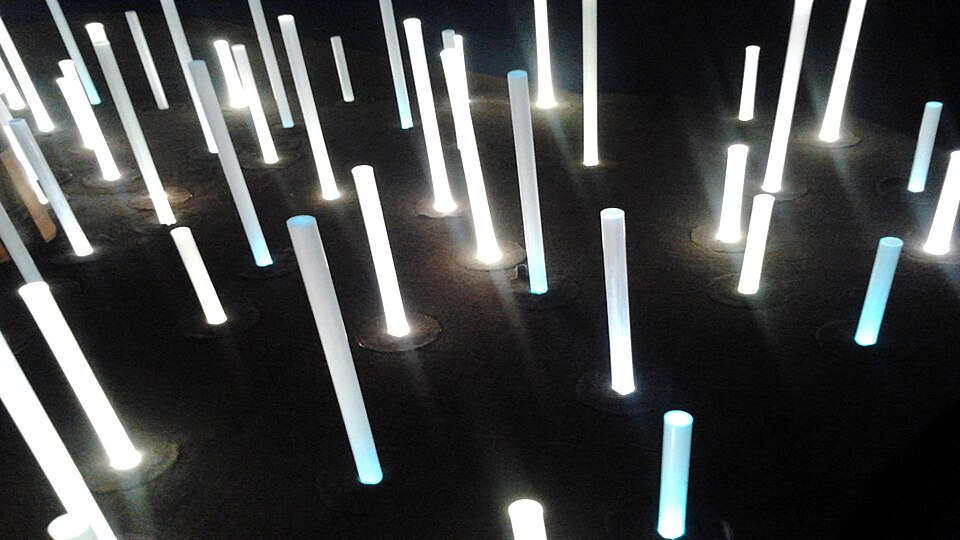</a></p>

- **类型**：瓶装日光灯 / Liter of Light
- **样式介绍**：利用透明瓶、水体折射或简易导光结构，把日光引入室内，强调低成本、材料再利用和社区可制作性。
- **设计观察**：适合观察瓶体、屋面开孔与采光角度的关系。
- **图片作者**：Edvaldo LL Souza
- **来源**：[Wikimedia Commons 原始文件页](https://commons.wikimedia.org/wiki/File:Exposicao_Lampada_de_Moser.jpg)
- **许可**：[CC BY-SA 4.0](https://creativecommons.org/licenses/by-sa/4.0)

### 002 · Moserlamp.jpg

<p align="center"><a href="https://commons.wikimedia.org/wiki/File:Moserlamp.jpg">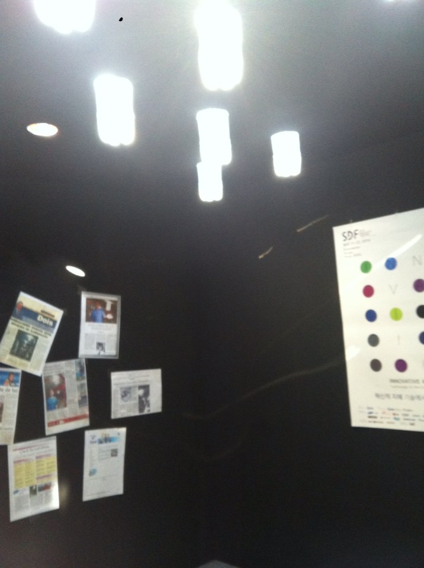</a></p>

- **类型**：瓶装日光灯 / Liter of Light
- **样式介绍**：利用透明瓶、水体折射或简易导光结构，把日光引入室内，强调低成本、材料再利用和社区可制作性。
- **设计观察**：重点在于用极少零件完成白天照明。
- **图片作者**：Leems330
- **来源**：[Wikimedia Commons 原始文件页](https://commons.wikimedia.org/wiki/File:Moserlamp.jpg)
- **许可**：[CC BY-SA 3.0](https://creativecommons.org/licenses/by-sa/3.0)

## 塑料瓶与再生容器灯

### 003 · Plastic Bottles and LED Lights repurposed as a chandelier during Ramadan in Muslim Quarter, Jerusalem 2011.jpg

<p align="center"><a href="https://commons.wikimedia.org/wiki/File:Plastic_Bottles_and_LED_Lights_repurposed_as_a_chandelier_during_Ramadan_in_Muslim_Quarter,_Jerusalem_2011.jpg">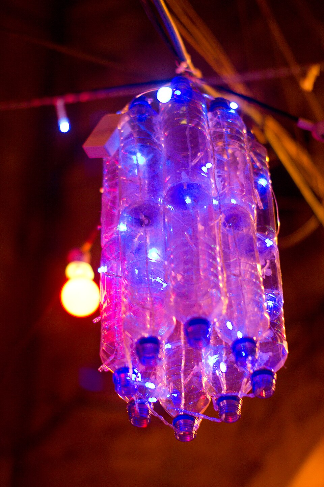</a></p>

- **类型**：塑料瓶与再生容器灯
- **样式介绍**：把废弃塑料瓶转化为采光构件、灯罩或装饰模块，减少一次性容器废弃并展示升级改造的可能性。
- **设计观察**：透明瓶体可承担导光、折射或扩散功能。
- **图片作者**：Victorgrigas
- **来源**：[Wikimedia Commons 原始文件页](https://commons.wikimedia.org/wiki/File:Plastic_Bottles_and_LED_Lights_repurposed_as_a_chandelier_during_Ramadan_in_Muslim_Quarter,_Jerusalem_2011.jpg)
- **许可**：[CC BY-SA 3.0](https://creativecommons.org/licenses/by-sa/3.0)

## 太阳能便携灯与灯笼

### 004 · 1965 Aristocrat Lo-Liner; Solar Light-Top Left.jpg

<p align="center"><a href="https://commons.wikimedia.org/wiki/File:1965_Aristocrat_Lo-Liner;_Solar_Light-Top_Left.jpg">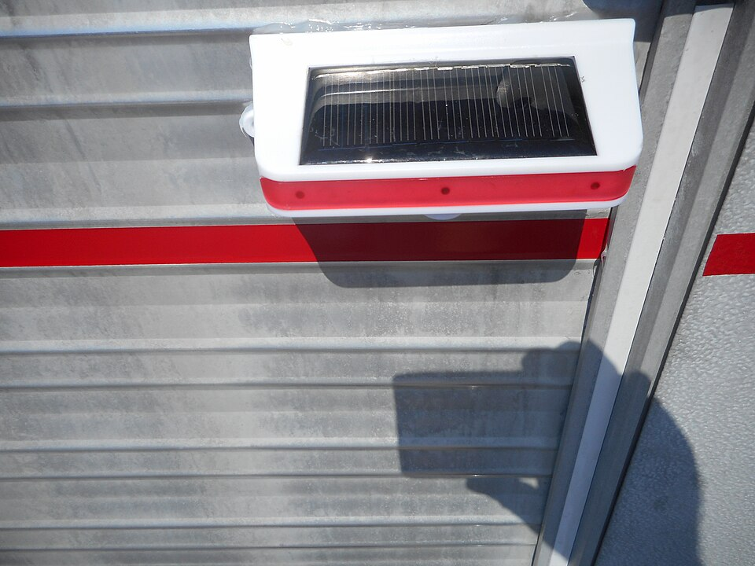</a></p>

- **类型**：太阳能便携灯与灯笼
- **样式介绍**：把小型光伏板、蓄电池和 LED 集成为便携照明，适用于离网家庭、露营、应急与社区学习场景。
- **设计观察**：便携提手与紧凑灯体方便在室内外转换使用。
- **图片作者**：DanTD
- **来源**：[Wikimedia Commons 原始文件页](https://commons.wikimedia.org/wiki/File:1965_Aristocrat_Lo-Liner;_Solar_Light-Top_Left.jpg)
- **许可**：[CC BY-SA 4.0](https://creativecommons.org/licenses/by-sa/4.0)

### 005 · 1965 Aristocrat Lo-Liner; Solar Light-Top Right.jpg

<p align="center"><a href="https://commons.wikimedia.org/wiki/File:1965_Aristocrat_Lo-Liner;_Solar_Light-Top_Right.jpg">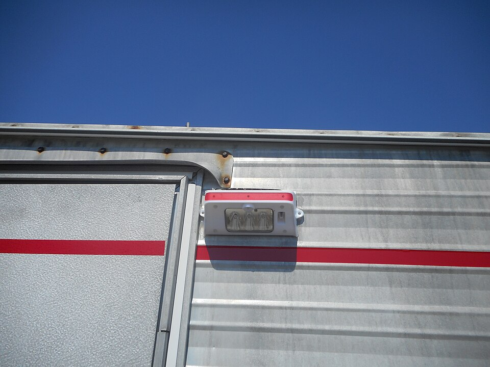</a></p>

- **类型**：太阳能便携灯与灯笼
- **样式介绍**：把小型光伏板、蓄电池和 LED 集成为便携照明，适用于离网家庭、露营、应急与社区学习场景。
- **设计观察**：一体式光伏供电减少一次性电池消耗。
- **图片作者**：DanTD
- **来源**：[Wikimedia Commons 原始文件页](https://commons.wikimedia.org/wiki/File:1965_Aristocrat_Lo-Liner;_Solar_Light-Top_Right.jpg)
- **许可**：[CC BY-SA 4.0](https://creativecommons.org/licenses/by-sa/4.0)

### 006 · 20230830 xl 1226-Solarstrassenleuchte Aron.jpg

<p align="center"><a href="https://commons.wikimedia.org/wiki/File:20230830_xl_1226-Solarstrassenleuchte_Aron.jpg">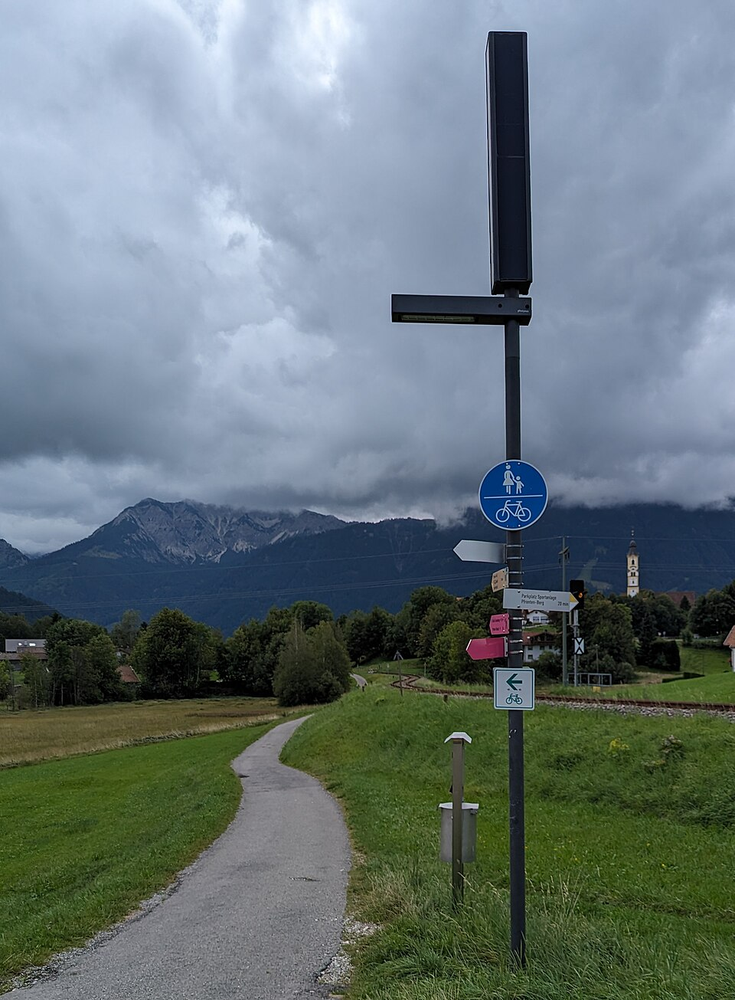</a></p>

- **类型**：太阳能便携灯与灯笼
- **样式介绍**：把小型光伏板、蓄电池和 LED 集成为便携照明，适用于离网家庭、露营、应急与社区学习场景。
- **设计观察**：扩散灯罩让低功率 LED 获得更均匀的照明。
- **图片作者**：Molgreen
- **来源**：[Wikimedia Commons 原始文件页](https://commons.wikimedia.org/wiki/File:20230830_xl_1226-Solarstrassenleuchte_Aron.jpg)
- **许可**：[CC BY-SA 4.0](https://creativecommons.org/licenses/by-sa/4.0)

### 007 · 6529. Kamran. Solar Lamp (2179357055).jpg

<p align="center"><a href="https://commons.wikimedia.org/wiki/File:6529._Kamran._Solar_Lamp_(2179357055).jpg">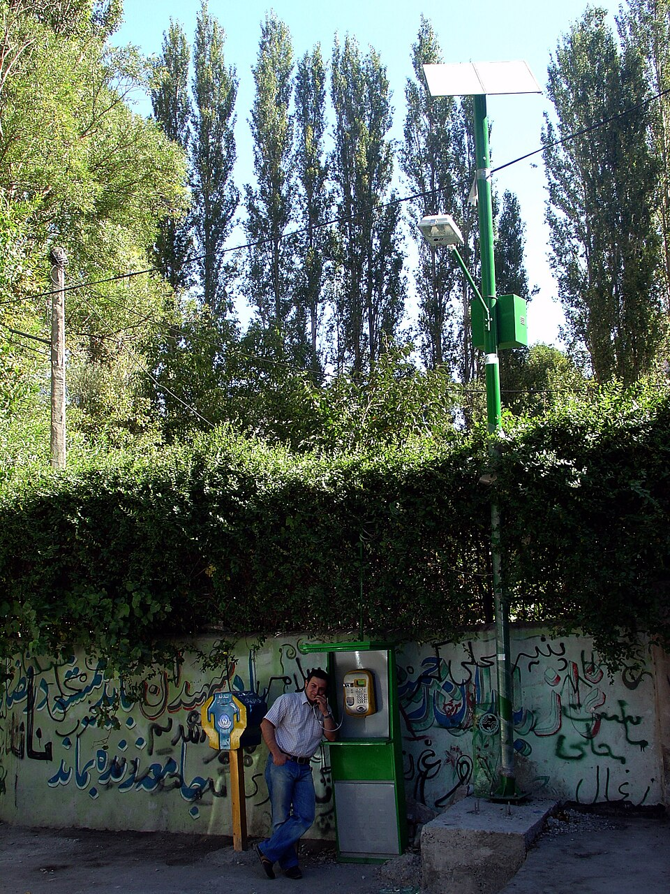</a></p>

- **类型**：太阳能便携灯与灯笼
- **样式介绍**：把小型光伏板、蓄电池和 LED 集成为便携照明，适用于离网家庭、露营、应急与社区学习场景。
- **设计观察**：适合无稳定电网地区的模块化照明设计。
- **图片作者**：Ensie & Matthias from San Diego, California, USA
- **来源**：[Wikimedia Commons 原始文件页](https://commons.wikimedia.org/wiki/File:6529._Kamran._Solar_Lamp_(2179357055).jpg)
- **许可**：[CC BY-SA 2.0](https://creativecommons.org/licenses/by-sa/2.0)

### 008 · 6531. Solar Lamp (2179359325).jpg

<p align="center"><a href="https://commons.wikimedia.org/wiki/File:6531._Solar_Lamp_(2179359325).jpg">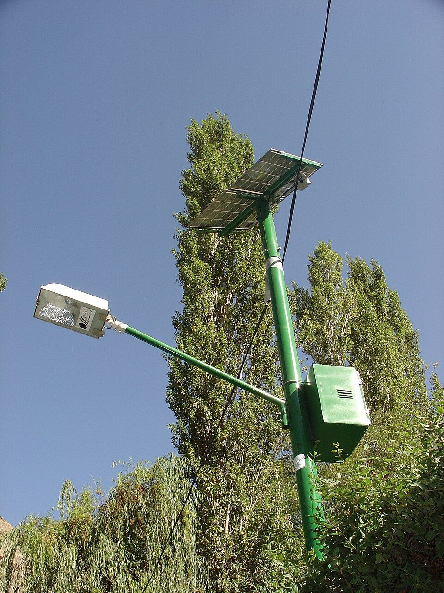</a></p>

- **类型**：太阳能便携灯与灯笼
- **样式介绍**：把小型光伏板、蓄电池和 LED 集成为便携照明，适用于离网家庭、露营、应急与社区学习场景。
- **设计观察**：便携提手与紧凑灯体方便在室内外转换使用。
- **图片作者**：Ensie & Matthias from San Diego, California, USA
- **来源**：[Wikimedia Commons 原始文件页](https://commons.wikimedia.org/wiki/File:6531._Solar_Lamp_(2179359325).jpg)
- **许可**：[CC BY-SA 2.0](https://creativecommons.org/licenses/by-sa/2.0)

### 009 · Barattolo-lampada solare e lampade variopinte decorative (Fai da te).jpg

<p align="center"><a href="https://commons.wikimedia.org/wiki/File:Barattolo-lampada_solare_e_lampade_variopinte_decorative_(Fai_da_te).jpg">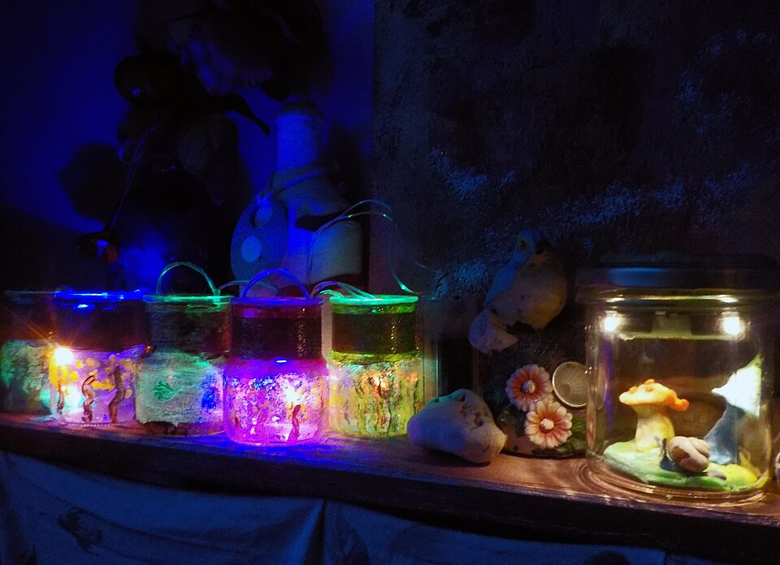</a></p>

- **类型**：太阳能便携灯与灯笼
- **样式介绍**：把小型光伏板、蓄电池和 LED 集成为便携照明，适用于离网家庭、露营、应急与社区学习场景。
- **设计观察**：一体式光伏供电减少一次性电池消耗。
- **图片作者**：Albarubescens
- **来源**：[Wikimedia Commons 原始文件页](https://commons.wikimedia.org/wiki/File:Barattolo-lampada_solare_e_lampade_variopinte_decorative_(Fai_da_te).jpg)
- **许可**：[CC BY-SA 4.0](https://creativecommons.org/licenses/by-sa/4.0)

### 010 · Children Studying by Solar Light (19484599412).jpg

<p align="center"><a href="https://commons.wikimedia.org/wiki/File:Children_Studying_by_Solar_Light_(19484599412).jpg">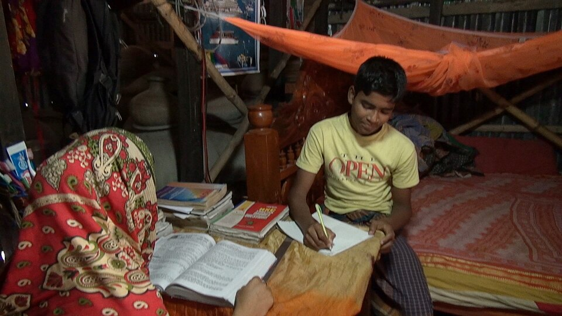</a></p>

- **类型**：太阳能便携灯与灯笼
- **样式介绍**：把小型光伏板、蓄电池和 LED 集成为便携照明，适用于离网家庭、露营、应急与社区学习场景。
- **设计观察**：扩散灯罩让低功率 LED 获得更均匀的照明。
- **图片作者**：Helena Wright
- **来源**：[Wikimedia Commons 原始文件页](https://commons.wikimedia.org/wiki/File:Children_Studying_by_Solar_Light_(19484599412).jpg)
- **许可**：[CC BY 2.0](https://creativecommons.org/licenses/by/2.0)

### 011 · Christopher from Zambia studying by the light of a solar lamp.jpg

<p align="center"><a href="https://commons.wikimedia.org/wiki/File:Christopher_from_Zambia_studying_by_the_light_of_a_solar_lamp.jpg">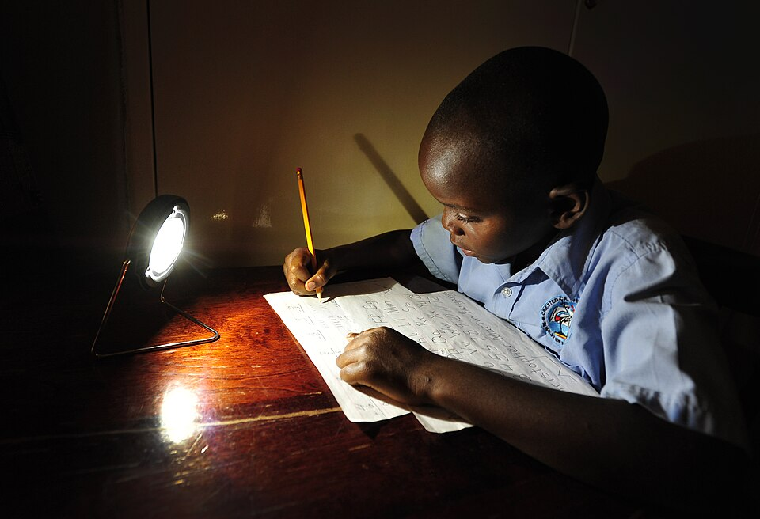</a></p>

- **类型**：太阳能便携灯与灯笼
- **样式介绍**：把小型光伏板、蓄电池和 LED 集成为便携照明，适用于离网家庭、露营、应急与社区学习场景。
- **设计观察**：适合无稳定电网地区的模块化照明设计。
- **图片作者**：Patrick Bentley
- **来源**：[Wikimedia Commons 原始文件页](https://commons.wikimedia.org/wiki/File:Christopher_from_Zambia_studying_by_the_light_of_a_solar_lamp.jpg)
- **许可**：[CC BY 2.0](https://creativecommons.org/licenses/by/2.0)

### 012 · Faretto solare Redentore Cuglieri.jpg

<p align="center"><a href="https://commons.wikimedia.org/wiki/File:Faretto_solare_Redentore_Cuglieri.jpg">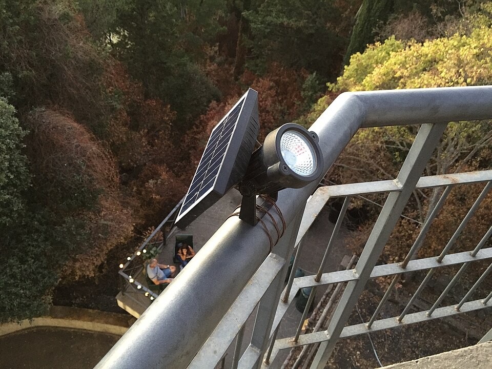</a></p>

- **类型**：太阳能便携灯与灯笼
- **样式介绍**：把小型光伏板、蓄电池和 LED 集成为便携照明，适用于离网家庭、露营、应急与社区学习场景。
- **设计观察**：便携提手与紧凑灯体方便在室内外转换使用。
- **图片作者**：Air fans
- **来源**：[Wikimedia Commons 原始文件页](https://commons.wikimedia.org/wiki/File:Faretto_solare_Redentore_Cuglieri.jpg)
- **许可**：[CC BY-SA 4.0](https://creativecommons.org/licenses/by-sa/4.0)

### 013 · Fünf leuchtende Solarlaternen nach Einbruch der Dunkelheit.jpg

<p align="center"><a href="https://commons.wikimedia.org/wiki/File:F%C3%BCnf_leuchtende_Solarlaternen_nach_Einbruch_der_Dunkelheit.jpg">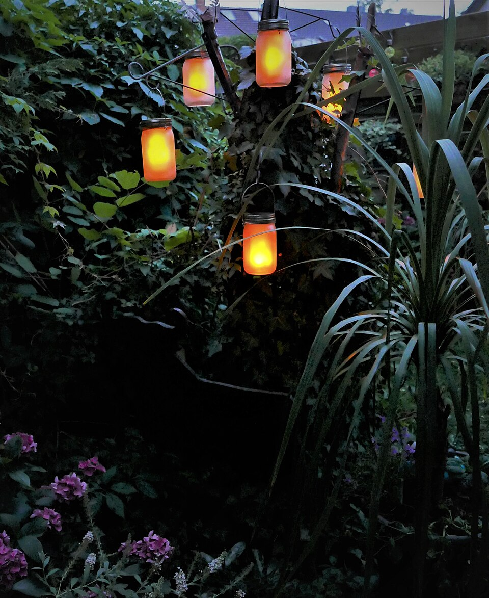</a></p>

- **类型**：太阳能便携灯与灯笼
- **样式介绍**：把小型光伏板、蓄电池和 LED 集成为便携照明，适用于离网家庭、露营、应急与社区学习场景。
- **设计观察**：一体式光伏供电减少一次性电池消耗。
- **图片作者**：Gordito1869
- **来源**：[Wikimedia Commons 原始文件页](https://commons.wikimedia.org/wiki/File:F%C3%BCnf_leuchtende_Solarlaternen_nach_Einbruch_der_Dunkelheit.jpg)
- **许可**：[CC BY-SA 4.0](https://creativecommons.org/licenses/by-sa/4.0)

### 014 · Hei solar light champ 1.jpg

<p align="center"><a href="https://commons.wikimedia.org/wiki/File:Hei_solar_light_champ_1.jpg">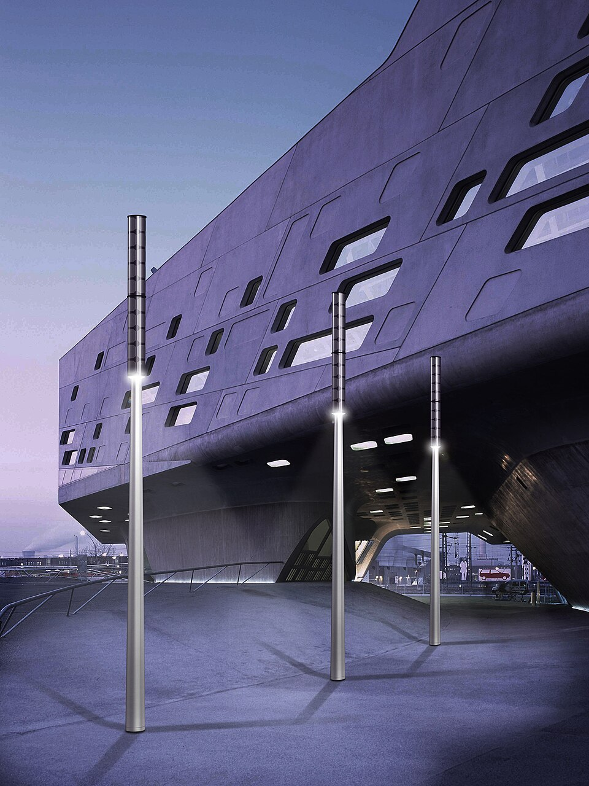</a></p>

- **类型**：太阳能便携灯与灯笼
- **样式介绍**：把小型光伏板、蓄电池和 LED 集成为便携照明，适用于离网家庭、露营、应急与社区学习场景。
- **设计观察**：扩散灯罩让低功率 LED 获得更均匀的照明。
- **图片作者**：Karin Legat
- **来源**：[Wikimedia Commons 原始文件页](https://commons.wikimedia.org/wiki/File:Hei_solar_light_champ_1.jpg)
- **许可**：Public domain

### 015 · HK SKD TKO 將軍澳南 Tseung Kwan O South Promenade 海濱 bay Solar lamp at construction site June 2022 Px3.jpg

<p align="center"><a href="https://commons.wikimedia.org/wiki/File:HK_SKD_TKO_%E5%B0%87%E8%BB%8D%E6%BE%B3%E5%8D%97_Tseung_Kwan_O_South_Promenade_%E6%B5%B7%E6%BF%B1_bay_Solar_lamp_at_construction_site_June_2022_Px3.jpg">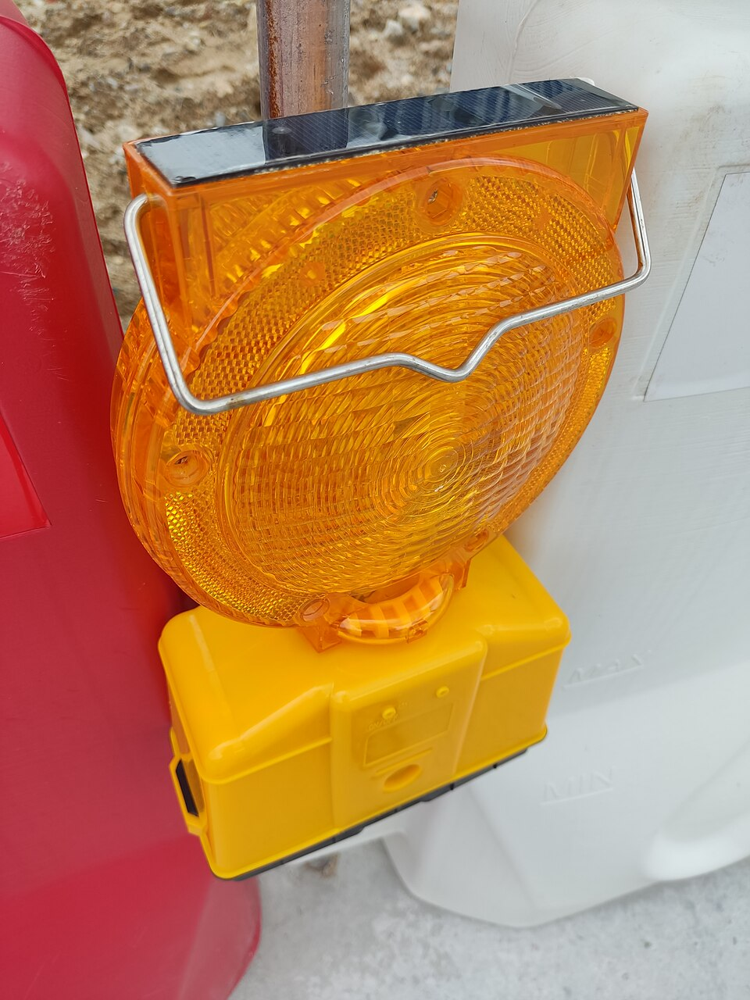</a></p>

- **类型**：太阳能便携灯与灯笼
- **样式介绍**：把小型光伏板、蓄电池和 LED 集成为便携照明，适用于离网家庭、露营、应急与社区学习场景。
- **设计观察**：适合无稳定电网地区的模块化照明设计。
- **图片作者**：Nadihauming Hong
- **来源**：[Wikimedia Commons 原始文件页](https://commons.wikimedia.org/wiki/File:HK_SKD_TKO_%E5%B0%87%E8%BB%8D%E6%BE%B3%E5%8D%97_Tseung_Kwan_O_South_Promenade_%E6%B5%B7%E6%BF%B1_bay_Solar_lamp_at_construction_site_June_2022_Px3.jpg)
- **许可**：[CC BY-SA 4.0](https://creativecommons.org/licenses/by-sa/4.0)

### 016 · Lampada solare 1.jpg

<p align="center"><a href="https://commons.wikimedia.org/wiki/File:Lampada_solare_1.jpg">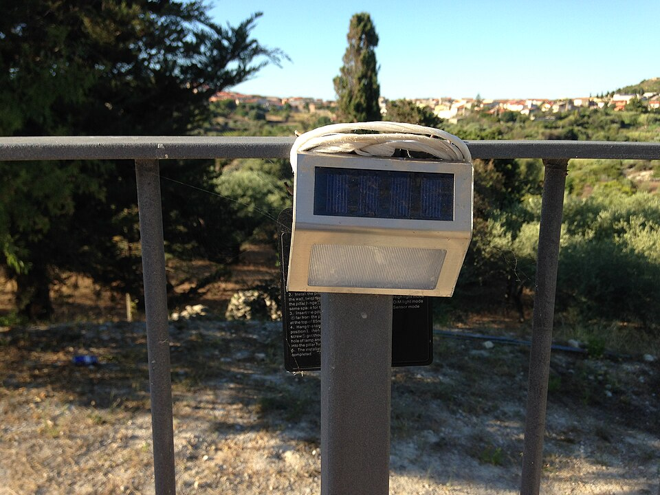</a></p>

- **类型**：太阳能便携灯与灯笼
- **样式介绍**：把小型光伏板、蓄电池和 LED 集成为便携照明，适用于离网家庭、露营、应急与社区学习场景。
- **设计观察**：便携提手与紧凑灯体方便在室内外转换使用。
- **图片作者**：Antonio Mette
- **来源**：[Wikimedia Commons 原始文件页](https://commons.wikimedia.org/wiki/File:Lampada_solare_1.jpg)
- **许可**：[CC BY-SA 4.0](https://creativecommons.org/licenses/by-sa/4.0)

### 017 · Lampada solare 2.jpg

<p align="center"><a href="https://commons.wikimedia.org/wiki/File:Lampada_solare_2.jpg">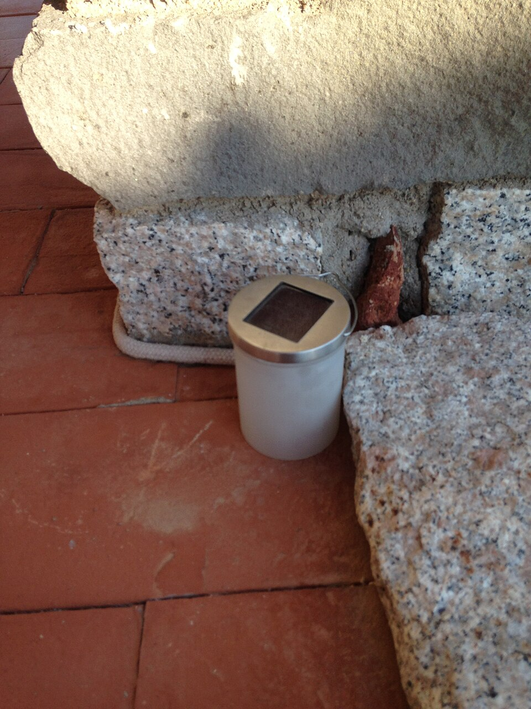</a></p>

- **类型**：太阳能便携灯与灯笼
- **样式介绍**：把小型光伏板、蓄电池和 LED 集成为便携照明，适用于离网家庭、露营、应急与社区学习场景。
- **设计观察**：一体式光伏供电减少一次性电池消耗。
- **图片作者**：Antonio Mette
- **来源**：[Wikimedia Commons 原始文件页](https://commons.wikimedia.org/wiki/File:Lampada_solare_2.jpg)
- **许可**：[CC BY-SA 4.0](https://creativecommons.org/licenses/by-sa/4.0)

### 018 · Lampada solare 5.jpg

<p align="center"><a href="https://commons.wikimedia.org/wiki/File:Lampada_solare_5.jpg">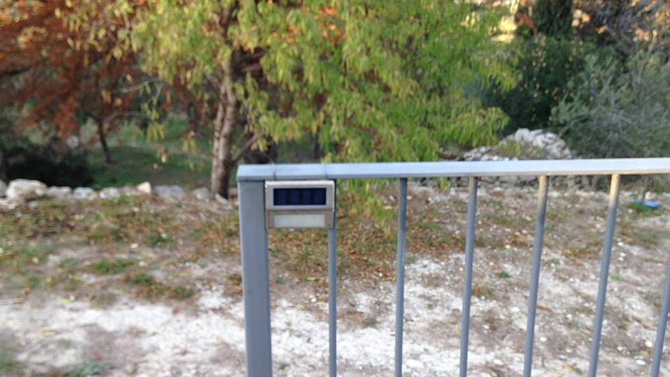</a></p>

- **类型**：太阳能便携灯与灯笼
- **样式介绍**：把小型光伏板、蓄电池和 LED 集成为便携照明，适用于离网家庭、露营、应急与社区学习场景。
- **设计观察**：扩散灯罩让低功率 LED 获得更均匀的照明。
- **图片作者**：Air fans
- **来源**：[Wikimedia Commons 原始文件页](https://commons.wikimedia.org/wiki/File:Lampada_solare_5.jpg)
- **许可**：[CC BY-SA 4.0](https://creativecommons.org/licenses/by-sa/4.0)

## 太阳能路灯

### 019 · 20160913 xl IMG 3628-LED-Strassenlampen-mit-Solarzellen-und-Windkraftanlage-in-Dziwnów-(deutsch Dievenow)-in-Polen--Fotograf-Charlotte-K.jpg

<p align="center"><a href="https://commons.wikimedia.org/wiki/File:20160913_xl_IMG_3628-LED-Strassenlampen-mit-Solarzellen-und-Windkraftanlage-in-Dziwn%C3%B3w-(deutsch_Dievenow)-in-Polen--Fotograf-Charlotte-K.jpg">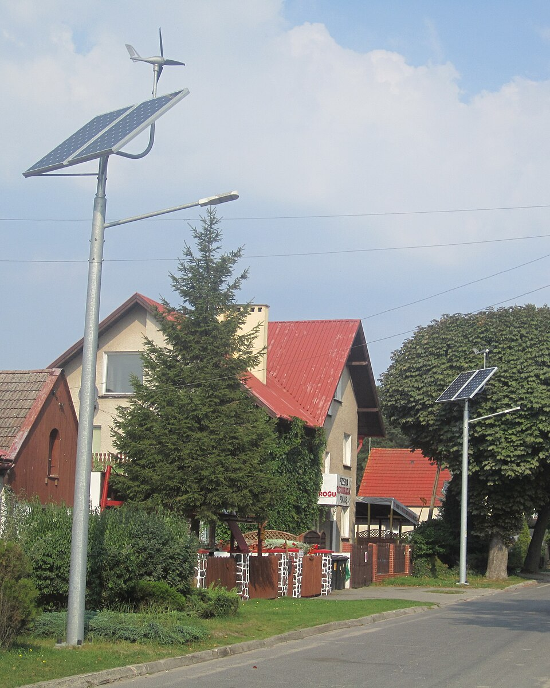</a></p>

- **类型**：太阳能路灯
- **样式介绍**：通过独立光伏板、储能与高效灯头形成离网公共照明，可减少布线与夜间用电负担。
- **设计观察**：可比较分体式和一体式光伏板的结构差异。
- **图片作者**：Charlotte K
- **来源**：[Wikimedia Commons 原始文件页](https://commons.wikimedia.org/wiki/File:20160913_xl_IMG_3628-LED-Strassenlampen-mit-Solarzellen-und-Windkraftanlage-in-Dziwn%C3%B3w-(deutsch_Dievenow)-in-Polen--Fotograf-Charlotte-K.jpg)
- **许可**：[CC BY-SA 4.0](https://creativecommons.org/licenses/by-sa/4.0)

### 020 · 20221003 xl 153056987-Strasselampe-mit-Solarzellen-und-Windkraftanlage-in-Bad-Harzburg.jpg

<p align="center"><a href="https://commons.wikimedia.org/wiki/File:20221003_xl_153056987-Strasselampe-mit-Solarzellen-und-Windkraftanlage-in-Bad-Harzburg.jpg">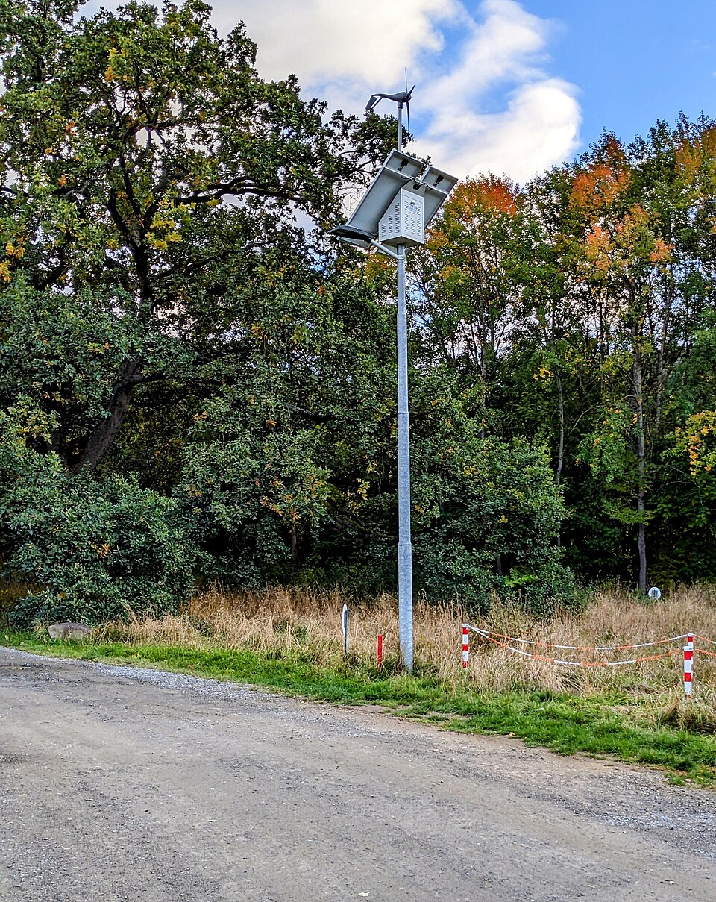</a></p>

- **类型**：太阳能路灯
- **样式介绍**：通过独立光伏板、储能与高效灯头形成离网公共照明，可减少布线与夜间用电负担。
- **设计观察**：灯杆高度与面板朝向共同影响照明与发电效率。
- **图片作者**：Molgreen
- **来源**：[Wikimedia Commons 原始文件页](https://commons.wikimedia.org/wiki/File:20221003_xl_153056987-Strasselampe-mit-Solarzellen-und-Windkraftanlage-in-Bad-Harzburg.jpg)
- **许可**：[CC BY-SA 4.0](https://creativecommons.org/licenses/by-sa/4.0)

### 021 · 20230831 xl 1613-solare LED Straßenlaterne.jpg

<p align="center"><a href="https://commons.wikimedia.org/wiki/File:20230831_xl_1613-solare_LED_Stra%C3%9Fenlaterne.jpg">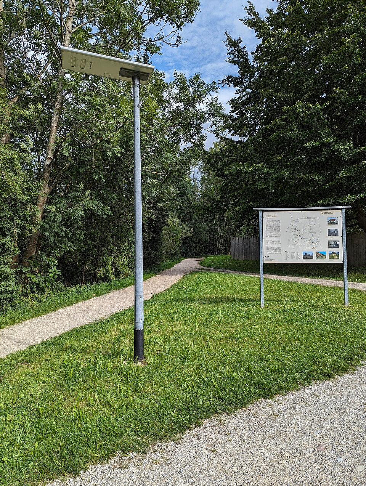</a></p>

- **类型**：太阳能路灯
- **样式介绍**：通过独立光伏板、储能与高效灯头形成离网公共照明，可减少布线与夜间用电负担。
- **设计观察**：适合道路、步道、社区广场等公共空间。
- **图片作者**：Molgreen
- **来源**：[Wikimedia Commons 原始文件页](https://commons.wikimedia.org/wiki/File:20230831_xl_1613-solare_LED_Stra%C3%9Fenlaterne.jpg)
- **许可**：[CC BY-SA 4.0](https://creativecommons.org/licenses/by-sa/4.0)

### 022 · A pier with street lamps running on solar energy, Victoria, British Columbia, Canada 02.jpg

<p align="center"><a href="https://commons.wikimedia.org/wiki/File:A_pier_with_street_lamps_running_on_solar_energy,_Victoria,_British_Columbia,_Canada_02.jpg">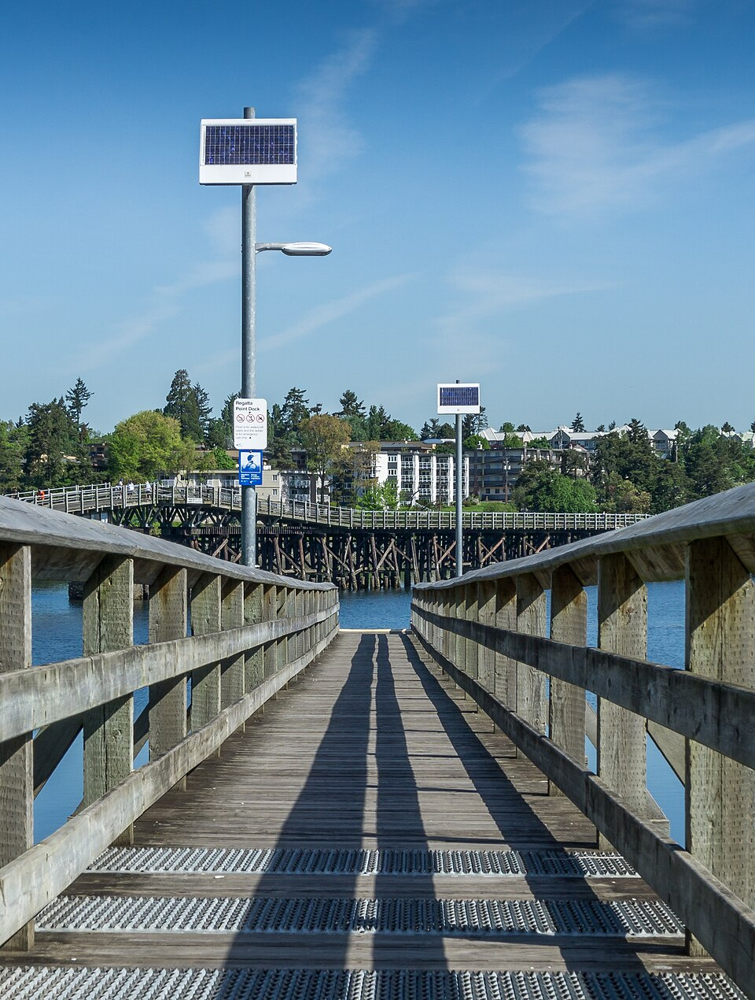</a></p>

- **类型**：太阳能路灯
- **样式介绍**：通过独立光伏板、储能与高效灯头形成离网公共照明，可减少布线与夜间用电负担。
- **设计观察**：部分方案结合风能，展示多能源互补思路。
- **图片作者**：Michal Klajban
- **来源**：[Wikimedia Commons 原始文件页](https://commons.wikimedia.org/wiki/File:A_pier_with_street_lamps_running_on_solar_energy,_Victoria,_British_Columbia,_Canada_02.jpg)
- **许可**：[CC BY-SA 4.0](https://creativecommons.org/licenses/by-sa/4.0)

### 023 · Ady Straße, Straßenlampe mit Solarzelle, 2021 Gyál.jpg

<p align="center"><a href="https://commons.wikimedia.org/wiki/File:Ady_Stra%C3%9Fe,_Stra%C3%9Fenlampe_mit_Solarzelle,_2021_Gy%C3%A1l.jpg">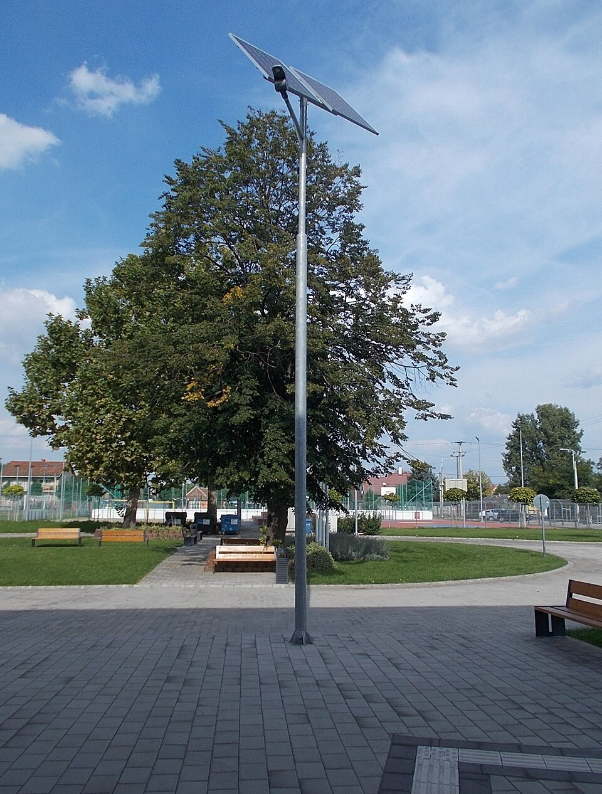</a></p>

- **类型**：太阳能路灯
- **样式介绍**：通过独立光伏板、储能与高效灯头形成离网公共照明，可减少布线与夜间用电负担。
- **设计观察**：可比较分体式和一体式光伏板的结构差异。
- **图片作者**：Globetrotter19
- **来源**：[Wikimedia Commons 原始文件页](https://commons.wikimedia.org/wiki/File:Ady_Stra%C3%9Fe,_Stra%C3%9Fenlampe_mit_Solarzelle,_2021_Gy%C3%A1l.jpg)
- **许可**：[CC BY-SA 3.0](https://creativecommons.org/licenses/by-sa/3.0)

### 024 · Ariana Park Solar Lights.JPG

<p align="center"><a href="https://commons.wikimedia.org/wiki/File:Ariana_Park_Solar_Lights.JPG">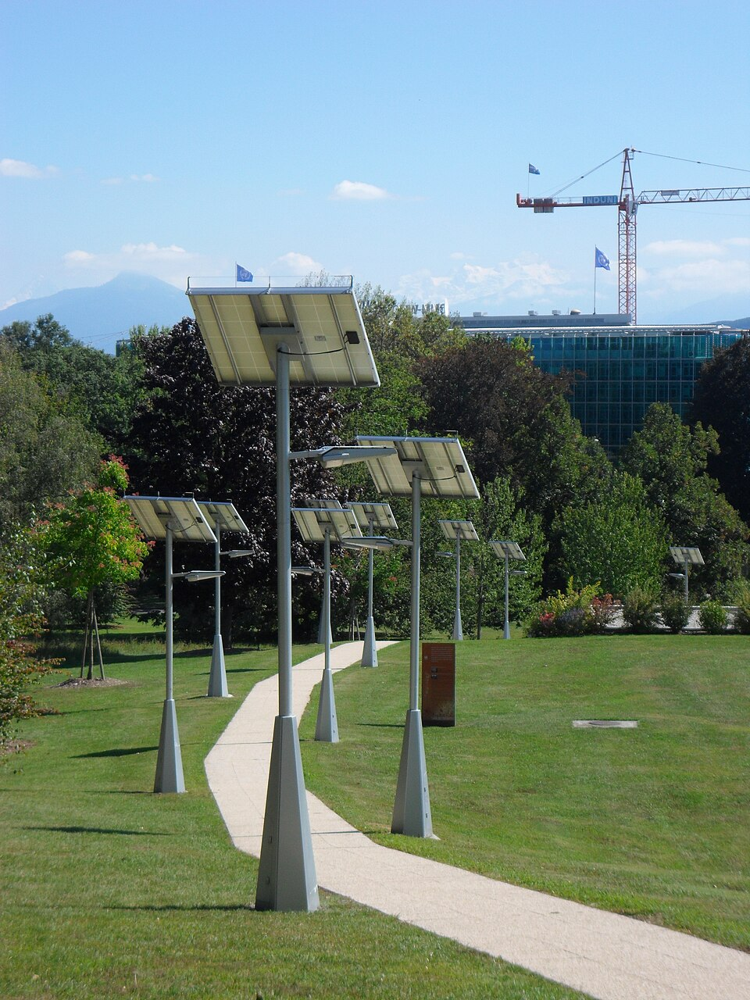</a></p>

- **类型**：太阳能路灯
- **样式介绍**：通过独立光伏板、储能与高效灯头形成离网公共照明，可减少布线与夜间用电负担。
- **设计观察**：灯杆高度与面板朝向共同影响照明与发电效率。
- **图片作者**：Credits to Mourad Ben Abdallah / Wikimedia Commons
- **来源**：[Wikimedia Commons 原始文件页](https://commons.wikimedia.org/wiki/File:Ariana_Park_Solar_Lights.JPG)
- **许可**：[CC BY-SA 3.0](https://creativecommons.org/licenses/by-sa/3.0)

### 025 · BS Solar Wind Street Light.JPG

<p align="center"><a href="https://commons.wikimedia.org/wiki/File:BS_Solar_Wind_Street_Light.JPG">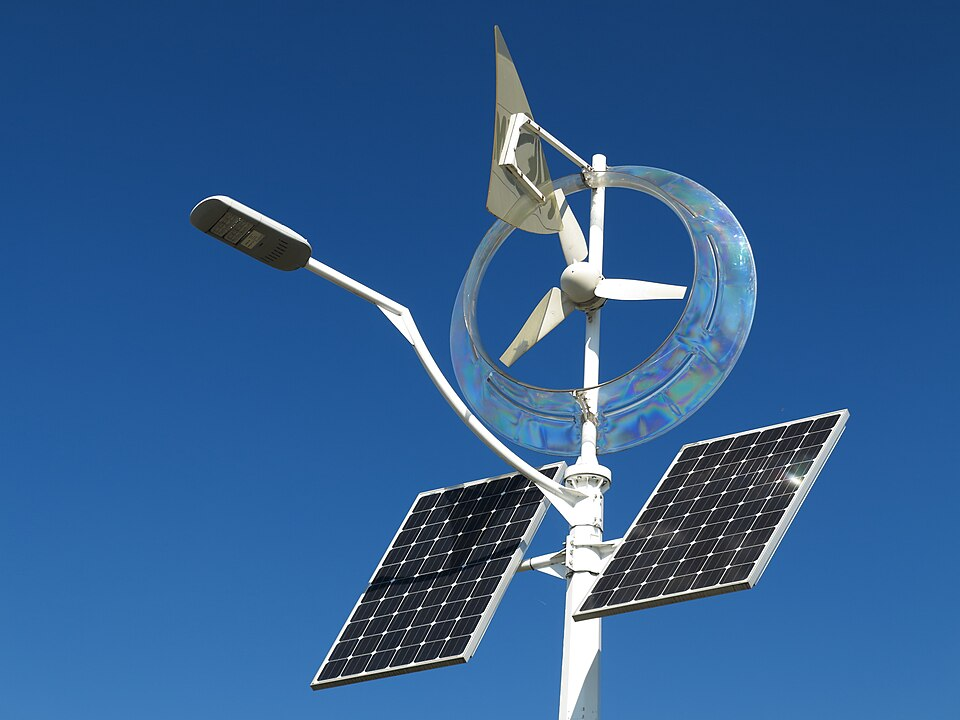</a></p>

- **类型**：太阳能路灯
- **样式介绍**：通过独立光伏板、储能与高效灯头形成离网公共照明，可减少布线与夜间用电负担。
- **设计观察**：适合道路、步道、社区广场等公共空间。
- **图片作者**：TeWeBs
- **来源**：[Wikimedia Commons 原始文件页](https://commons.wikimedia.org/wiki/File:BS_Solar_Wind_Street_Light.JPG)
- **许可**：[CC BY-SA 4.0](https://creativecommons.org/licenses/by-sa/4.0)

### 026 · DEGAN Gabin (solar street lights).jpg

<p align="center"><a href="https://commons.wikimedia.org/wiki/File:DEGAN_Gabin_(solar_street_lights).jpg">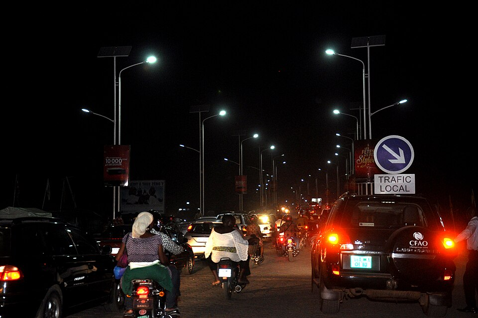</a></p>

- **类型**：太阳能路灯
- **样式介绍**：通过独立光伏板、储能与高效灯头形成离网公共照明，可减少布线与夜间用电负担。
- **设计观察**：部分方案结合风能，展示多能源互补思路。
- **图片作者**：DEGAN Gabin
- **来源**：[Wikimedia Commons 原始文件页](https://commons.wikimedia.org/wiki/File:DEGAN_Gabin_(solar_street_lights).jpg)
- **许可**：[CC BY-SA 4.0](https://creativecommons.org/licenses/by-sa/4.0)

### 027 · Kossuth Straße und Károlyi Straße Ecke, Lampe, Solarpanel, 2021 Gyál.jpg

<p align="center"><a href="https://commons.wikimedia.org/wiki/File:Kossuth_Stra%C3%9Fe_und_K%C3%A1rolyi_Stra%C3%9Fe_Ecke,_Lampe,_Solarpanel,_2021_Gy%C3%A1l.jpg">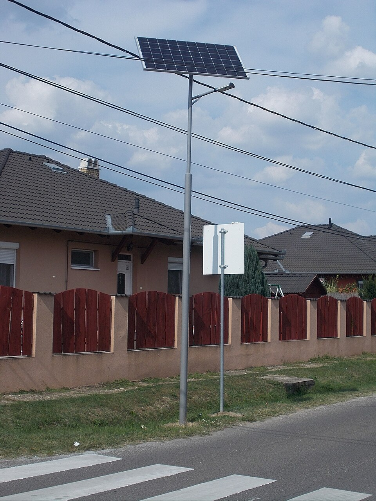</a></p>

- **类型**：太阳能路灯
- **样式介绍**：通过独立光伏板、储能与高效灯头形成离网公共照明，可减少布线与夜间用电负担。
- **设计观察**：可比较分体式和一体式光伏板的结构差异。
- **图片作者**：Globetrotter19
- **来源**：[Wikimedia Commons 原始文件页](https://commons.wikimedia.org/wiki/File:Kossuth_Stra%C3%9Fe_und_K%C3%A1rolyi_Stra%C3%9Fe_Ecke,_Lampe,_Solarpanel,_2021_Gy%C3%A1l.jpg)
- **许可**：[CC BY-SA 3.0](https://creativecommons.org/licenses/by-sa/3.0)

### 028 · Lampione solare a muro 1.jpg

<p align="center"><a href="https://commons.wikimedia.org/wiki/File:Lampione_solare_a_muro_1.jpg">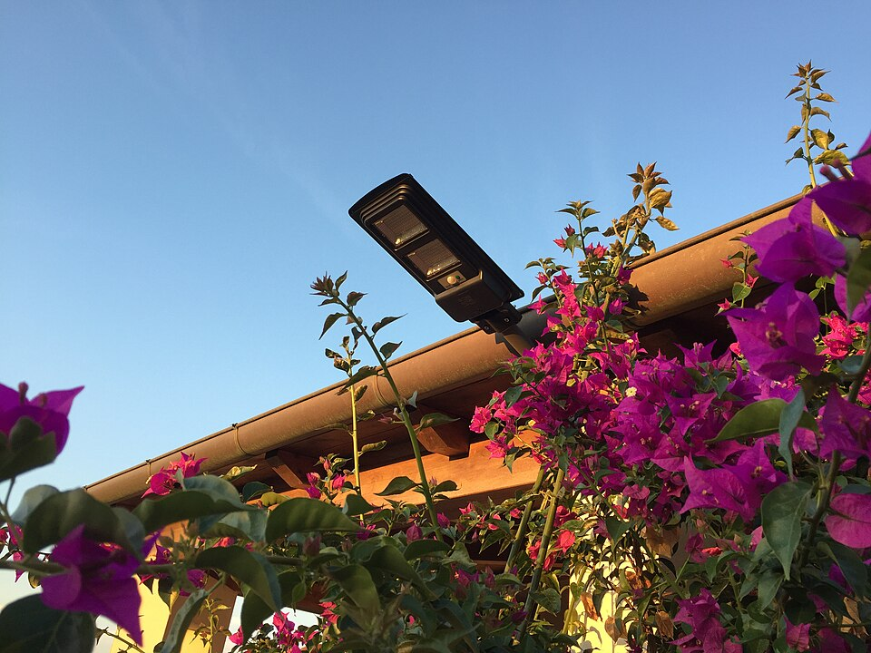</a></p>

- **类型**：太阳能路灯
- **样式介绍**：通过独立光伏板、储能与高效灯头形成离网公共照明，可减少布线与夜间用电负担。
- **设计观察**：灯杆高度与面板朝向共同影响照明与发电效率。
- **图片作者**：Air fans
- **来源**：[Wikimedia Commons 原始文件页](https://commons.wikimedia.org/wiki/File:Lampione_solare_a_muro_1.jpg)
- **许可**：[CC BY-SA 4.0](https://creativecommons.org/licenses/by-sa/4.0)

### 029 · Lampione solare a muro 2.jpg

<p align="center"><a href="https://commons.wikimedia.org/wiki/File:Lampione_solare_a_muro_2.jpg">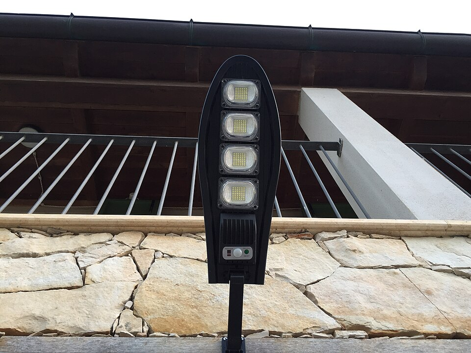</a></p>

- **类型**：太阳能路灯
- **样式介绍**：通过独立光伏板、储能与高效灯头形成离网公共照明，可减少布线与夜间用电负担。
- **设计观察**：适合道路、步道、社区广场等公共空间。
- **图片作者**：Air fans
- **来源**：[Wikimedia Commons 原始文件页](https://commons.wikimedia.org/wiki/File:Lampione_solare_a_muro_2.jpg)
- **许可**：[CC BY-SA 4.0](https://creativecommons.org/licenses/by-sa/4.0)

### 030 · Mammoth Lakes CA Solar Pathway Lighting.jpg

<p align="center"><a href="https://commons.wikimedia.org/wiki/File:Mammoth_Lakes_CA_Solar_Pathway_Lighting.jpg">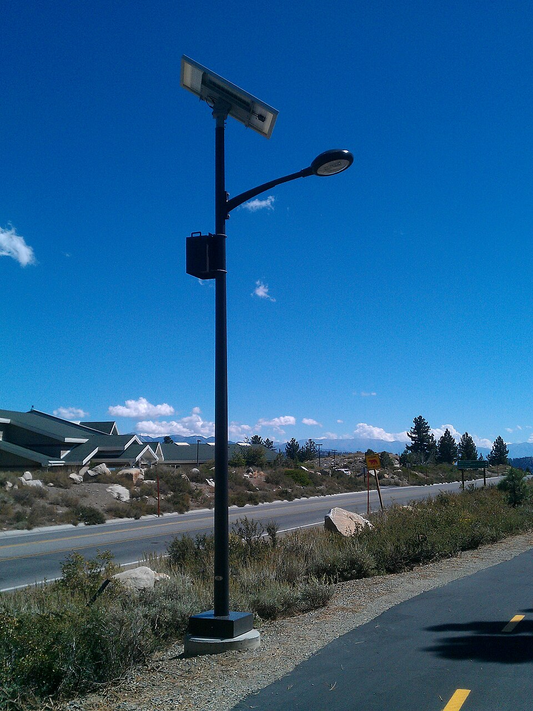</a></p>

- **类型**：太阳能路灯
- **样式介绍**：通过独立光伏板、储能与高效灯头形成离网公共照明，可减少布线与夜间用电负担。
- **设计观察**：部分方案结合风能，展示多能源互补思路。
- **图片作者**：Miltondawson
- **来源**：[Wikimedia Commons 原始文件页](https://commons.wikimedia.org/wiki/File:Mammoth_Lakes_CA_Solar_Pathway_Lighting.jpg)
- **许可**：[CC BY-SA 3.0](https://creativecommons.org/licenses/by-sa/3.0)

### 031 · Mammoth Lakes CA Solar Street Lights.jpg

<p align="center"><a href="https://commons.wikimedia.org/wiki/File:Mammoth_Lakes_CA_Solar_Street_Lights.jpg">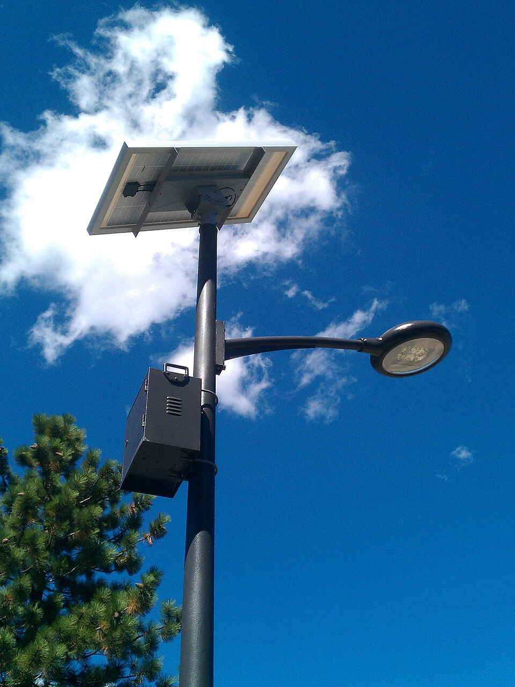</a></p>

- **类型**：太阳能路灯
- **样式介绍**：通过独立光伏板、储能与高效灯头形成离网公共照明，可减少布线与夜间用电负担。
- **设计观察**：可比较分体式和一体式光伏板的结构差异。
- **图片作者**：Miltondawson
- **来源**：[Wikimedia Commons 原始文件页](https://commons.wikimedia.org/wiki/File:Mammoth_Lakes_CA_Solar_Street_Lights.jpg)
- **许可**：[CC BY-SA 3.0](https://creativecommons.org/licenses/by-sa/3.0)

### 032 · Millennium Park, Gehweg, Solarzellen, 2021 Gyál.jpg

<p align="center"><a href="https://commons.wikimedia.org/wiki/File:Millennium_Park,_Gehweg,_Solarzellen,_2021_Gy%C3%A1l.jpg">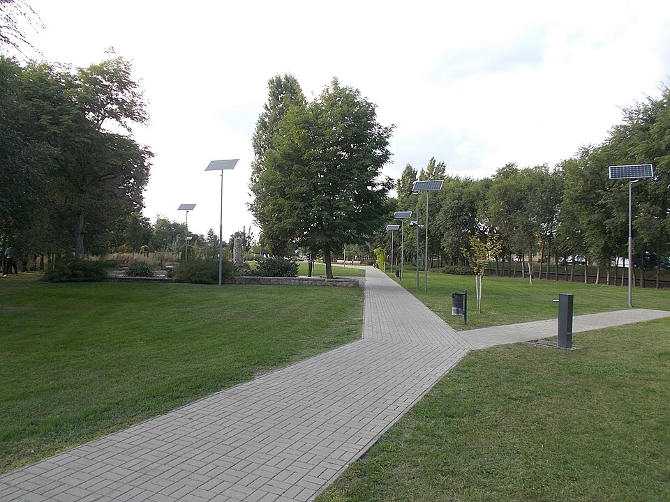</a></p>

- **类型**：太阳能路灯
- **样式介绍**：通过独立光伏板、储能与高效灯头形成离网公共照明，可减少布线与夜间用电负担。
- **设计观察**：灯杆高度与面板朝向共同影响照明与发电效率。
- **图片作者**：Globetrotter19
- **来源**：[Wikimedia Commons 原始文件页](https://commons.wikimedia.org/wiki/File:Millennium_Park,_Gehweg,_Solarzellen,_2021_Gy%C3%A1l.jpg)
- **许可**：[CC BY-SA 3.0](https://creativecommons.org/licenses/by-sa/3.0)

### 033 · Portable Solar Powered Street Light, Ebenezer Street, Bradford - geograph.org.uk - 7639084.jpg

<p align="center"><a href="https://commons.wikimedia.org/wiki/File:Portable_Solar_Powered_Street_Light,_Ebenezer_Street,_Bradford_-_geograph.org.uk_-_7639084.jpg">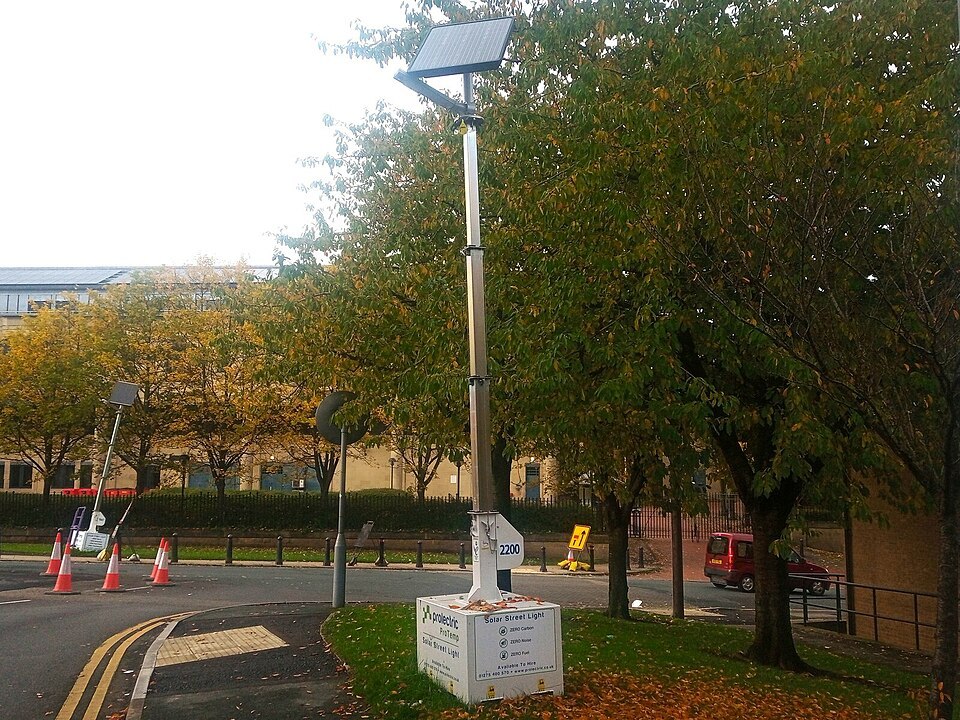</a></p>

- **类型**：太阳能路灯
- **样式介绍**：通过独立光伏板、储能与高效灯头形成离网公共照明，可减少布线与夜间用电负担。
- **设计观察**：适合道路、步道、社区广场等公共空间。
- **图片作者**：Stephen Armstrong
- **来源**：[Wikimedia Commons 原始文件页](https://commons.wikimedia.org/wiki/File:Portable_Solar_Powered_Street_Light,_Ebenezer_Street,_Bradford_-_geograph.org.uk_-_7639084.jpg)
- **许可**：[CC BY-SA 2.0](https://creativecommons.org/licenses/by-sa/2.0)

## 太阳能庭院与景观灯

### 034 · Bell Gardens Solar Cross-Walk Lighting.jpg

<p align="center"><a href="https://commons.wikimedia.org/wiki/File:Bell_Gardens_Solar_Cross-Walk_Lighting.jpg">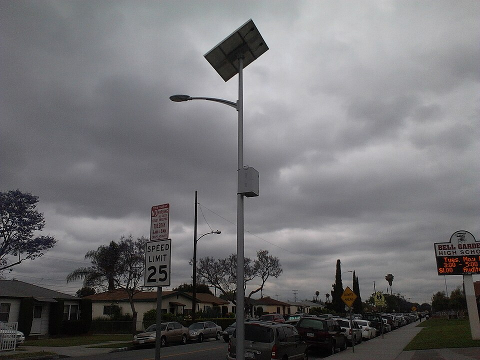</a></p>

- **类型**：太阳能庭院与景观灯
- **样式介绍**：小尺度光伏景观灯通常采用低照度 LED、自动感光和插地或悬挂结构，兼顾路径提示与氛围照明。
- **设计观察**：小型面板与灯罩融合，适合观察产品一体化设计。
- **图片作者**：Miltondawson
- **来源**：[Wikimedia Commons 原始文件页](https://commons.wikimedia.org/wiki/File:Bell_Gardens_Solar_Cross-Walk_Lighting.jpg)
- **许可**：[CC BY-SA 3.0](https://creativecommons.org/licenses/by-sa/3.0)

### 035 · Hanging small garden light 001.jpg

<p align="center"><a href="https://commons.wikimedia.org/wiki/File:Hanging_small_garden_light_001.jpg">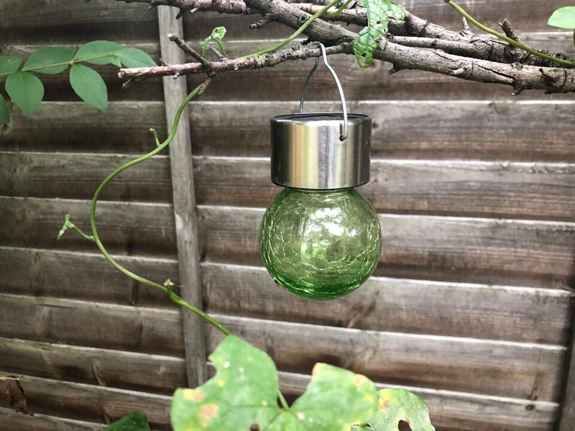</a></p>

- **类型**：太阳能庭院与景观灯
- **样式介绍**：小尺度光伏景观灯通常采用低照度 LED、自动感光和插地或悬挂结构，兼顾路径提示与氛围照明。
- **设计观察**：插地、壁挂和悬吊形式对应不同庭院场景。
- **图片作者**：Roger Bellver
- **来源**：[Wikimedia Commons 原始文件页](https://commons.wikimedia.org/wiki/File:Hanging_small_garden_light_001.jpg)
- **许可**：[CC BY-SA 4.0](https://creativecommons.org/licenses/by-sa/4.0)

### 036 · Hanging small garden light 002.jpg

<p align="center"><a href="https://commons.wikimedia.org/wiki/File:Hanging_small_garden_light_002.jpg">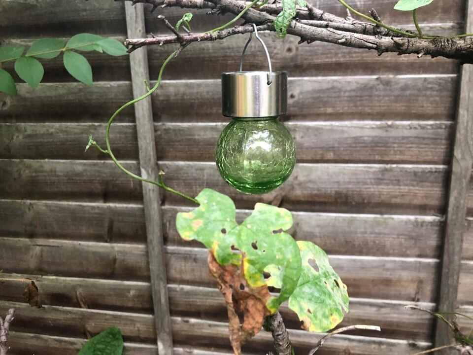</a></p>

- **类型**：太阳能庭院与景观灯
- **样式介绍**：小尺度光伏景观灯通常采用低照度 LED、自动感光和插地或悬挂结构，兼顾路径提示与氛围照明。
- **设计观察**：低亮度持续照明能兼顾能耗和夜间导向。
- **图片作者**：Roger Bellver
- **来源**：[Wikimedia Commons 原始文件页](https://commons.wikimedia.org/wiki/File:Hanging_small_garden_light_002.jpg)
- **许可**：[CC BY-SA 4.0](https://creativecommons.org/licenses/by-sa/4.0)

## 太阳能灯具综合样式

### 037 · Bird feeder and lamp covered in snow - 20230113.jpg

<p align="center"><a href="https://commons.wikimedia.org/wiki/File:Bird_feeder_and_lamp_covered_in_snow_-_20230113.jpg">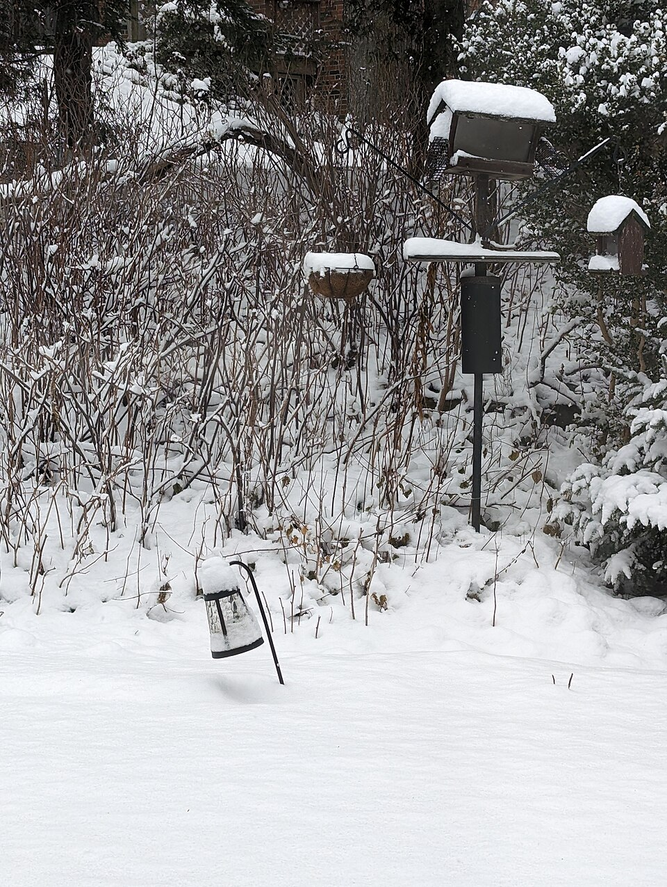</a></p>

- **类型**：太阳能灯具综合样式
- **样式介绍**：太阳能灯具把可再生能源直接转化为照明服务，涵盖家用灯、营地灯、工作灯和公共设施等多种形态。
- **设计观察**：展示光伏组件、储能和灯具之间的不同组合方式。
- **图片作者**：Sikander Iqbal
- **来源**：[Wikimedia Commons 原始文件页](https://commons.wikimedia.org/wiki/File:Bird_feeder_and_lamp_covered_in_snow_-_20230113.jpg)
- **许可**：[CC BY-SA 4.0](https://creativecommons.org/licenses/by-sa/4.0)

### 038 · City of London Cemetery and Crematorium - temporary grave decorations 06.jpg

<p align="center"><a href="https://commons.wikimedia.org/wiki/File:City_of_London_Cemetery_and_Crematorium_-_temporary_grave_decorations_06.jpg">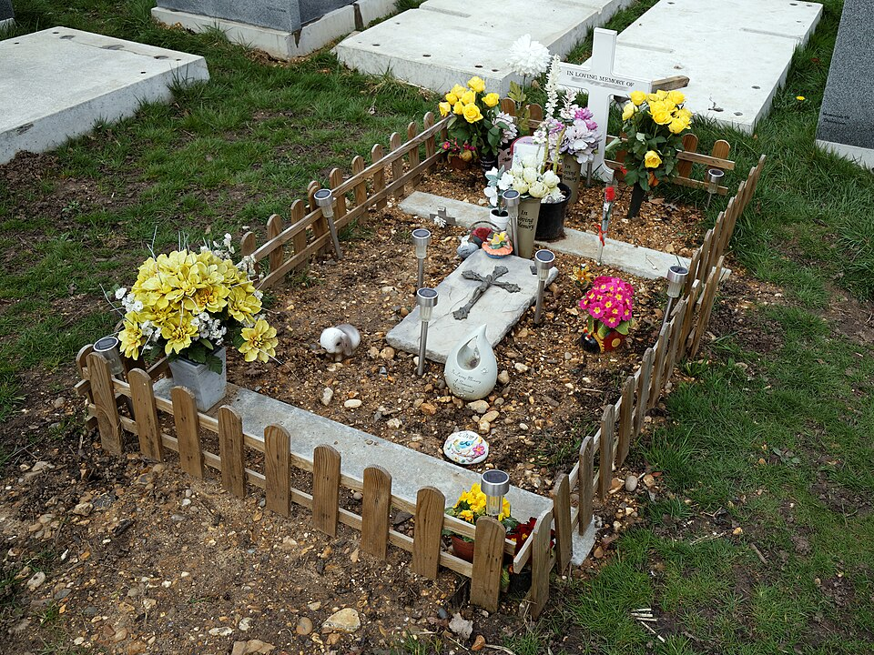</a></p>

- **类型**：太阳能灯具综合样式
- **样式介绍**：太阳能灯具把可再生能源直接转化为照明服务，涵盖家用灯、营地灯、工作灯和公共设施等多种形态。
- **设计观察**：可观察便携、固定与共享使用模式的差异。
- **图片作者**：Acabashi
- **来源**：[Wikimedia Commons 原始文件页](https://commons.wikimedia.org/wiki/File:City_of_London_Cemetery_and_Crematorium_-_temporary_grave_decorations_06.jpg)
- **许可**：[CC BY-SA 4.0](https://creativecommons.org/licenses/by-sa/4.0)

### 039 · City of London Cemetery and Crematorium - temporary plastic grave decorations 04.jpg

<p align="center"><a href="https://commons.wikimedia.org/wiki/File:City_of_London_Cemetery_and_Crematorium_-_temporary_plastic_grave_decorations_04.jpg">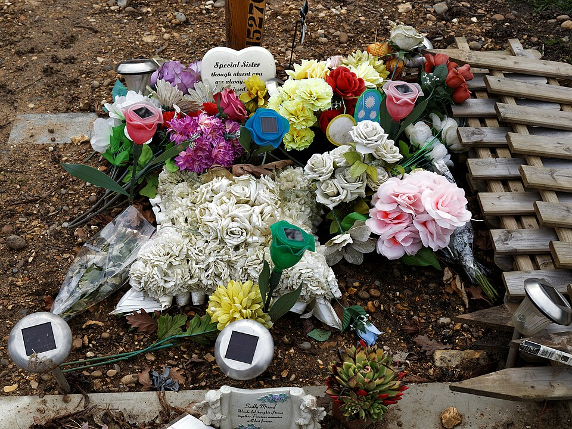</a></p>

- **类型**：太阳能灯具综合样式
- **样式介绍**：太阳能灯具把可再生能源直接转化为照明服务，涵盖家用灯、营地灯、工作灯和公共设施等多种形态。
- **设计观察**：不同外壳反映耐候、散热与维护需求。
- **图片作者**：Acabashi
- **来源**：[Wikimedia Commons 原始文件页](https://commons.wikimedia.org/wiki/File:City_of_London_Cemetery_and_Crematorium_-_temporary_plastic_grave_decorations_04.jpg)
- **许可**：[CC BY-SA 4.0](https://creativecommons.org/licenses/by-sa/4.0)

### 040 · Concrete night 6 (rubin-20160222-220040).jpg

<p align="center"><a href="https://commons.wikimedia.org/wiki/File:Concrete_night_6_(rubin-20160222-220040).jpg">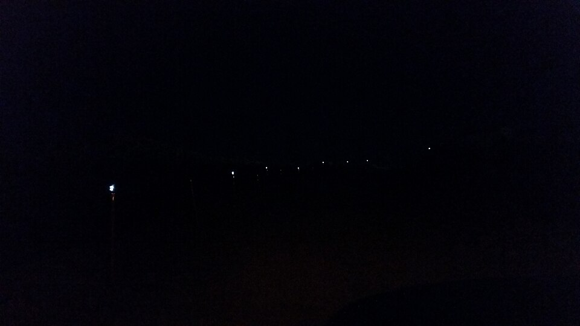</a></p>

- **类型**：太阳能灯具综合样式
- **样式介绍**：太阳能灯具把可再生能源直接转化为照明服务，涵盖家用灯、营地灯、工作灯和公共设施等多种形态。
- **设计观察**：适合作为离网照明产品的形态素材。
- **图片作者**：Rubin Observatory/NSF/AURA
- **来源**：[Wikimedia Commons 原始文件页](https://commons.wikimedia.org/wiki/File:Concrete_night_6_(rubin-20160222-220040).jpg)
- **许可**：[CC BY 4.0](https://creativecommons.org/licenses/by/4.0)

### 041 · Evergreen Cemetery grave for David Dock Thompson.jpg

<p align="center"><a href="https://commons.wikimedia.org/wiki/File:Evergreen_Cemetery_grave_for_David_Dock_Thompson.jpg">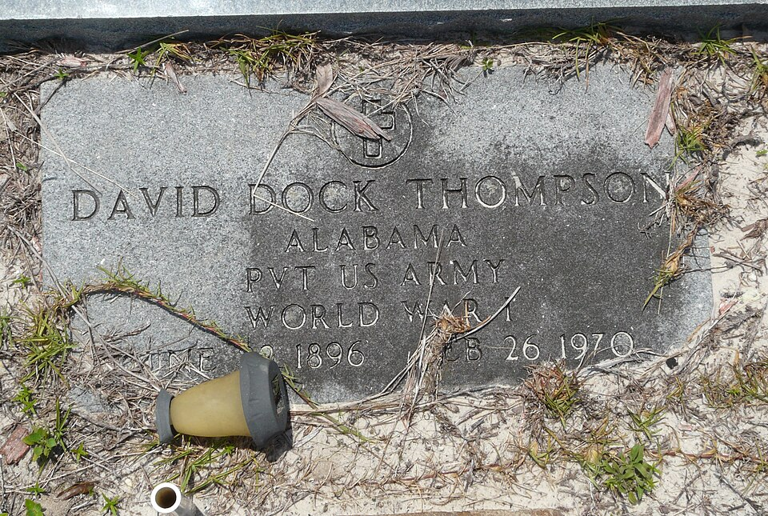</a></p>

- **类型**：太阳能灯具综合样式
- **样式介绍**：太阳能灯具把可再生能源直接转化为照明服务，涵盖家用灯、营地灯、工作灯和公共设施等多种形态。
- **设计观察**：展示光伏组件、储能和灯具之间的不同组合方式。
- **图片作者**：The Bushranger
- **来源**：[Wikimedia Commons 原始文件页](https://commons.wikimedia.org/wiki/File:Evergreen_Cemetery_grave_for_David_Dock_Thompson.jpg)
- **许可**：[CC BY-SA 4.0](https://creativecommons.org/licenses/by-sa/4.0)

### 042 · Evergreen Cemetery grave for Henry Albert Lee.jpg

<p align="center"><a href="https://commons.wikimedia.org/wiki/File:Evergreen_Cemetery_grave_for_Henry_Albert_Lee.jpg">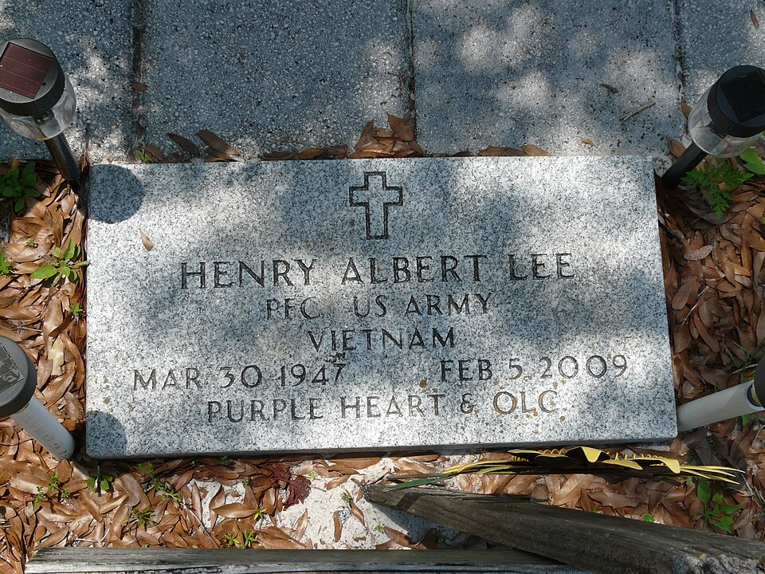</a></p>

- **类型**：太阳能灯具综合样式
- **样式介绍**：太阳能灯具把可再生能源直接转化为照明服务，涵盖家用灯、营地灯、工作灯和公共设施等多种形态。
- **设计观察**：可观察便携、固定与共享使用模式的差异。
- **图片作者**：The Bushranger
- **来源**：[Wikimedia Commons 原始文件页](https://commons.wikimedia.org/wiki/File:Evergreen_Cemetery_grave_for_Henry_Albert_Lee.jpg)
- **许可**：[CC BY-SA 4.0](https://creativecommons.org/licenses/by-sa/4.0)

### 043 · Fawn garden sculpture in Tuntorp.jpg

<p align="center"><a href="https://commons.wikimedia.org/wiki/File:Fawn_garden_sculpture_in_Tuntorp.jpg">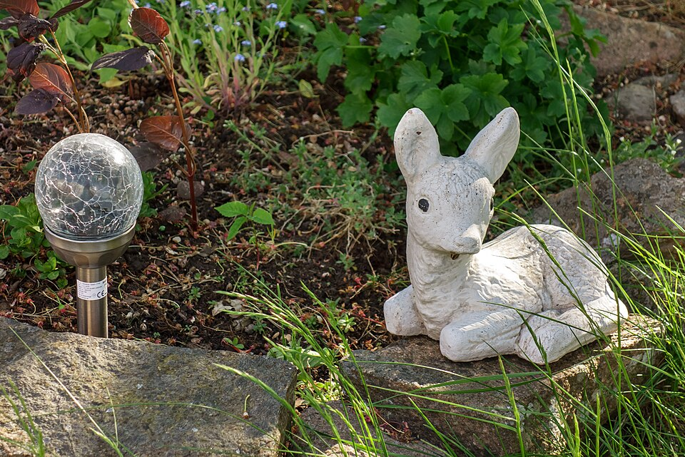</a></p>

- **类型**：太阳能灯具综合样式
- **样式介绍**：太阳能灯具把可再生能源直接转化为照明服务，涵盖家用灯、营地灯、工作灯和公共设施等多种形态。
- **设计观察**：不同外壳反映耐候、散热与维护需求。
- **图片作者**：W.carter
- **来源**：[Wikimedia Commons 原始文件页](https://commons.wikimedia.org/wiki/File:Fawn_garden_sculpture_in_Tuntorp.jpg)
- **许可**：[CC BY-SA 4.0](https://creativecommons.org/licenses/by-sa/4.0)

### 044 · Fonarik 4168.jpg

<p align="center"><a href="https://commons.wikimedia.org/wiki/File:Fonarik_4168.jpg">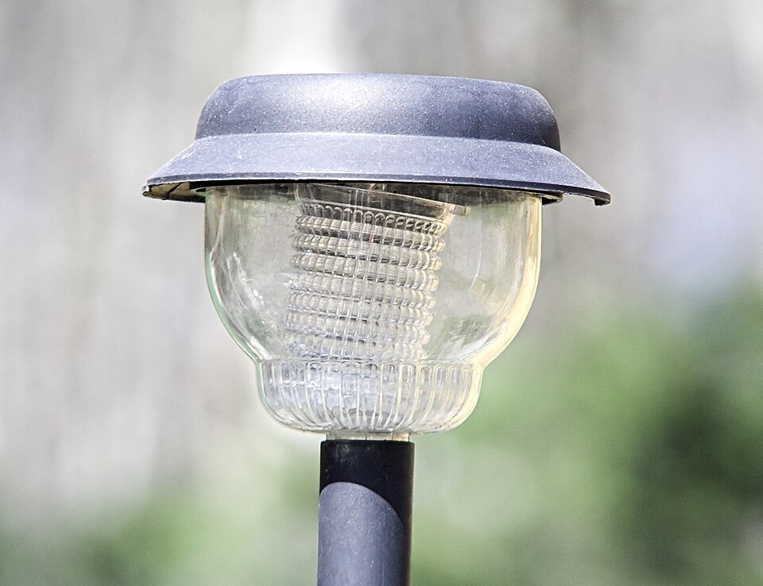</a></p>

- **类型**：太阳能灯具综合样式
- **样式介绍**：太阳能灯具把可再生能源直接转化为照明服务，涵盖家用灯、营地灯、工作灯和公共设施等多种形态。
- **设计观察**：适合作为离网照明产品的形态素材。
- **图片作者**：PereslavlFoto
- **来源**：[Wikimedia Commons 原始文件页](https://commons.wikimedia.org/wiki/File:Fonarik_4168.jpg)
- **许可**：[CC BY-SA 3.0](https://creativecommons.org/licenses/by-sa/3.0)

### 045 · Fontana di luce.jpg

<p align="center"><a href="https://commons.wikimedia.org/wiki/File:Fontana_di_luce.jpg">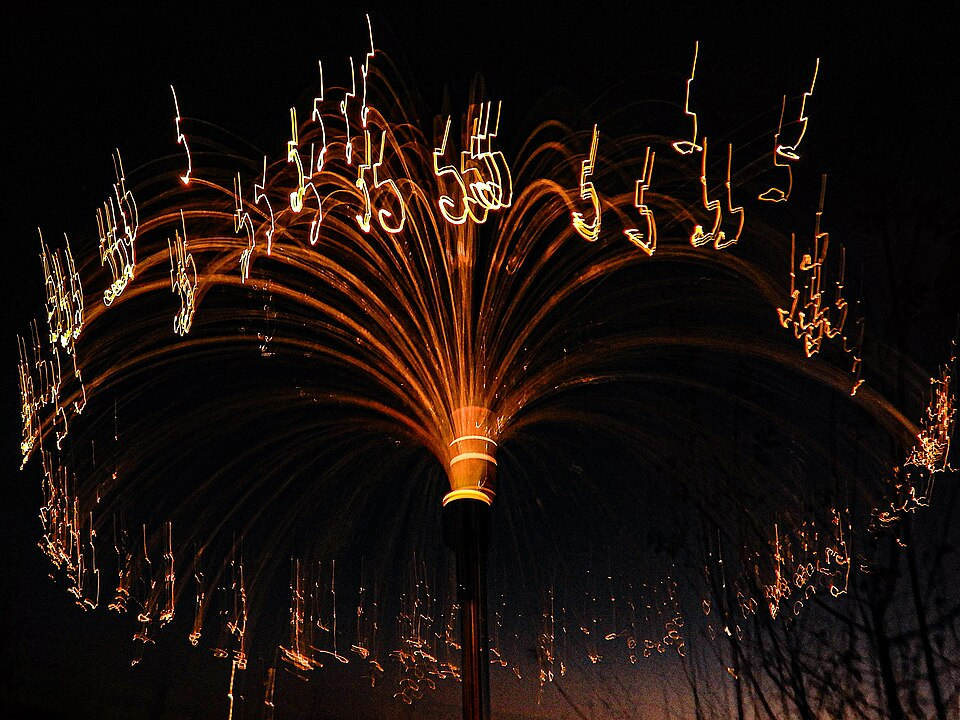</a></p>

- **类型**：太阳能灯具综合样式
- **样式介绍**：太阳能灯具把可再生能源直接转化为照明服务，涵盖家用灯、营地灯、工作灯和公共设施等多种形态。
- **设计观察**：展示光伏组件、储能和灯具之间的不同组合方式。
- **图片作者**：Albarubescens
- **来源**：[Wikimedia Commons 原始文件页](https://commons.wikimedia.org/wiki/File:Fontana_di_luce.jpg)
- **许可**：[CC BY-SA 4.0](https://creativecommons.org/licenses/by-sa/4.0)

### 046 · Glagla roses.jpg

<p align="center"><a href="https://commons.wikimedia.org/wiki/File:Glagla_roses.jpg">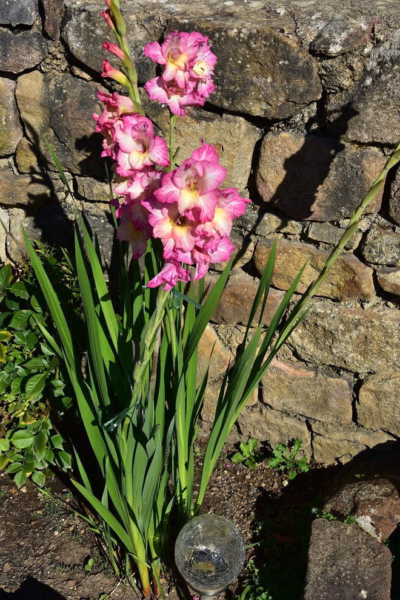</a></p>

- **类型**：太阳能灯具综合样式
- **样式介绍**：太阳能灯具把可再生能源直接转化为照明服务，涵盖家用灯、营地灯、工作灯和公共设施等多种形态。
- **设计观察**：可观察便携、固定与共享使用模式的差异。
- **图片作者**：Dacia 1410 Sport
- **来源**：[Wikimedia Commons 原始文件页](https://commons.wikimedia.org/wiki/File:Glagla_roses.jpg)
- **许可**：[CC BY-SA 4.0](https://creativecommons.org/licenses/by-sa/4.0)

### 047 · J.R. Lockamy memorial garden.jpg

<p align="center"><a href="https://commons.wikimedia.org/wiki/File:J.R._Lockamy_memorial_garden.jpg">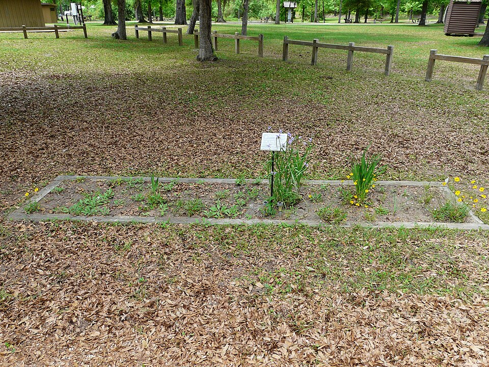</a></p>

- **类型**：太阳能灯具综合样式
- **样式介绍**：太阳能灯具把可再生能源直接转化为照明服务，涵盖家用灯、营地灯、工作灯和公共设施等多种形态。
- **设计观察**：不同外壳反映耐候、散热与维护需求。
- **图片作者**：The Bushranger
- **来源**：[Wikimedia Commons 原始文件页](https://commons.wikimedia.org/wiki/File:J.R._Lockamy_memorial_garden.jpg)
- **许可**：[CC BY-SA 4.0](https://creativecommons.org/licenses/by-sa/4.0)

### 048 · Lampioncini solari.jpg

<p align="center"><a href="https://commons.wikimedia.org/wiki/File:Lampioncini_solari.jpg">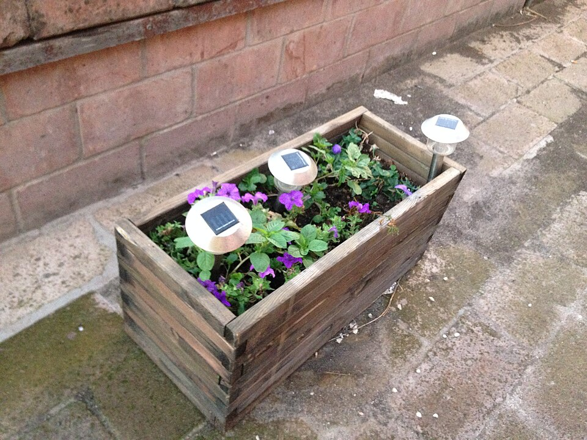</a></p>

- **类型**：太阳能灯具综合样式
- **样式介绍**：太阳能灯具把可再生能源直接转化为照明服务，涵盖家用灯、营地灯、工作灯和公共设施等多种形态。
- **设计观察**：适合作为离网照明产品的形态素材。
- **图片作者**：Antonio Mette
- **来源**：[Wikimedia Commons 原始文件页](https://commons.wikimedia.org/wiki/File:Lampioncini_solari.jpg)
- **许可**：[CC BY-SA 4.0](https://creativecommons.org/licenses/by-sa/4.0)

### 049 · Lampioncino solare 2.jpg

<p align="center"><a href="https://commons.wikimedia.org/wiki/File:Lampioncino_solare_2.jpg">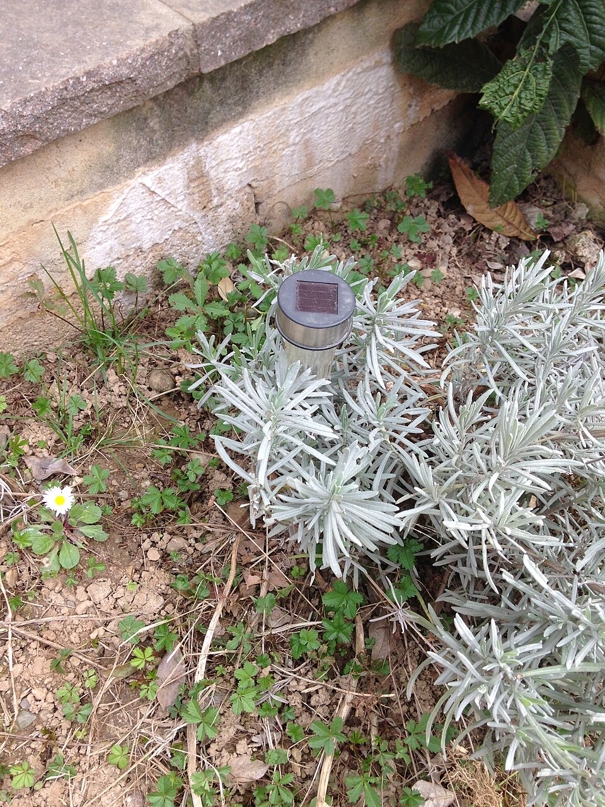</a></p>

- **类型**：太阳能灯具综合样式
- **样式介绍**：太阳能灯具把可再生能源直接转化为照明服务，涵盖家用灯、营地灯、工作灯和公共设施等多种形态。
- **设计观察**：展示光伏组件、储能和灯具之间的不同组合方式。
- **图片作者**：Antonio Mette
- **来源**：[Wikimedia Commons 原始文件页](https://commons.wikimedia.org/wiki/File:Lampioncino_solare_2.jpg)
- **许可**：[CC BY-SA 4.0](https://creativecommons.org/licenses/by-sa/4.0)

### 050 · Lampioncino solare.jpg

<p align="center"><a href="https://commons.wikimedia.org/wiki/File:Lampioncino_solare.jpg">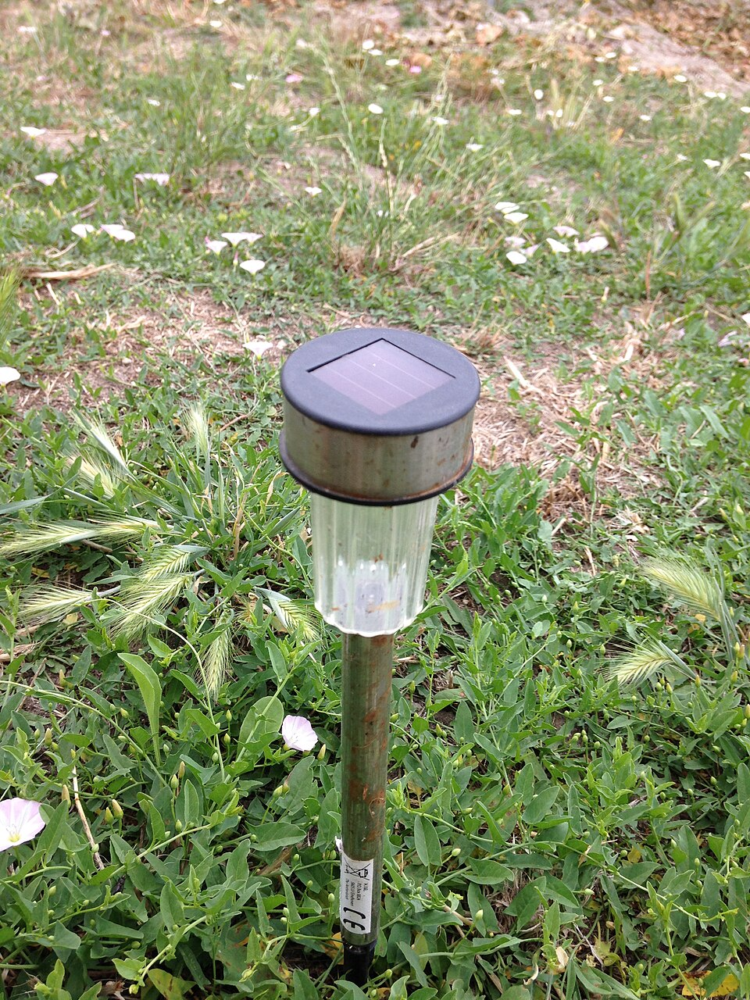</a></p>

- **类型**：太阳能灯具综合样式
- **样式介绍**：太阳能灯具把可再生能源直接转化为照明服务，涵盖家用灯、营地灯、工作灯和公共设施等多种形态。
- **设计观察**：可观察便携、固定与共享使用模式的差异。
- **图片作者**：Antonio Mette
- **来源**：[Wikimedia Commons 原始文件页](https://commons.wikimedia.org/wiki/File:Lampioncino_solare.jpg)
- **许可**：[CC BY-SA 4.0](https://creativecommons.org/licenses/by-sa/4.0)

### 051 · Lanterne solaire, Guilherand-Granges (14810250737).jpg

<p align="center"><a href="https://commons.wikimedia.org/wiki/File:Lanterne_solaire,_Guilherand-Granges_(14810250737).jpg"></a></p>

- **类型**：太阳能灯具综合样式
- **样式介绍**：太阳能灯具把可再生能源直接转化为照明服务，涵盖家用灯、营地灯、工作灯和公共设施等多种形态。
- **设计观察**：不同外壳反映耐候、散热与维护需求。
- **图片作者**：Nicolas Buffler from Guilherand Granges, France
- **来源**：[Wikimedia Commons 原始文件页](https://commons.wikimedia.org/wiki/File:Lanterne_solaire,_Guilherand-Granges_(14810250737).jpg)
- **许可**：[CC BY 2.0](https://creativecommons.org/licenses/by/2.0)

### 052 · Latarnia os. Przyjazni in poznan.jpg

<p align="center"><a href="https://commons.wikimedia.org/wiki/File:Latarnia_os._Przyjazni_in_poznan.jpg"></a></p>

- **类型**：太阳能灯具综合样式
- **样式介绍**：太阳能灯具把可再生能源直接转化为照明服务，涵盖家用灯、营地灯、工作灯和公共设施等多种形态。
- **设计观察**：适合作为离网照明产品的形态素材。
- **图片作者**：MOs810
- **来源**：[Wikimedia Commons 原始文件页](https://commons.wikimedia.org/wiki/File:Latarnia_os._Przyjazni_in_poznan.jpg)
- **许可**：[CC BY-SA 4.0](https://creativecommons.org/licenses/by-sa/4.0)

### 053 · Leuchtende Solarbiene in der Dunkelheit, Köln, Deutschland.jpg

<p align="center"><a href="https://commons.wikimedia.org/wiki/File:Leuchtende_Solarbiene_in_der_Dunkelheit,_K%C3%B6ln,_Deutschland.jpg"></a></p>

- **类型**：太阳能灯具综合样式
- **样式介绍**：太阳能灯具把可再生能源直接转化为照明服务，涵盖家用灯、营地灯、工作灯和公共设施等多种形态。
- **设计观察**：展示光伏组件、储能和灯具之间的不同组合方式。
- **图片作者**：Gordito1869
- **来源**：[Wikimedia Commons 原始文件页](https://commons.wikimedia.org/wiki/File:Leuchtende_Solarbiene_in_der_Dunkelheit,_K%C3%B6ln,_Deutschland.jpg)
- **许可**：[CC BY-SA 4.0](https://creativecommons.org/licenses/by-sa/4.0)

### 054 · Luci con cella solare-DSC 0061.jpg

<p align="center"><a href="https://commons.wikimedia.org/wiki/File:Luci_con_cella_solare-DSC_0061.jpg"></a></p>

- **类型**：太阳能灯具综合样式
- **样式介绍**：太阳能灯具把可再生能源直接转化为照明服务，涵盖家用灯、营地灯、工作灯和公共设施等多种形态。
- **设计观察**：可观察便携、固定与共享使用模式的差异。
- **图片作者**：Marco Centenaro (classe 1980)
- **来源**：[Wikimedia Commons 原始文件页](https://commons.wikimedia.org/wiki/File:Luci_con_cella_solare-DSC_0061.jpg)
- **许可**：[CC BY-SA 4.0](https://creativecommons.org/licenses/by-sa/4.0)

## 竹制与天然材料灯

### 055 · Bamboo carved table lamp, Konkan, Maharashtra.jpg

<p align="center"><a href="https://commons.wikimedia.org/wiki/File:Bamboo_carved_table_lamp,_Konkan,_Maharashtra.jpg"></a></p>

- **类型**：竹制与天然材料灯
- **样式介绍**：竹材生长快、可再生且易于编织和雕刻，适合制作透光纹理丰富的灯罩与灯体。
- **设计观察**：竹条与孔洞形成自然的光影纹理。
- **图片作者**：Art Projects MKCL KF
- **来源**：[Wikimedia Commons 原始文件页](https://commons.wikimedia.org/wiki/File:Bamboo_carved_table_lamp,_Konkan,_Maharashtra.jpg)
- **许可**：[CC BY-SA 4.0](https://creativecommons.org/licenses/by-sa/4.0)

### 056 · Bamboo carving lamp, Konkan, Maharashtra.jpg

<p align="center"><a href="https://commons.wikimedia.org/wiki/File:Bamboo_carving_lamp,_Konkan,_Maharashtra.jpg"></a></p>

- **类型**：竹制与天然材料灯
- **样式介绍**：竹材生长快、可再生且易于编织和雕刻，适合制作透光纹理丰富的灯罩与灯体。
- **设计观察**：轻质结构适合吊灯、台灯和手工灯笼。
- **图片作者**：Art Projects MKCL KF
- **来源**：[Wikimedia Commons 原始文件页](https://commons.wikimedia.org/wiki/File:Bamboo_carving_lamp,_Konkan,_Maharashtra.jpg)
- **许可**：[CC BY-SA 4.0](https://creativecommons.org/licenses/by-sa/4.0)

### 057 · Bamboo Lamp, Tonglüshan.jpg

<p align="center"><a href="https://commons.wikimedia.org/wiki/File:Bamboo_Lamp,_Tongl%C3%BCshan.jpg"></a></p>

- **类型**：竹制与天然材料灯
- **样式介绍**：竹材生长快、可再生且易于编织和雕刻，适合制作透光纹理丰富的灯罩与灯体。
- **设计观察**：可关注材料防潮、散热与连接方式。
- **图片作者**：Amarespeco
- **来源**：[Wikimedia Commons 原始文件页](https://commons.wikimedia.org/wiki/File:Bamboo_Lamp,_Tongl%C3%BCshan.jpg)
- **许可**：[CC BY-SA 4.0](https://creativecommons.org/licenses/by-sa/4.0)

### 058 · Bamboo Lamp, Tribal Art, Maharashtra.jpg

<p align="center"><a href="https://commons.wikimedia.org/wiki/File:Bamboo_Lamp,_Tribal_Art,_Maharashtra.jpg"></a></p>

- **类型**：竹制与天然材料灯
- **样式介绍**：竹材生长快、可再生且易于编织和雕刻，适合制作透光纹理丰富的灯罩与灯体。
- **设计观察**：传统工艺与低功率 LED 可以形成现代混合设计。
- **图片作者**：Art Projects MKCL KF
- **来源**：[Wikimedia Commons 原始文件页](https://commons.wikimedia.org/wiki/File:Bamboo_Lamp,_Tribal_Art,_Maharashtra.jpg)
- **许可**：[CC BY-SA 4.0](https://creativecommons.org/licenses/by-sa/4.0)

### 059 · Bamboo lamp.jpg

<p align="center"><a href="https://commons.wikimedia.org/wiki/File:Bamboo_lamp.jpg"></a></p>

- **类型**：竹制与天然材料灯
- **样式介绍**：竹材生长快、可再生且易于编织和雕刻，适合制作透光纹理丰富的灯罩与灯体。
- **设计观察**：竹条与孔洞形成自然的光影纹理。
- **图片作者**：Medhi jyoti
- **来源**：[Wikimedia Commons 原始文件页](https://commons.wikimedia.org/wiki/File:Bamboo_lamp.jpg)
- **许可**：[CC BY-SA 4.0](https://creativecommons.org/licenses/by-sa/4.0)

### 060 · Bamboo palms, topiary shrubbery (in the shapes of gate lamps) and flowering plants in the hilltop of Kakching Garden, Kangleipak.jpg

<p align="center"><a href="https://commons.wikimedia.org/wiki/File:Bamboo_palms,_topiary_shrubbery_(in_the_shapes_of_gate_lamps)_and_flowering_plants_in_the_hilltop_of_Kakching_Garden,_Kangleipak.jpg"></a></p>

- **类型**：竹制与天然材料灯
- **样式介绍**：竹材生长快、可再生且易于编织和雕刻，适合制作透光纹理丰富的灯罩与灯体。
- **设计观察**：轻质结构适合吊灯、台灯和手工灯笼。
- **图片作者**：Haoreima
- **来源**：[Wikimedia Commons 原始文件页](https://commons.wikimedia.org/wiki/File:Bamboo_palms,_topiary_shrubbery_(in_the_shapes_of_gate_lamps)_and_flowering_plants_in_the_hilltop_of_Kakching_Garden,_Kangleipak.jpg)
- **许可**：[CC BY 4.0](https://creativecommons.org/licenses/by/4.0)

## 木质低影响灯具

### 061 · Antique Wooden Lamp from Bharat.jpg

<p align="center"><a href="https://commons.wikimedia.org/wiki/File:Antique_Wooden_Lamp_from_Bharat.jpg"></a></p>

- **类型**：木质低影响灯具
- **样式介绍**：木材可通过车削、拼接、雕刻或弯曲形成温暖的灯体；采用再生木或负责任来源木材时可降低材料影响。
- **设计观察**：木纹与暖色光源形成柔和的视觉体验。
- **图片作者**：Amitbalani
- **来源**：[Wikimedia Commons 原始文件页](https://commons.wikimedia.org/wiki/File:Antique_Wooden_Lamp_from_Bharat.jpg)
- **许可**：[CC0](http://creativecommons.org/publicdomain/zero/1.0/deed.en)

## 节能 LED 台灯

### 062 · Battery powered LED desk lamp - battery and board-9281.jpg

<p align="center"><a href="https://commons.wikimedia.org/wiki/File:Battery_powered_LED_desk_lamp_-_battery_and_board-9281.jpg"></a></p>

- **类型**：节能 LED 台灯
- **样式介绍**：LED 台灯通过定向配光、调光和较低功耗满足阅读与工作照明，并可结合可维修灯臂与智能控制延长使用周期。
- **设计观察**：灯臂与转轴让光线只覆盖需要的工作区域。
- **图片作者**：Raimond Spekking
- **来源**：[Wikimedia Commons 原始文件页](https://commons.wikimedia.org/wiki/File:Battery_powered_LED_desk_lamp_-_battery_and_board-9281.jpg)
- **许可**：[CC BY-SA 4.0](https://creativecommons.org/licenses/by-sa/4.0)

### 063 · Battery powered LED desk lamp - board with SMD LEDs-9676.jpg

<p align="center"><a href="https://commons.wikimedia.org/wiki/File:Battery_powered_LED_desk_lamp_-_board_with_SMD_LEDs-9676.jpg"></a></p>

- **类型**：节能 LED 台灯
- **样式介绍**：LED 台灯通过定向配光、调光和较低功耗满足阅读与工作照明，并可结合可维修灯臂与智能控制延长使用周期。
- **设计观察**：调光和色温控制有助于按场景降低不必要能耗。
- **图片作者**：Raimond Spekking
- **来源**：[Wikimedia Commons 原始文件页](https://commons.wikimedia.org/wiki/File:Battery_powered_LED_desk_lamp_-_board_with_SMD_LEDs-9676.jpg)
- **许可**：[CC BY-SA 4.0](https://creativecommons.org/licenses/by-sa/4.0)

### 064 · Battery powered LED desk lamp - board with USB port and on-off-switch-9283.jpg

<p align="center"><a href="https://commons.wikimedia.org/wiki/File:Battery_powered_LED_desk_lamp_-_board_with_USB_port_and_on-off-switch-9283.jpg"></a></p>

- **类型**：节能 LED 台灯
- **样式介绍**：LED 台灯通过定向配光、调光和较低功耗满足阅读与工作照明，并可结合可维修灯臂与智能控制延长使用周期。
- **设计观察**：可观察散热结构、扩散罩与桌面占用之间的平衡。
- **图片作者**：Raimond Spekking
- **来源**：[Wikimedia Commons 原始文件页](https://commons.wikimedia.org/wiki/File:Battery_powered_LED_desk_lamp_-_board_with_USB_port_and_on-off-switch-9283.jpg)
- **许可**：[CC BY-SA 4.0](https://creativecommons.org/licenses/by-sa/4.0)

### 065 · Battery powered LED desk lamp-7420.jpg

<p align="center"><a href="https://commons.wikimedia.org/wiki/File:Battery_powered_LED_desk_lamp-7420.jpg"></a></p>

- **类型**：节能 LED 台灯
- **样式介绍**：LED 台灯通过定向配光、调光和较低功耗满足阅读与工作照明，并可结合可维修灯臂与智能控制延长使用周期。
- **设计观察**：模块化电源和可替换部件有助于延长产品寿命。
- **图片作者**：Raimond Spekking
- **来源**：[Wikimedia Commons 原始文件页](https://commons.wikimedia.org/wiki/File:Battery_powered_LED_desk_lamp-7420.jpg)
- **许可**：[CC BY-SA 4.0](https://creativecommons.org/licenses/by-sa/4.0)

### 066 · Concise bamboo eye protection LED desk lamp.jpg

<p align="center"><a href="https://commons.wikimedia.org/wiki/File:Concise_bamboo_eye_protection_LED_desk_lamp.jpg"></a></p>

- **类型**：节能 LED 台灯
- **样式介绍**：LED 台灯通过定向配光、调光和较低功耗满足阅读与工作照明，并可结合可维修灯臂与智能控制延长使用周期。
- **设计观察**：灯臂与转轴让光线只覆盖需要的工作区域。
- **图片作者**：Indesign Technology
- **来源**：[Wikimedia Commons 原始文件页](https://commons.wikimedia.org/wiki/File:Concise_bamboo_eye_protection_LED_desk_lamp.jpg)
- **许可**：[CC BY-SA 4.0](https://creativecommons.org/licenses/by-sa/4.0)

### 067 · Dekala Arches™ Smart Lamp.jpg

<p align="center"><a href="https://commons.wikimedia.org/wiki/File:Dekala_Arches%E2%84%A2_Smart_Lamp.jpg"></a></p>

- **类型**：节能 LED 台灯
- **样式介绍**：LED 台灯通过定向配光、调光和较低功耗满足阅读与工作照明，并可结合可维修灯臂与智能控制延长使用周期。
- **设计观察**：调光和色温控制有助于按场景降低不必要能耗。
- **图片作者**：LannyWay
- **来源**：[Wikimedia Commons 原始文件页](https://commons.wikimedia.org/wiki/File:Dekala_Arches%E2%84%A2_Smart_Lamp.jpg)
- **许可**：[CC BY-SA 4.0](https://creativecommons.org/licenses/by-sa/4.0)

## 高效 LED 灯具

### 068 · "blamp 1" spring collection.jpg

<p align="center"><a href="https://commons.wikimedia.org/wiki/File:%22blamp_1%22_spring_collection.jpg"></a></p>

- **类型**：高效 LED 灯具
- **样式介绍**：LED 以较低功耗提供高光效，并可通过调光、定向配光和长寿命设计减少运行阶段的能源与维护消耗。
- **设计观察**：灯体形态围绕散热、配光和驱动器布置展开。
- **图片作者**：Stw-kunst
- **来源**：[Wikimedia Commons 原始文件页](https://commons.wikimedia.org/wiki/File:%22blamp_1%22_spring_collection.jpg)
- **许可**：[CC BY-SA 4.0](https://creativecommons.org/licenses/by-sa/4.0)

### 069 · 106(2017.10.01)-27- V3A-93M Faur V3A-A3 (37426204531).jpg

<p align="center"><a href="https://commons.wikimedia.org/wiki/File:106(2017.10.01)-27-_V3A-93M_Faur_V3A-A3_(37426204531).jpg"></a></p>

- **类型**：高效 LED 灯具
- **样式介绍**：LED 以较低功耗提供高光效，并可通过调光、定向配光和长寿命设计减少运行阶段的能源与维护消耗。
- **设计观察**：定向发光有助于把光送到真正需要的位置。
- **图片作者**：M Marius
- **来源**：[Wikimedia Commons 原始文件页](https://commons.wikimedia.org/wiki/File:106(2017.10.01)-27-_V3A-93M_Faur_V3A-A3_(37426204531).jpg)
- **许可**：[CC BY-SA 2.0](https://creativecommons.org/licenses/by-sa/2.0)

### 070 · 20220404 Campinglampe Varta L10 2022.jpg

<p align="center"><a href="https://commons.wikimedia.org/wiki/File:20220404_Campinglampe_Varta_L10_2022.jpg"></a></p>

- **类型**：高效 LED 灯具
- **样式介绍**：LED 以较低功耗提供高光效，并可通过调光、定向配光和长寿命设计减少运行阶段的能源与维护消耗。
- **设计观察**：模块化光源与可更换部件能延长产品寿命。
- **图片作者**：VSchagow
- **来源**：[Wikimedia Commons 原始文件页](https://commons.wikimedia.org/wiki/File:20220404_Campinglampe_Varta_L10_2022.jpg)
- **许可**：[CC BY-SA 4.0](https://creativecommons.org/licenses/by-sa/4.0)

### 071 · 202506 南方澳進安宮的藻井與一座仿古宮燈.jpg

<p align="center"><a href="https://commons.wikimedia.org/wiki/File:202506_%E5%8D%97%E6%96%B9%E6%BE%B3%E9%80%B2%E5%AE%89%E5%AE%AE%E7%9A%84%E8%97%BB%E4%BA%95%E8%88%87%E4%B8%80%E5%BA%A7%E4%BB%BF%E5%8F%A4%E5%AE%AE%E7%87%88.jpg"></a></p>

- **类型**：高效 LED 灯具
- **样式介绍**：LED 以较低功耗提供高光效，并可通过调光、定向配光和长寿命设计减少运行阶段的能源与维护消耗。
- **设计观察**：可观察家用、工作与公共照明的不同配光方式。
- **图片作者**：Junyu-K
- **来源**：[Wikimedia Commons 原始文件页](https://commons.wikimedia.org/wiki/File:202506_%E5%8D%97%E6%96%B9%E6%BE%B3%E9%80%B2%E5%AE%89%E5%AE%AE%E7%9A%84%E8%97%BB%E4%BA%95%E8%88%87%E4%B8%80%E5%BA%A7%E4%BB%BF%E5%8F%A4%E5%AE%AE%E7%87%88.jpg)
- **许可**：[CC BY-SA 4.0](https://creativecommons.org/licenses/by-sa/4.0)

### 072 · 9789Philippine Independence Day, Rizal Park 50.jpg

<p align="center"><a href="https://commons.wikimedia.org/wiki/File:9789Philippine_Independence_Day,_Rizal_Park_50.jpg"></a></p>

- **类型**：高效 LED 灯具
- **样式介绍**：LED 以较低功耗提供高光效，并可通过调光、定向配光和长寿命设计减少运行阶段的能源与维护消耗。
- **设计观察**：灯体形态围绕散热、配光和驱动器布置展开。
- **图片作者**：Judgefloro
- **来源**：[Wikimedia Commons 原始文件页](https://commons.wikimedia.org/wiki/File:9789Philippine_Independence_Day,_Rizal_Park_50.jpg)
- **许可**：[CC0](http://creativecommons.org/publicdomain/zero/1.0/deed.en)

### 073 · AmbientLED.png

<p align="center"><a href="https://commons.wikimedia.org/wiki/File:AmbientLED.png"></a></p>

- **类型**：高效 LED 灯具
- **样式介绍**：LED 以较低功耗提供高光效，并可通过调光、定向配光和长寿命设计减少运行阶段的能源与维护消耗。
- **设计观察**：定向发光有助于把光送到真正需要的位置。
- **图片作者**：Blueviper99
- **来源**：[Wikimedia Commons 原始文件页](https://commons.wikimedia.org/wiki/File:AmbientLED.png)
- **许可**：[CC BY 3.0](https://creativecommons.org/licenses/by/3.0)

### 074 · Ausgeschalteter LED-Pfeil mit Abschussvorrichtung.png

<p align="center"><a href="https://commons.wikimedia.org/wiki/File:Ausgeschalteter_LED-Pfeil_mit_Abschussvorrichtung.png"></a></p>

- **类型**：高效 LED 灯具
- **样式介绍**：LED 以较低功耗提供高光效，并可通过调光、定向配光和长寿命设计减少运行阶段的能源与维护消耗。
- **设计观察**：模块化光源与可更换部件能延长产品寿命。
- **图片作者**：Zavijava2
- **来源**：[Wikimedia Commons 原始文件页](https://commons.wikimedia.org/wiki/File:Ausgeschalteter_LED-Pfeil_mit_Abschussvorrichtung.png)
- **许可**：[CC0](http://creativecommons.org/publicdomain/zero/1.0/deed.en)

### 075 · AUT — Tirol — Bezirk Landeck — Gemeinde Galtür — Hauptstraße 29c (Museum Alpinarium · innen) 2026-07-30 Mattes.jpg

<p align="center"><a href="https://commons.wikimedia.org/wiki/File:AUT_%E2%80%94_Tirol_%E2%80%94_Bezirk_Landeck_%E2%80%94_Gemeinde_Galt%C3%BCr_%E2%80%94_Hauptstra%C3%9Fe_29c_(Museum_Alpinarium_%C2%B7_innen)_2026-07-30_Mattes.jpg"></a></p>

- **类型**：高效 LED 灯具
- **样式介绍**：LED 以较低功耗提供高光效，并可通过调光、定向配光和长寿命设计减少运行阶段的能源与维护消耗。
- **设计观察**：可观察家用、工作与公共照明的不同配光方式。
- **图片作者**：User:Mateus2019
- **来源**：[Wikimedia Commons 原始文件页](https://commons.wikimedia.org/wiki/File:AUT_%E2%80%94_Tirol_%E2%80%94_Bezirk_Landeck_%E2%80%94_Gemeinde_Galt%C3%BCr_%E2%80%94_Hauptstra%C3%9Fe_29c_(Museum_Alpinarium_%C2%B7_innen)_2026-07-30_Mattes.jpg)
- **许可**：[CC BY 2.0 de](https://creativecommons.org/licenses/by/2.0/de/deed.en)

### 076 · Automotive LED Solution.jpg

<p align="center"><a href="https://commons.wikimedia.org/wiki/File:Automotive_LED_Solution.jpg"></a></p>

- **类型**：高效 LED 灯具
- **样式介绍**：LED 以较低功耗提供高光效，并可通过调光、定向配光和长寿命设计减少运行阶段的能源与维护消耗。
- **设计观察**：灯体形态围绕散热、配光和驱动器布置展开。
- **图片作者**：Formularally
- **来源**：[Wikimedia Commons 原始文件页](https://commons.wikimedia.org/wiki/File:Automotive_LED_Solution.jpg)
- **许可**：[CC BY-SA 4.0](https://creativecommons.org/licenses/by-sa/4.0)

### 077 · Blokker LED light bulbs, Hillegersberg, Rotterdam (2020) 01.jpg

<p align="center"><a href="https://commons.wikimedia.org/wiki/File:Blokker_LED_light_bulbs,_Hillegersberg,_Rotterdam_(2020)_01.jpg"></a></p>

- **类型**：高效 LED 灯具
- **样式介绍**：LED 以较低功耗提供高光效，并可通过调光、定向配光和长寿命设计减少运行阶段的能源与维护消耗。
- **设计观察**：定向发光有助于把光送到真正需要的位置。
- **图片作者**：Donald Trung Quoc Don (Chữ Hán: 徵國單) - Wikimedia Commons - © CC BY-SA 4.0 International. (Want to use this image?) Original publication 📤: --Donald Trung 『徵國單』 (No Fake News 💬) (WikiProject Numismatics 💴) (Articles 📚) 13:12, 31 January 2021 (UTC)
- **来源**：[Wikimedia Commons 原始文件页](https://commons.wikimedia.org/wiki/File:Blokker_LED_light_bulbs,_Hillegersberg,_Rotterdam_(2020)_01.jpg)
- **许可**：[CC BY-SA 4.0](https://creativecommons.org/licenses/by-sa/4.0)

### 078 · Blokker LED light bulbs, Hillegersberg, Rotterdam (2020) 02.jpg

<p align="center"><a href="https://commons.wikimedia.org/wiki/File:Blokker_LED_light_bulbs,_Hillegersberg,_Rotterdam_(2020)_02.jpg"></a></p>

- **类型**：高效 LED 灯具
- **样式介绍**：LED 以较低功耗提供高光效，并可通过调光、定向配光和长寿命设计减少运行阶段的能源与维护消耗。
- **设计观察**：模块化光源与可更换部件能延长产品寿命。
- **图片作者**：Donald Trung Quoc Don (Chữ Hán: 徵國單) - Wikimedia Commons - © CC BY-SA 4.0 International. (Want to use this image?) Original publication 📤: --Donald Trung 『徵國單』 (No Fake News 💬) (WikiProject Numismatics 💴) (Articles 📚) 13:12, 31 January 2021 (UTC)
- **来源**：[Wikimedia Commons 原始文件页](https://commons.wikimedia.org/wiki/File:Blokker_LED_light_bulbs,_Hillegersberg,_Rotterdam_(2020)_02.jpg)
- **许可**：[CC BY-SA 4.0](https://creativecommons.org/licenses/by-sa/4.0)

### 079 · Blue emergency courtesy lights.jpg

<p align="center"><a href="https://commons.wikimedia.org/wiki/File:Blue_emergency_courtesy_lights.jpg"></a></p>

- **类型**：高效 LED 灯具
- **样式介绍**：LED 以较低功耗提供高光效，并可通过调光、定向配光和长寿命设计减少运行阶段的能源与维护消耗。
- **设计观察**：可观察家用、工作与公共照明的不同配光方式。
- **图片作者**：own work
- **来源**：[Wikimedia Commons 原始文件页](https://commons.wikimedia.org/wiki/File:Blue_emergency_courtesy_lights.jpg)
- **许可**：Public domain

### 080 · Blue LED light.jpg

<p align="center"><a href="https://commons.wikimedia.org/wiki/File:Blue_LED_light.jpg"></a></p>

- **类型**：高效 LED 灯具
- **样式介绍**：LED 以较低功耗提供高光效，并可通过调光、定向配光和长寿命设计减少运行阶段的能源与维护消耗。
- **设计观察**：灯体形态围绕散热、配光和驱动器布置展开。
- **图片作者**：Common Member code specialist
- **来源**：[Wikimedia Commons 原始文件页](https://commons.wikimedia.org/wiki/File:Blue_LED_light.jpg)
- **许可**：[CC BY-SA 4.0](https://creativecommons.org/licenses/by-sa/4.0)

### 081 · Bulbdial 1 - Flickr - oskay.jpg

<p align="center"><a href="https://commons.wikimedia.org/wiki/File:Bulbdial_1_-_Flickr_-_oskay.jpg"></a></p>

- **类型**：高效 LED 灯具
- **样式介绍**：LED 以较低功耗提供高光效，并可通过调光、定向配光和长寿命设计减少运行阶段的能源与维护消耗。
- **设计观察**：定向发光有助于把光送到真正需要的位置。
- **图片作者**：Windell Oskay from Sunnyvale, CA, USA
- **来源**：[Wikimedia Commons 原始文件页](https://commons.wikimedia.org/wiki/File:Bulbdial_1_-_Flickr_-_oskay.jpg)
- **许可**：[CC BY 2.0](https://creativecommons.org/licenses/by/2.0)

### 082 · Cannon Building Lighting (52388746759).jpg

<p align="center"><a href="https://commons.wikimedia.org/wiki/File:Cannon_Building_Lighting_(52388746759).jpg"></a></p>

- **类型**：高效 LED 灯具
- **样式介绍**：LED 以较低功耗提供高光效，并可通过调光、定向配光和长寿命设计减少运行阶段的能源与维护消耗。
- **设计观察**：模块化光源与可更换部件能延长产品寿命。
- **图片作者**：USCapitol from Washington, D.C., United States of America
- **来源**：[Wikimedia Commons 原始文件页](https://commons.wikimedia.org/wiki/File:Cannon_Building_Lighting_(52388746759).jpg)
- **许可**：Public domain

### 083 · Catalonia Cabrils CartellLluminos.JPG

<p align="center"><a href="https://commons.wikimedia.org/wiki/File:Catalonia_Cabrils_CartellLluminos.JPG"></a></p>

- **类型**：高效 LED 灯具
- **样式介绍**：LED 以较低功耗提供高光效，并可通过调光、定向配光和长寿命设计减少运行阶段的能源与维护消耗。
- **设计观察**：可观察家用、工作与公共照明的不同配光方式。
- **图片作者**：Friviere
- **来源**：[Wikimedia Commons 原始文件页](https://commons.wikimedia.org/wiki/File:Catalonia_Cabrils_CartellLluminos.JPG)
- **许可**：[CC BY-SA 3.0](https://creativecommons.org/licenses/by-sa/3.0)

### 084 · CHARTRES SARLAM.jpg

<p align="center"><a href="https://commons.wikimedia.org/wiki/File:CHARTRES_SARLAM.jpg"></a></p>

- **类型**：高效 LED 灯具
- **样式介绍**：LED 以较低功耗提供高光效，并可通过调光、定向配光和长寿命设计减少运行阶段的能源与维护消耗。
- **设计观察**：灯体形态围绕散热、配光和驱动器布置展开。
- **图片作者**：Mvanheems
- **来源**：[Wikimedia Commons 原始文件页](https://commons.wikimedia.org/wiki/File:CHARTRES_SARLAM.jpg)
- **许可**：[CC BY-SA 3.0](https://creativecommons.org/licenses/by-sa/3.0)

### 085 · CHARTRES-LED SARLAM.jpg

<p align="center"><a href="https://commons.wikimedia.org/wiki/File:CHARTRES-LED_SARLAM.jpg"></a></p>

- **类型**：高效 LED 灯具
- **样式介绍**：LED 以较低功耗提供高光效，并可通过调光、定向配光和长寿命设计减少运行阶段的能源与维护消耗。
- **设计观察**：定向发光有助于把光送到真正需要的位置。
- **图片作者**：Mvanheems
- **来源**：[Wikimedia Commons 原始文件页](https://commons.wikimedia.org/wiki/File:CHARTRES-LED_SARLAM.jpg)
- **许可**：[CC BY-SA 3.0](https://creativecommons.org/licenses/by-sa/3.0)

### 086 · Cheung Chau lucky bun LED lamp (Hong Kong).jpg

<p align="center"><a href="https://commons.wikimedia.org/wiki/File:Cheung_Chau_lucky_bun_LED_lamp_(Hong_Kong).jpg"></a></p>

- **类型**：高效 LED 灯具
- **样式介绍**：LED 以较低功耗提供高光效，并可通过调光、定向配光和长寿命设计减少运行阶段的能源与维护消耗。
- **设计观察**：模块化光源与可更换部件能延长产品寿命。
- **图片作者**：Mk2010
- **来源**：[Wikimedia Commons 原始文件页](https://commons.wikimedia.org/wiki/File:Cheung_Chau_lucky_bun_LED_lamp_(Hong_Kong).jpg)
- **许可**：[CC BY-SA 3.0](https://creativecommons.org/licenses/by-sa/3.0)

### 087 · Clas Ohlson LED spotlight lamp.JPG

<p align="center"><a href="https://commons.wikimedia.org/wiki/File:Clas_Ohlson_LED_spotlight_lamp.JPG"></a></p>

- **类型**：高效 LED 灯具
- **样式介绍**：LED 以较低功耗提供高光效，并可通过调光、定向配光和长寿命设计减少运行阶段的能源与维护消耗。
- **设计观察**：可观察家用、工作与公共照明的不同配光方式。
- **图片作者**：Dmitry G
- **来源**：[Wikimedia Commons 原始文件页](https://commons.wikimedia.org/wiki/File:Clas_Ohlson_LED_spotlight_lamp.JPG)
- **许可**：[CC BY-SA 3.0](https://creativecommons.org/licenses/by-sa/3.0)

## 手摇与应急发电灯

### 088 · 2021-03-30 Hand-crank operated generator (dynamo torch) plus backup.jpg

<p align="center"><a href="https://commons.wikimedia.org/wiki/File:2021-03-30_Hand-crank_operated_generator_(dynamo_torch)_plus_backup.jpg"></a></p>

- **类型**：手摇与应急发电灯
- **样式介绍**：手摇发电灯通过小型发电机把人力转为电能，适合停电、灾害应急和离网环境，并减少一次性电池依赖。
- **设计观察**：手柄、齿轮和发电机形成可直观理解的能源链路。
- **图片作者**：Franz van Duns
- **来源**：[Wikimedia Commons 原始文件页](https://commons.wikimedia.org/wiki/File:2021-03-30_Hand-crank_operated_generator_(dynamo_torch)_plus_backup.jpg)
- **许可**：[CC BY-SA 4.0](https://creativecommons.org/licenses/by-sa/4.0)

### 089 · C. Crane CC Solar Observer (14575444308).jpg

<p align="center"><a href="https://commons.wikimedia.org/wiki/File:C._Crane_CC_Solar_Observer_(14575444308).jpg"></a></p>

- **类型**：手摇与应急发电灯
- **样式介绍**：手摇发电灯通过小型发电机把人力转为电能，适合停电、灾害应急和离网环境，并减少一次性电池依赖。
- **设计观察**：常把照明、收音机和应急充电整合在同一设备中。
- **图片作者**：James Case from Philadelphia, Mississippi, U.S.A.
- **来源**：[Wikimedia Commons 原始文件页](https://commons.wikimedia.org/wiki/File:C._Crane_CC_Solar_Observer_(14575444308).jpg)
- **许可**：[CC BY 2.0](https://creativecommons.org/licenses/by/2.0)

### 090 · Crank powered flashlight disassembled.jpg

<p align="center"><a href="https://commons.wikimedia.org/wiki/File:Crank_powered_flashlight_disassembled.jpg"></a></p>

- **类型**：手摇与应急发电灯
- **样式介绍**：手摇发电灯通过小型发电机把人力转为电能，适合停电、灾害应急和离网环境，并减少一次性电池依赖。
- **设计观察**：拆解图有助于观察可维修性与零件布局。
- **图片作者**：Chetvorno
- **来源**：[Wikimedia Commons 原始文件页](https://commons.wikimedia.org/wiki/File:Crank_powered_flashlight_disassembled.jpg)
- **许可**：[CC0](http://creativecommons.org/publicdomain/zero/1.0/deed.en)

### 091 · Handheld Flashlight Radio.jpg

<p align="center"><a href="https://commons.wikimedia.org/wiki/File:Handheld_Flashlight_Radio.jpg"></a></p>

- **类型**：手摇与应急发电灯
- **样式介绍**：手摇发电灯通过小型发电机把人力转为电能，适合停电、灾害应急和离网环境，并减少一次性电池依赖。
- **设计观察**：适合作为无需外部电网的备用照明参考。
- **图片作者**：Torindkflt
- **来源**：[Wikimedia Commons 原始文件页](https://commons.wikimedia.org/wiki/File:Handheld_Flashlight_Radio.jpg)
- **许可**：[CC BY-SA 3.0](https://creativecommons.org/licenses/by-sa/3.0)

## 自行车与人力发电照明

### 092 · 0066-fahrradsammlung-RalfR.jpg

<p align="center"><a href="https://commons.wikimedia.org/wiki/File:0066-fahrradsammlung-RalfR.jpg"></a></p>

- **类型**：自行车与人力发电照明
- **样式介绍**：自行车灯和摩擦发电灯利用骑行机械能或可充电电池供电，体现低碳交通与按需照明的结合。
- **设计观察**：可比较花鼓发电、轮胎摩擦发电和充电式灯具。
- **图片作者**：Ralf Roletschek (talk) - Infos über Fahrräder auf fahrradmonteur.de
- **来源**：[Wikimedia Commons 原始文件页](https://commons.wikimedia.org/wiki/File:0066-fahrradsammlung-RalfR.jpg)
- **许可**：[FAL](http://artlibre.org/licence/lal/en)

### 093 · 03-08-01-Dagebüll-Mole-beladenes-Reiserad-RalfR-R0014311-03.jpg

<p align="center"><a href="https://commons.wikimedia.org/wiki/File:03-08-01-Dageb%C3%BCll-Mole-beladenes-Reiserad-RalfR-R0014311-03.jpg"></a></p>

- **类型**：自行车与人力发电照明
- **样式介绍**：自行车灯和摩擦发电灯利用骑行机械能或可充电电池供电，体现低碳交通与按需照明的结合。
- **设计观察**：紧凑外壳强调防水、抗震与快速拆装。
- **图片作者**：Ralf Roletschek
- **来源**：[Wikimedia Commons 原始文件页](https://commons.wikimedia.org/wiki/File:03-08-01-Dageb%C3%BCll-Mole-beladenes-Reiserad-RalfR-R0014311-03.jpg)
- **许可**：[GFDL 1.2](http://www.gnu.org/licenses/old-licenses/fdl-1.2.html)

### 094 · 12-11-02-fahrrad-salzburg-19.jpg

<p align="center"><a href="https://commons.wikimedia.org/wiki/File:12-11-02-fahrrad-salzburg-19.jpg"></a></p>

- **类型**：自行车与人力发电照明
- **样式介绍**：自行车灯和摩擦发电灯利用骑行机械能或可充电电池供电，体现低碳交通与按需照明的结合。
- **设计观察**：前灯配光重视道路可见度，尾灯重视识别性。
- **图片作者**：Ralf Roletschek (talk) - Infos über Fahrräder auf fahrradmonteur.de
- **来源**：[Wikimedia Commons 原始文件页](https://commons.wikimedia.org/wiki/File:12-11-02-fahrrad-salzburg-19.jpg)
- **许可**：[GFDL 1.2](http://www.gnu.org/licenses/old-licenses/fdl-1.2.html)

### 095 · 15-04-24-Fahrrad-Nürnberg-RalfR-DSCF4301-12.jpg

<p align="center"><a href="https://commons.wikimedia.org/wiki/File:15-04-24-Fahrrad-N%C3%BCrnberg-RalfR-DSCF4301-12.jpg"></a></p>

- **类型**：自行车与人力发电照明
- **样式介绍**：自行车灯和摩擦发电灯利用骑行机械能或可充电电池供电，体现低碳交通与按需照明的结合。
- **设计观察**：把出行动能转为照明，减少一次性电池依赖。
- **图片作者**：Ralf Roletschek
- **来源**：[Wikimedia Commons 原始文件页](https://commons.wikimedia.org/wiki/File:15-04-24-Fahrrad-N%C3%BCrnberg-RalfR-DSCF4301-12.jpg)
- **许可**：[GFDL 1.2](http://www.gnu.org/licenses/old-licenses/fdl-1.2.html)

### 096 · 2011-02-11-fahrraddetail-by-RalfR-26.jpg

<p align="center"><a href="https://commons.wikimedia.org/wiki/File:2011-02-11-fahrraddetail-by-RalfR-26.jpg"></a></p>

- **类型**：自行车与人力发电照明
- **样式介绍**：自行车灯和摩擦发电灯利用骑行机械能或可充电电池供电，体现低碳交通与按需照明的结合。
- **设计观察**：可比较花鼓发电、轮胎摩擦发电和充电式灯具。
- **图片作者**：Ralf Roletschek (talk) - Fahrradtechnik auf fahrradmonteur.de
- **来源**：[Wikimedia Commons 原始文件页](https://commons.wikimedia.org/wiki/File:2011-02-11-fahrraddetail-by-RalfR-26.jpg)
- **许可**：[FAL](http://artlibre.org/licence/lal/en)

### 097 · 2020-01-08 Llum de bicicleta il·lumina el camí de la Venta a Museros 01.jpg

<p align="center"><a href="https://commons.wikimedia.org/wiki/File:2020-01-08_Llum_de_bicicleta_il%C2%B7lumina_el_cam%C3%AD_de_la_Venta_a_Museros_01.jpg"></a></p>

- **类型**：自行车与人力发电照明
- **样式介绍**：自行车灯和摩擦发电灯利用骑行机械能或可充电电池供电，体现低碳交通与按需照明的结合。
- **设计观察**：紧凑外壳强调防水、抗震与快速拆装。
- **图片作者**：Pacopac
- **来源**：[Wikimedia Commons 原始文件页](https://commons.wikimedia.org/wiki/File:2020-01-08_Llum_de_bicicleta_il%C2%B7lumina_el_cam%C3%AD_de_la_Venta_a_Museros_01.jpg)
- **许可**：[CC BY-SA 4.0](https://creativecommons.org/licenses/by-sa/4.0)

### 098 · 2020-01-08 Llum de bicicleta il·lumina el camí de la Venta a Museros 02.jpg

<p align="center"><a href="https://commons.wikimedia.org/wiki/File:2020-01-08_Llum_de_bicicleta_il%C2%B7lumina_el_cam%C3%AD_de_la_Venta_a_Museros_02.jpg"></a></p>

- **类型**：自行车与人力发电照明
- **样式介绍**：自行车灯和摩擦发电灯利用骑行机械能或可充电电池供电，体现低碳交通与按需照明的结合。
- **设计观察**：前灯配光重视道路可见度，尾灯重视识别性。
- **图片作者**：Pacopac
- **来源**：[Wikimedia Commons 原始文件页](https://commons.wikimedia.org/wiki/File:2020-01-08_Llum_de_bicicleta_il%C2%B7lumina_el_cam%C3%AD_de_la_Venta_a_Museros_02.jpg)
- **许可**：[CC BY-SA 4.0](https://creativecommons.org/licenses/by-sa/4.0)

### 099 · 2022-10-23 Fahrradkarbidlampe 01.jpg

<p align="center"><a href="https://commons.wikimedia.org/wiki/File:2022-10-23_Fahrradkarbidlampe_01.jpg"></a></p>

- **类型**：自行车与人力发电照明
- **样式介绍**：自行车灯和摩擦发电灯利用骑行机械能或可充电电池供电，体现低碳交通与按需照明的结合。
- **设计观察**：把出行动能转为照明，减少一次性电池依赖。
- **图片作者**：Bärbel Miemietz
- **来源**：[Wikimedia Commons 原始文件页](https://commons.wikimedia.org/wiki/File:2022-10-23_Fahrradkarbidlampe_01.jpg)
- **许可**：[CC BY-SA 4.0](https://creativecommons.org/licenses/by-sa/4.0)

### 100 · 2022-10-23 Fahrradkarbidlampe 02.jpg

<p align="center"><a href="https://commons.wikimedia.org/wiki/File:2022-10-23_Fahrradkarbidlampe_02.jpg"></a></p>

- **类型**：自行车与人力发电照明
- **样式介绍**：自行车灯和摩擦发电灯利用骑行机械能或可充电电池供电，体现低碳交通与按需照明的结合。
- **设计观察**：可比较花鼓发电、轮胎摩擦发电和充电式灯具。
- **图片作者**：Bärbel Miemietz
- **来源**：[Wikimedia Commons 原始文件页](https://commons.wikimedia.org/wiki/File:2022-10-23_Fahrradkarbidlampe_02.jpg)
- **许可**：[CC BY-SA 4.0](https://creativecommons.org/licenses/by-sa/4.0)

### 101 · 2022-10-23 Fahrradkarbidlampe 03.jpg

<p align="center"><a href="https://commons.wikimedia.org/wiki/File:2022-10-23_Fahrradkarbidlampe_03.jpg"></a></p>

- **类型**：自行车与人力发电照明
- **样式介绍**：自行车灯和摩擦发电灯利用骑行机械能或可充电电池供电，体现低碳交通与按需照明的结合。
- **设计观察**：紧凑外壳强调防水、抗震与快速拆装。
- **图片作者**：Bärbel Miemietz
- **来源**：[Wikimedia Commons 原始文件页](https://commons.wikimedia.org/wiki/File:2022-10-23_Fahrradkarbidlampe_03.jpg)
- **许可**：[CC BY-SA 4.0](https://creativecommons.org/licenses/by-sa/4.0)

### 102 · 2022-10-23 Fahrradkarbidlampe 04.jpg

<p align="center"><a href="https://commons.wikimedia.org/wiki/File:2022-10-23_Fahrradkarbidlampe_04.jpg"></a></p>

- **类型**：自行车与人力发电照明
- **样式介绍**：自行车灯和摩擦发电灯利用骑行机械能或可充电电池供电，体现低碳交通与按需照明的结合。
- **设计观察**：前灯配光重视道路可见度，尾灯重视识别性。
- **图片作者**：Bärbel Miemietz
- **来源**：[Wikimedia Commons 原始文件页](https://commons.wikimedia.org/wiki/File:2022-10-23_Fahrradkarbidlampe_04.jpg)
- **许可**：[CC BY-SA 4.0](https://creativecommons.org/licenses/by-sa/4.0)

### 103 · 2022-10-23 Fahrradkarbidlampe 05.jpg

<p align="center"><a href="https://commons.wikimedia.org/wiki/File:2022-10-23_Fahrradkarbidlampe_05.jpg"></a></p>

- **类型**：自行车与人力发电照明
- **样式介绍**：自行车灯和摩擦发电灯利用骑行机械能或可充电电池供电，体现低碳交通与按需照明的结合。
- **设计观察**：把出行动能转为照明，减少一次性电池依赖。
- **图片作者**：Bärbel Miemietz
- **来源**：[Wikimedia Commons 原始文件页](https://commons.wikimedia.org/wiki/File:2022-10-23_Fahrradkarbidlampe_05.jpg)
- **许可**：[CC BY-SA 4.0](https://creativecommons.org/licenses/by-sa/4.0)

## 太阳能灯具补充样式

### 104 · Mit den Augen leuchtende Solar-Lamas in der beginnenden Dunkelheit, Köln, Deutschland 2.jpg

<p align="center"><a href="https://commons.wikimedia.org/wiki/File:Mit_den_Augen_leuchtende_Solar-Lamas_in_der_beginnenden_Dunkelheit,_K%C3%B6ln,_Deutschland_2.jpg"></a></p>

- **类型**：太阳能灯具补充样式
- **样式介绍**：太阳能灯具通过光伏发电和储能实现离网照明，形态随使用环境、便携需求和配光目标而变化。
- **设计观察**：可作为光伏组件与灯体一体化设计的补充参考。
- **图片作者**：Gordito1869
- **来源**：[Wikimedia Commons 原始文件页](https://commons.wikimedia.org/wiki/File:Mit_den_Augen_leuchtende_Solar-Lamas_in_der_beginnenden_Dunkelheit,_K%C3%B6ln,_Deutschland_2.jpg)
- **许可**：[CC BY-SA 4.0](https://creativecommons.org/licenses/by-sa/4.0)

### 105 · Mit den Augen leuchtende Solar-Lamas in der beginnenden Dunkelheit, Köln, Deutschland.jpg

<p align="center"><a href="https://commons.wikimedia.org/wiki/File:Mit_den_Augen_leuchtende_Solar-Lamas_in_der_beginnenden_Dunkelheit,_K%C3%B6ln,_Deutschland.jpg"></a></p>

- **类型**：太阳能灯具补充样式
- **样式介绍**：太阳能灯具通过光伏发电和储能实现离网照明，形态随使用环境、便携需求和配光目标而变化。
- **设计观察**：可作为光伏组件与灯体一体化设计的补充参考。
- **图片作者**：Gordito1869
- **来源**：[Wikimedia Commons 原始文件页](https://commons.wikimedia.org/wiki/File:Mit_den_Augen_leuchtende_Solar-Lamas_in_der_beginnenden_Dunkelheit,_K%C3%B6ln,_Deutschland.jpg)
- **许可**：[CC BY-SA 4.0](https://creativecommons.org/licenses/by-sa/4.0)

### 106 · Promotion of Solar Lantern among women through selfhelp.jpg

<p align="center"><a href="https://commons.wikimedia.org/wiki/File:Promotion_of_Solar_Lantern_among_women_through_selfhelp.jpg"></a></p>

- **类型**：太阳能灯具补充样式
- **样式介绍**：太阳能灯具通过光伏发电和储能实现离网照明，形态随使用环境、便携需求和配光目标而变化。
- **设计观察**：可作为光伏组件与灯体一体化设计的补充参考。
- **图片作者**：Anil Abbi
- **来源**：[Wikimedia Commons 原始文件页](https://commons.wikimedia.org/wiki/File:Promotion_of_Solar_Lantern_among_women_through_selfhelp.jpg)
- **许可**：[CC BY-SA 4.0](https://creativecommons.org/licenses/by-sa/4.0)

### 107 · Rechargeable beacons of hope.jpg

<p align="center"><a href="https://commons.wikimedia.org/wiki/File:Rechargeable_beacons_of_hope.jpg"></a></p>

- **类型**：太阳能灯具补充样式
- **样式介绍**：太阳能灯具通过光伏发电和储能实现离网照明，形态随使用环境、便携需求和配光目标而变化。
- **设计观察**：可作为光伏组件与灯体一体化设计的补充参考。
- **图片作者**：Nels2235
- **来源**：[Wikimedia Commons 原始文件页](https://commons.wikimedia.org/wiki/File:Rechargeable_beacons_of_hope.jpg)
- **许可**：[CC BY 4.0](https://creativecommons.org/licenses/by/4.0)

### 108 · Skeptischer roter Kater.JPG

<p align="center"><a href="https://commons.wikimedia.org/wiki/File:Skeptischer_roter_Kater.JPG"></a></p>

- **类型**：太阳能灯具补充样式
- **样式介绍**：太阳能灯具通过光伏发电和储能实现离网照明，形态随使用环境、便携需求和配光目标而变化。
- **设计观察**：可作为光伏组件与灯体一体化设计的补充参考。
- **图片作者**：4028mdk09
- **来源**：[Wikimedia Commons 原始文件页](https://commons.wikimedia.org/wiki/File:Skeptischer_roter_Kater.JPG)
- **许可**：[CC BY-SA 3.0](https://creativecommons.org/licenses/by-sa/3.0)

### 109 · Solar camping ight.jpg

<p align="center"><a href="https://commons.wikimedia.org/wiki/File:Solar_camping_ight.jpg"></a></p>

- **类型**：太阳能灯具补充样式
- **样式介绍**：太阳能灯具通过光伏发电和储能实现离网照明，形态随使用环境、便携需求和配光目标而变化。
- **设计观察**：可作为光伏组件与灯体一体化设计的补充参考。
- **图片作者**：Energypeg
- **来源**：[Wikimedia Commons 原始文件页](https://commons.wikimedia.org/wiki/File:Solar_camping_ight.jpg)
- **许可**：[CC BY-SA 4.0](https://creativecommons.org/licenses/by-sa/4.0)

### 110 · Solar cell-powered light (1).jpg

<p align="center"><a href="https://commons.wikimedia.org/wiki/File:Solar_cell-powered_light_(1).jpg"></a></p>

- **类型**：太阳能灯具补充样式
- **样式介绍**：太阳能灯具通过光伏发电和储能实现离网照明，形态随使用环境、便携需求和配光目标而变化。
- **设计观察**：可作为光伏组件与灯体一体化设计的补充参考。
- **图片作者**：I would appreciate being notified if you use my work outside Wikimedia. Do not copy this image illegally by ignoring the terms of the license below, as it is not in the public domain. If you would like special permission to use, license, or purchase the image please contact me to negotiate terms. More of my work can be found in my personal gallery.
- **来源**：[Wikimedia Commons 原始文件页](https://commons.wikimedia.org/wiki/File:Solar_cell-powered_light_(1).jpg)
- **许可**：[CC BY-SA 3.0](https://creativecommons.org/licenses/by-sa/3.0)

### 111 · Solar cell-powered light (2).jpg

<p align="center"><a href="https://commons.wikimedia.org/wiki/File:Solar_cell-powered_light_(2).jpg"></a></p>

- **类型**：太阳能灯具补充样式
- **样式介绍**：太阳能灯具通过光伏发电和储能实现离网照明，形态随使用环境、便携需求和配光目标而变化。
- **设计观察**：可作为光伏组件与灯体一体化设计的补充参考。
- **图片作者**：I would appreciate being notified if you use my work outside Wikimedia. Do not copy this image illegally by ignoring the terms of the license below, as it is not in the public domain. If you would like special permission to use, license, or purchase the image please contact me to negotiate terms. More of my work can be found in my personal gallery.
- **来源**：[Wikimedia Commons 原始文件页](https://commons.wikimedia.org/wiki/File:Solar_cell-powered_light_(2).jpg)
- **许可**：[CC BY-SA 3.0](https://creativecommons.org/licenses/by-sa/3.0)

### 112 · Solar garden light.jpg

<p align="center"><a href="https://commons.wikimedia.org/wiki/File:Solar_garden_light.jpg"></a></p>

- **类型**：太阳能灯具补充样式
- **样式介绍**：太阳能灯具通过光伏发电和储能实现离网照明，形态随使用环境、便携需求和配光目标而变化。
- **设计观察**：可作为光伏组件与灯体一体化设计的补充参考。
- **图片作者**：Leon Brooks
- **来源**：[Wikimedia Commons 原始文件页](https://commons.wikimedia.org/wiki/File:Solar_garden_light.jpg)
- **许可**：Public domain

### 113 · Solar garden Lights top.jpg

<p align="center"><a href="https://commons.wikimedia.org/wiki/File:Solar_garden_Lights_top.jpg"></a></p>

- **类型**：太阳能灯具补充样式
- **样式介绍**：太阳能灯具通过光伏发电和储能实现离网照明，形态随使用环境、便携需求和配光目标而变化。
- **设计观察**：可作为光伏组件与灯体一体化设计的补充参考。
- **图片作者**：Yousaf465
- **来源**：[Wikimedia Commons 原始文件页](https://commons.wikimedia.org/wiki/File:Solar_garden_Lights_top.jpg)
- **许可**：[CC BY 3.0](https://creativecommons.org/licenses/by/3.0)

### 114 · Solar integrated light.jpg

<p align="center"><a href="https://commons.wikimedia.org/wiki/File:Solar_integrated_light.jpg"></a></p>

- **类型**：太阳能灯具补充样式
- **样式介绍**：太阳能灯具通过光伏发电和储能实现离网照明，形态随使用环境、便携需求和配光目标而变化。
- **设计观察**：可作为光伏组件与灯体一体化设计的补充参考。
- **图片作者**：Fumikas Sagisavas
- **来源**：[Wikimedia Commons 原始文件页](https://commons.wikimedia.org/wiki/File:Solar_integrated_light.jpg)
- **许可**：[CC0](http://creativecommons.org/publicdomain/zero/1.0/deed.en)

### 115 · Solar Lantern.jpg

<p align="center"><a href="https://commons.wikimedia.org/wiki/File:Solar_Lantern.jpg"></a></p>

- **类型**：太阳能灯具补充样式
- **样式介绍**：太阳能灯具通过光伏发电和储能实现离网照明，形态随使用环境、便携需求和配光目标而变化。
- **设计观察**：可作为光伏组件与灯体一体化设计的补充参考。
- **图片作者**：Brücke-Osteuropa
- **来源**：[Wikimedia Commons 原始文件页](https://commons.wikimedia.org/wiki/File:Solar_Lantern.jpg)
- **许可**：Public domain

### 116 · Solar Light.jpg

<p align="center"><a href="https://commons.wikimedia.org/wiki/File:Solar_Light.jpg"></a></p>

- **类型**：太阳能灯具补充样式
- **样式介绍**：太阳能灯具通过光伏发电和储能实现离网照明，形态随使用环境、便携需求和配光目标而变化。
- **设计观察**：可作为光伏组件与灯体一体化设计的补充参考。
- **图片作者**：PP Chaudhary
- **来源**：[Wikimedia Commons 原始文件页](https://commons.wikimedia.org/wiki/File:Solar_Light.jpg)
- **许可**：[CC BY-SA 4.0](https://creativecommons.org/licenses/by-sa/4.0)

### 117 · Solar-Lamas bei Tageslicht, Köln, Deutschland.jpg

<p align="center"><a href="https://commons.wikimedia.org/wiki/File:Solar-Lamas_bei_Tageslicht,_K%C3%B6ln,_Deutschland.jpg"></a></p>

- **类型**：太阳能灯具补充样式
- **样式介绍**：太阳能灯具通过光伏发电和储能实现离网照明，形态随使用环境、便携需求和配光目标而变化。
- **设计观察**：可作为光伏组件与灯体一体化设计的补充参考。
- **图片作者**：Gordito1869
- **来源**：[Wikimedia Commons 原始文件页](https://commons.wikimedia.org/wiki/File:Solar-Lamas_bei_Tageslicht,_K%C3%B6ln,_Deutschland.jpg)
- **许可**：[CC BY-SA 4.0](https://creativecommons.org/licenses/by-sa/4.0)

## 高效 LED 补充样式

### 118 · Clear at last.jpg

<p align="center"><a href="https://commons.wikimedia.org/wiki/File:Clear_at_last.jpg"></a></p>

- **类型**：高效 LED 补充样式
- **样式介绍**：LED 灯具以高光效、长寿命和可控配光降低照明能耗，并覆盖从家用到公共空间的多种产品形态。
- **设计观察**：可作为节能光源、散热结构和配光形式的补充参考。
- **图片作者**：kerinin
- **来源**：[Wikimedia Commons 原始文件页](https://commons.wikimedia.org/wiki/File:Clear_at_last.jpg)
- **许可**：[CC BY-SA 2.0](https://creativecommons.org/licenses/by-sa/2.0)

### 119 · Colorblast-12-TR.jpg

<p align="center"><a href="https://commons.wikimedia.org/wiki/File:Colorblast-12-TR.jpg"></a></p>

- **类型**：高效 LED 补充样式
- **样式介绍**：LED 灯具以高光效、长寿命和可控配光降低照明能耗，并覆盖从家用到公共空间的多种产品形态。
- **设计观察**：可作为节能光源、散热结构和配光形式的补充参考。
- **图片作者**：Dodd m
- **来源**：[Wikimedia Commons 原始文件页](https://commons.wikimedia.org/wiki/File:Colorblast-12-TR.jpg)
- **许可**：[CC BY 3.0](https://creativecommons.org/licenses/by/3.0)

### 120 · DPL LED Curing system.jpg

<p align="center"><a href="https://commons.wikimedia.org/wiki/File:DPL_LED_Curing_system.jpg"></a></p>

- **类型**：高效 LED 补充样式
- **样式介绍**：LED 灯具以高光效、长寿命和可控配光降低照明能耗，并覆盖从家用到公共空间的多种产品形态。
- **设计观察**：可作为节能光源、散热结构和配光形式的补充参考。
- **图片作者**：Dplleduv
- **来源**：[Wikimedia Commons 原始文件页](https://commons.wikimedia.org/wiki/File:DPL_LED_Curing_system.jpg)
- **许可**：[CC BY-SA 4.0](https://creativecommons.org/licenses/by-sa/4.0)

## 图片使用说明

图片署名采用 Title–Author–Source–License 的结构。若需要再次使用某张图片，请进入对应的 Wikimedia Commons 原始文件页，核对最新的作者、许可版本和署名要求。仓库内的 `eco-lights-metadata.json` 保存了本次采集时的结构化来源信息。

## 项目来源

- 原始网站项目：[arubis/liter-of-light](https://github.com/arubis/liter-of-light)
- 图片来源：[Wikimedia Commons](https://commons.wikimedia.org/)
